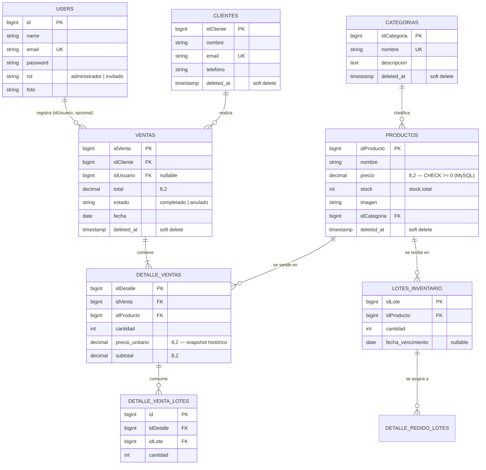

# Base de datos — Supermarket

## 1. Diagrama entidad-relación

> `DETALLE_VENTAS` tiene además una UNIQUE KEY compuesta sobre
> `(idVenta, idProducto)` — Mermaid no tiene una notación estándar para
> claves únicas compuestas, así que queda documentada aquí en vez de en el
> diagrama: un mismo producto no puede aparecer dos veces como línea
> separada de la misma venta.
>

> Este bloque `mermaid` se renderiza automáticamente como diagrama en GitHub,
> GitLab y en la mayoría de visores de Markdown modernos.

---

## 2. Por qué el modelo está así (decisiones de diseño)

### 2.1. `detalle_ventas` separado de `ventas` (cabecera/detalle)

Una venta tiene **N** productos, cada uno con su propia cantidad. Guardar
eso en una sola fila de `ventas` violaría 1FN (valores repetidos/listas en
una columna). El patrón cabecera-detalle es el estándar para este problema
y es el mismo que usan sistemas de facturación reales.

### 2.2. `detalle_ventas.precio_unitario` es una copia, no una referencia

`precio_unitario` y `subtotal` se **guardan** en el momento de la venta en
vez de calcularse leyendo `productos.precio` cada vez. Esto es intencional:
si mañana el precio de un producto cambia, las ventas históricas **no**
deben cambiar de valor retroactivamente. Es la razón de negocio real detrás
de por qué esta tabla no se normaliza más — normalizar de más aquí sería un
error, no una mejora.

### 2.3. Reglas `ON DELETE` — cada una tiene una razón de negocio distinta

| Relación                              | Regla         | Razón |
|----------------------------------------|---------------|-------|
| `productos.idCategoria → categorias`   | `RESTRICT`    | No tiene sentido un producto sin categoría; forzar a reasignar antes de borrar. |
| `ventas.idCliente → clientes`         | `RESTRICT`    | Nunca se debe borrar un cliente que ya tiene historial de compras (auditoría). |
| `ventas.idUsuario → users`            | `SET NULL`    | Si se borra la cuenta de un empleado, sus ventas pasadas deben conservarse. |
| `detalle_ventas.idVenta → ventas`   | `CASCADE`     | Una línea no tiene sentido sin su venta; al borrar la venta, sus líneas se van con ella. |
| `detalle_ventas.idProducto → productos` | `RESTRICT`  | Protege el historial: no se puede borrar un producto que ya aparece en ventas pasadas (se usa soft delete + papelera para "retirarlo" del catálogo en su lugar). |
| `lotes_inventario.idProducto → productos` | `CASCADE`  | Los lotes no tienen sentido sin su producto. |
| `detalle_venta_lotes.idDetalle → detalle_ventas` | `CASCADE` | La asignación de inventario se elimina con su línea de venta. |
| `detalle_venta_lotes.idLote → lotes_inventario` | `RESTRICT` | Un lote no se elimina si una venta conserva una asignación a él. |

Cada `RESTRICT`/`SET NULL`/`CASCADE` aquí es una decisión deliberada, no el
valor por defecto de Laravel — es la parte del modelo que un tribunal de
tesis suele preguntar primero, así que vale la pena poder explicarla así,
tabla por tabla.

### 2.4. `CHECK (stock >= 0)` y `CHECK (precio >= 0)` en `productos` — defensa en profundidad

La aplicación ya valida en `VentaController` que no se venda más stock del
disponible, usando una transacción con `lockForUpdate()` (bloqueo de fila)
para que dos ventas concurrentes no puedan agotar el mismo stock dos veces.
El `CHECK` a nivel de motor es una **segunda capa**: si en el futuro alguien
escribe una consulta SQL directa, un script de importación masiva, o un
nuevo endpoint que se salte la capa de aplicación, el motor de base de datos
rechaza el dato inválido de todas formas. Es la diferencia entre "confiar en
que el código siempre se porte bien" y "que sea imposible representar un
estado inválido en la base de datos". `precio` recibe el mismo refuerzo por
la misma razón, aunque el riesgo de un precio negativo sea hoy solo teórico.

Requiere MySQL 8.0.16+ o MariaDB 10.2.1+ (versiones anteriores ignoran
`CHECK` silenciosamente). En SQLite (usado solo para desarrollo rápido) esta
regla se omite a nivel de motor porque `ALTER TABLE ... ADD CONSTRAINT` no
existe ahí, pero la capa de aplicación la sigue aplicando igual.

### 2.5. `deleted_at` (soft deletes)

Ninguna de estas entidades se borra físicamente por defecto: se marca
`deleted_at` y desaparece de las vistas normales, pero el registro sigue
existiendo para no romper el historial de ventas ni las llaves foráneas que
apuntan a ella. Las entidades catalogadas (`categorias`, `productos`,
`clientes`) se gestionan desde una única pantalla "Papelera" (`/papelera`, una pestaña por tipo, con restauración y
eliminación permanente en lote), separada de la baja normal, para tener un
paso adicional intencional antes de un borrado irreversible. El borrado
permanente revalida en la capa de aplicación que ninguna fila dependiente
(activa o también en papelera) siga apuntándole por llave foránea, para no
depender únicamente del rechazo del motor ante una violación de `RESTRICT`.
Al restaurar, un producto no puede volver mientras su categoría siga en la
papelera (quedaría apuntando a una categoría que no aparece en ningún
selector): primero se restaura la categoría.

### 2.6. Índices y llaves únicas

- `users.email`, `clientes.email`, `categorias.nombre`:
  `UNIQUE`, para que la propia base de datos garantice que no exista un
  duplicado aunque la validación de la aplicación falle o se salte.
- `detalle_ventas (idVenta, idProducto)`: `UNIQUE` compuesta, para que un
  mismo producto no pueda quedar registrado dos veces como línea separada
  de la misma venta (si se necesita más cantidad, se suma en la misma línea).
- Toda columna de llave foránea (`idCategoria`, `idCliente`,
  `idUsuario`, `idVenta`, `idProducto`, `idDetalle`, `idLote`) queda indexada automáticamente por
  Laravel al declarar la `foreign()`, acelerando los `JOIN` que usan los
  reportes y el dashboard.
- `ventas.fecha` tiene índice propio: es la columna más filtrada/ordenada
  en reportes de ventas y en el dashboard.

---

### 2.7. Inventario por lotes y asignación FEFO

`productos.stock` conserva el total agregado para compatibilidad con el
catálogo y los informes. `lotes_inventario` guarda la cantidad por lote y su
fecha de vencimiento opcional. Al registrar una venta, el servicio bloquea
el producto y los lotes, excluye los vencidos y consume primero el lote
vigente con vencimiento más próximo (FEFO); los lotes sin fecha se consumen
después de los perecederos. `detalle_venta_lotes` guarda qué lote abasteció
cada línea para que la anulación o edición de la venta restituya exactamente
las cantidades originales.

## 3. Levantar el esquema

El proyecto ofrece dos caminos para llegar exactamente al mismo esquema:

1. **`php artisan migrate --seed`** — las migraciones en
   `database/migrations/` son la fuente de verdad versionada.

La migración `2026_10_16_180000_rename_pedidos_to_ventas` actualiza las
instalaciones existentes renombrando las tablas y claves anteriores sin
recrear ni perder datos de ventas.

Los archivos SQL de respaldo son instantáneas históricas y no corresponden
al esquema actual. Para instalaciones nuevas deben usarse migraciones.

---

## 4. Historial de correcciones aplicadas a este esquema

Durante la revisión se corrigieron los siguientes problemas, todos
verificados con pruebas reales (no solo lectura de código):

1. **Migración duplicada de `users`** — dos migraciones intentaban crear la
   misma tabla, lo que hacía fallar `migrate:fresh` desde cero. Se corrigió
   la segunda para que sea un `ALTER TABLE` (agrega `rol` y `foto`) en vez
   de un `CREATE TABLE` repetido.
2. **Tabla `password_resets` obsoleta** — coexistía sin usarse junto a
   `password_reset_tokens` (la que Laravel usa realmente según
   `config/auth.php`). Se eliminó la migración muerta.
3. **`CHECK` de stock no portable** — usaba sintaxis exclusiva de MySQL vía
   `DB::statement`, lo que rompía `migrate:fresh` en SQLite. Ahora es
   condicional según el driver de conexión.
4. **Hash de contraseña inválido en el respaldo `.sql`** — el archivo traía
   un hash bcrypt que no correspondía a la contraseña documentada; el login
   habría fallado en una demo en vivo. Se regeneró y se verificó con
   `password_verify()` antes de publicarlo.
5. **Dos juegos de credenciales distintos** según la vía de instalación
   (seeder vs. `.sql`) — unificados a un solo juego de credenciales.
6. **`ext-bcmath` no declarada** en `composer.json` pese a ser requerida por
   `VentaService` — ahora falla `composer install` con un mensaje claro
   en vez de que la app truene al registrar una venta.
7. **Papelera incompleta y dispersa** — solo `productos` tenía una papelera
   navegable; `categorias`, `clientes` y `proveedores` solo se podían
   recuperar de forma indirecta, recreando el mismo nombre/email exacto. Se
   reemplazó por una papelera única (`/papelera`) con una pestaña por tipo,
   contadores, selección múltiple, acciones en lote con confirmación, y el
   chequeo de integridad referencial antes de cada borrado permanente
   (bloquea si aún hay filas dependientes, activas o en su propia papelera);
   las URLs de las antiguas papeleras redirigen a su pestaña.
8. **Reglas de negocio sin respaldo en la base de datos** — `proveedores.nombre`
   único y "un producto no se repite dentro de la misma venta" solo estaban
   garantizados por la capa de aplicación, a diferencia de reglas equivalentes
   en `productos`/`categorias` que sí tenían un índice único como última
   línea de defensa. Se agregaron `UNIQUE` en `proveedores.nombre` y en
   `detalle_ventas (idVenta, idProducto)`, y un `CHECK (precio >= 0)` en
   `productos` (MySQL), en línea con el `CHECK (stock >= 0)` ya existente.
9. **`APP_DEBUG=true` en el `.env` distribuido** — cualquier error habría
   mostrado trazas completas (rutas de archivos, consultas SQL) en el
   navegador del propietario del negocio. Se cambió a `false` por defecto.
10. **Contraseñas demo hardcodeadas en el seeder** — ahora se leen de
    `SEED_ADMIN_PASSWORD` / `SEED_EMPLEADO_PASSWORD` con `password123` como
    valor por defecto solo para desarrollo, con una advertencia explícita en
    el código para cambiarlas antes de operar con datos reales.
11. **Trazabilidad de vencimientos en ventas** — se agregaron lotes con
    fecha opcional de vencimiento y asignaciones por línea de venta. El
    servicio compartido por web y API aplica FEFO, impide consumir lotes
    vencidos y restaura las cantidades originales al anular o editar una
    venta. El módulo de proveedores se retiró del esquema actual; su
    presencia en migraciones antiguas solo conserva la secuencia de upgrades
    para bases existentes.
