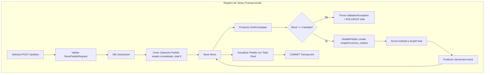

# 01 — Análisis del Sistema Real (SISMICRO / Supermarket)

> **Documento de Análisis de Pruebas de Software**  
> **Proyecto:** Sistema Web de Ventas e Inventario para el Micromercado SuperMarket  
> **Fecha de Análisis:** Septiembre 2026  
> **Estado del Análisis:** VERIFICADO (basado en inspección estricta del código fuente y esquema real)  
> **Estado de Pruebas:** PENDIENTE DE EJECUCIÓN (ningún test ha sido ejecutado ni calificado como PASS/FAIL en esta fase)  

---

## 1. Stack Tecnológico Real Verificado

A partir de la inspección de `composer.json`, `package.json`, `.env.example`, `routes/web.php` y `database/migrations/`:

| Componente | Tecnología / Versión Real | Evidencia en Repositorio |
| :--- | :--- | :--- |
| **Framework Backend** | Laravel 12.0 (`laravel/framework: ^12.0`) | `composer.json` (línea 13) |
| **Lenguaje Backend** | PHP 8.2+ con extensión requerida `ext-bcmath` | `composer.json` (líneas 9-10) |
| **Base de Datos Principal** | MySQL 8.0.16+ / MariaDB 10.2.1+ | `.env.example`, migraciones `fix_database_consistency` y `unsigned` |
| **Base de Datos Testing/Dev** | SQLite 3 (en memoria para tests, `database.sqlite` en local) | `phpunit.xml`, `README.md` |
| **Frontend / UI** | Blade + Bootstrap 5.3.2 + CSS Vanilla personalizado + DataTables 1.13.6 + FontAwesome 6.5.2 | `resources/views/layouts/app.blade.php` |
| **Bundler / Build** | Vite (`@vite('resources/js/codes.js')`) | `vite.config.js`, `package.json` |
| **Reportes PDF** | `barryvdh/laravel-dompdf: ^3.1` | `composer.json` (línea 11) |
| **Reportes Excel** | `maatwebsite/excel: ^3.1` | `composer.json` (línea 16) |
| **Códigos QR y Barras** | `endroid/qr-code: ^6.0`, `picqer/php-barcode-generator: ^3.3` | `composer.json` (líneas 12, 17) |
| **Suite de Testing** | PHPUnit 11.5.50 (Feature y Unit tests existentes) | `composer.json` (línea 26), `phpunit.xml` |

> [!NOTE]
> **Aclaración sobre AdminLTE:** En el contexto preliminar se mencionaba la posible presencia de AdminLTE. Se inspeccionaron las plantillas en `resources/views/layouts/app.blade.php` y se constató que **NO** se utiliza AdminLTE; el sistema cuenta con un layout propio basado en Bootstrap 5, FontAwesome y estilos CSS personalizados con soporte nativo de modo oscuro (dark mode).

---

## 2. Módulos Reales del Sistema

El sistema se compone de **9 módulos funcionales y 1 módulo transversal de infraestructura**:

### 2.1. Módulo de Autenticación y Control de Sesión
- **Controlador:** `App\Http\Controllers\Auth\LoginController.php`
- **Rutas:**
  - `GET /login` (`login`)
  - `POST /login`
  - `POST /logout` (`logout`)
  - `GET /` (`home` -> redirige a `dashboard` si está autenticado o a `login` si es invitado)
- **Vistas:** `resources/views/auth/login.blade.php`
- **Mecanismos clave:** Throttling mediante `ThrottlesLogins` (máximo 5 intentos, 2 minutos de bloqueo por `email|IP`), regeneración de ID de sesión contra ataques de fijación de sesión, soporte de cookie *Remember Me*, e invalidación y regeneración de token CSRF en logout.

### 2.2. Módulo Dashboard (Panel de Control)
- **Definición:** Ruta closure en `routes/web.php` (líneas 35-124)
- **Ruta:** `GET /dashboard` (`dashboard`)
- **Vista:** `resources/views/dashboard.blade.php`
- **Métricas calculadas:**
  - Contadores globales: `totalCategorias`, `totalProveedores`, `totalProductos`, `totalClientes`, `totalPedidos`.
  - Discriminación de pedidos: `totalPedidosCompletados`, `totalPedidosAnulados`.
  - Financiero: `totalVentas` (suma de `total` excluyendo pedidos anulados), `inventarioValuado` (sumatoria de `stock * precio`).
  - Alertas de inventario: `stockBajoCant` (productos con stock $\le 5$).
  - Gráficos y rankings: Ventas por día, ventas/cantidad por mes (compatible con SQLite vía `strftime` y MySQL vía `DATE_FORMAT`), Top 5 productos con mayores ingresos, Top 5 clientes con mayor volumen de compra.

### 2.3. Módulo de Categorías
- **Controlador:** `App\Http\Controllers\CategoriaController.php`
- **Modelo:** `App\Models\Categoria.php` (Tabla `categorias`, PK `idCategoria`, SoftDeletes)
- **Rutas:**
  - `GET /categorias` (index: auth)
  - `GET /categorias/create`, `POST /categorias`, `GET /categorias/{id}/edit`, `PUT /categorias/{id}`, `DELETE /categorias/{id}` (auth + `rol:administrador`)
- **Vistas:** `resources/views/categorias/index.blade.php`, `create.blade.php`, `edit.blade.php`
- **Comportamiento:** Paginación (15 registros), ordenamiento alfabético, auto-restauración desde papelera si se intenta registrar una categoría con nombre previamente eliminado, restricción estricta de borrado si tiene productos vinculados.

### 2.4. Módulo de Proveedores
- **Controlador:** `App\Http\Controllers\ProveedorController.php`
- **Modelo:** `App\Models\Proveedor.php` (Tabla `proveedores`, PK `idProveedor`, SoftDeletes)
- **Rutas:**
  - `GET /proveedores` (index: auth)
  - `GET /proveedores/create`, `POST /proveedores`, `GET /proveedores/{id}/edit`, `PUT /proveedores/{id}`, `DELETE /proveedores/{id}` (auth + `rol:administrador`)
- **Vistas:** `resources/views/proveedores/index.blade.php`, `create.blade.php`, `edit.blade.php`
- **Comportamiento:** Búsqueda en tiempo real por parámetro `q` (nombre, NIT, email o teléfono), `withCount('productos')`, auto-restauración si existía en papelera, bloqueo de eliminación si tiene productos asociados.

### 2.5. Módulo de Productos e Inventario
- **Controlador:** `App\Http\Controllers\ProductoController.php`
- **Modelo:** `App\Models\Producto.php` (Tabla `productos`, PK `idProducto`, SoftDeletes)
- **Rutas:**
  - `GET /productos` (index: auth)
  - `GET /productos-pdf`, `GET /productos-excel` (auth)
  - `GET /productos/{id}/qr`, `GET /productos/{id}/barcode` (auth)
  - `GET /productos/create`, `POST /productos`, `GET /productos/{id}/edit`, `PUT /productos/{id}`, `DELETE /productos/{id}` (auth + `rol:administrador`)
  - `GET /productos/papelera`, `PUT /productos/{id}/restore`, `DELETE /productos/{id}/force-delete` (auth + `rol:administrador`)
- **Vistas:** `resources/views/productos/index.blade.php`, `create.blade.php`, `edit.blade.php`, `papelera.blade.php`, `pdf.blade.php`
- **Comportamiento:** Subida y sustitución de imágenes (con sincronización física en `public/storage` vía `SincronizaImagenPublica`), generación de códigos QR (JSON con SKU, nombre, precio) y barras (Code128 basado en SKU estándar `PRD-XXXXXX` formateado por `App\Support\Sku`), gestión de papelera (soft delete) y eliminación definitiva (`forceDelete`) protegida contra productos con ventas históricas.

### 2.6. Módulo de Clientes
- **Controlador:** `App\Http\Controllers\ClienteController.php`
- **Modelo:** `App\Models\Cliente.php` (Tabla `clientes`, PK `idCliente`, SoftDeletes)
- **Rutas:**
  - `GET /clientes` (index: auth)
  - `GET /clientes/create`, `POST /clientes`, `GET /clientes/{id}/edit`, `PUT /clientes/{id}`, `DELETE /clientes/{id}` (auth + `rol:administrador`)
- **Vistas:** `resources/views/clientes/index.blade.php`, `create.blade.php`, `edit.blade.php`
- **Comportamiento:** Búsqueda por `q` (nombre o email), validación de unicidad de correo (incluyendo registros en papelera con restauración automática), protección de eliminación si el cliente registra pedidos en el historial.

### 2.7. Módulo de Pedidos / Ventas
- **Controlador:** `App\Http\Controllers\PedidoController.php`
- **Modelos:** `App\Models\Pedido.php` (Tabla `pedidos`, PK `idPedido`, SoftDeletes), `App\Models\DetallePedido.php` (Tabla `detalle_pedidos`, PK `idDetalle`)
- **FormRequests:** `App\Http\Requests\StorePedidoRequest.php`, `App\Http\Requests\UpdatePedidoRequest.php`
- **Rutas:**
  - `GET /pedidos`, `GET /pedidos/create`, `POST /pedidos` (auth: accesible para Administrador E Invitado)
  - `GET /pedidos/{id}/edit`, `PUT /pedidos/{id}`, `DELETE /pedidos/{id}` (auth + `rol:administrador`)
- **Vistas:** `resources/views/pedidos/index.blade.php`, `create.blade.php`, `edit.blade.php`
- **Comportamiento:** Gestión de ventas multi-ítem, cálculo de precisión decimal fija mediante `bcmath` (`bcmul`, `bcadd`), control transaccional atómico (`DB::transaction`) y concurrente (`lockForUpdate`), descuento de stock en tiempo real, recálculo y restitución inteligente de stock según transiciones de estado (`completado` <-> `anulado`), y eliminación con control de stock fantasma.

### 2.8. Módulo de Reportes de Ventas
- **Controlador:** `App\Http\Controllers\ReporteController.php`
- **Rutas:** (Exclusivas de `rol:administrador` en `routes/web.php`)
  - `GET /reportes/ventas` (`reportes.ventas`)
  - `GET /reportes/ventas/pdf` (`reportes.ventas.pdf`)
  - `GET /reportes/ventas/excel` (`reportes.ventas.excel`)
- **Vistas:** `resources/views/reportes/ventas.blade.php`, `ventas_pdf.blade.php`
- **Clases Export:** `App\Exports\VentasExport.php`
- **Comportamiento:** Filtros dinámicos por rango de fechas (`fecha_inicio`, `fecha_fin`), cliente específico (`id_cliente`) y estado (`todos`, `completado`, `anulado`). Las métricas globales (total dinero, total pedidos, total unidades, ticket promedio) se computan sobre el universo total filtrado excluyendo pedidos anulados, sin verse recortadas por la paginación de la tabla visual (15 filas). Exportación PDF y Excel reflejando con fidelidad los filtros activos.

### 2.9. Módulo de Usuarios del Sistema
- **Controlador:** `App\Http\Controllers\UsuarioController.php`
- **Modelo:** `App\Models\User.php` (Tabla `users`, PK `id`)
- **Rutas:** (Exclusivas de `rol:administrador`)
  - `GET /usuarios`, `GET /usuarios/create`, `POST /usuarios`, `GET /usuarios/{id}/edit`, `PUT /usuarios/{id}`, `DELETE /usuarios/{id}`
- **Vistas:** `resources/views/usuarios/index.blade.php`, `create.blade.php`, `edit.blade.php`
- **Comportamiento:** Alta y edición de credenciales (bcrypt cost 12), asignación de roles (`administrador` / `invitado`), avatar con sincronización en `public/storage`, validación estricta de contraseña (mínimo 6 caracteres, alfanumérica, confirmada), regla de protección contra auto-degradación de rol del administrador en sesión, y regla de protección contra auto-eliminación de cuenta.

### 2.10. Módulo de Manejo de Errores HTTP
- **Vistas:** `resources/views/errors/403.blade.php`, `404.blade.php`, `419.blade.php`, `429.blade.php`, `500.blade.php`, `503.blade.php`, `minimal.blade.php`
- **Comportamiento:** Respuestas HTTP personalizadas y semánticas, integradas con la identidad visual del supermercado, sin dependencias de sesión para errores públicos.

---

## 3. Funcionalidades Críticas de Negocio

Las siguientes funciones constituyen el núcleo operacional del sistema y presentan el mayor impacto ante fallos:



1. **Atomicidad y Bloqueo Concurrente de Stock (`PedidoController::store`, `PedidoController::registrarDetalles`):**
   - El descuento de stock ocurre dentro de `DB::transaction()`.
   - Se utiliza `Producto::where('idProducto', ...)->lockForUpdate()->firstOrFail()` para evitar condiciones de carrera (*race conditions*) donde dos cajeros vendan la última unidad simultáneamente.
   - Si un solo ítem de un pedido de 20 líneas no tiene suficiente stock, la transacción entera se revierte; no se crea el pedido ni se descuenta inventario parcial.

2. **Inmutabilidad y Preservación Histórica de Precios (`DetallePedido`):**
   - El campo `detalle_pedidos.precio_unitario` y `subtotal` se almacenan en el momento de la venta. Si posteriormente el administrador cambia el precio del producto en el catálogo, los pedidos históricos y reportes contables permanecen inalterados.

3. **Ciclo de Vida y Transiciones de Estado del Pedido (`PedidoController::update`):**
   - Transición `completado -> anulado`: Restituye el stock vendido al inventario y desactiva el conteo financiero del pedido.
   - Transición `anulado -> completado`: Valida disponibilidad actual y descuenta el stock nuevamente.
   - Transición `anulado -> anulado`: No altera el stock bajo ninguna circunstancia.
   - Modificación de cantidades en `completado`: Devuelve el stock anterior de forma atómica y descuenta la nueva cantidad calculada.

4. **Prevención de "Stock Fantasma" en Eliminación (`PedidoController::destroy`):**
   - Si se elimina un pedido `completado`, se devuelve el stock al inventario.
   - Si se elimina un pedido ya `anulado`, **NO** se devuelve stock, ya que fue devuelto en la anulación. Devolverlo crearía unidades ficticias en el inventario físico.

5. **Defensa en Profundidad de Integridad de Stock:**
   - **Nivel Aplicación:** Validaciones en `StorePedidoRequest`, verificación en `PedidoController` y método `Producto::tieneStock()`.
   - **Nivel Base de Datos (MySQL):** Constraint `chk_productos_stock_no_negativo CHECK (stock >= 0)` (migración `2026_07_30_070000_fix_database_consistency`) y columnas `INT UNSIGNED` en `productos.stock` y `detalle_pedidos.cantidad` (migración `2026_09_14_044922_make_stock_and_cantidad_unsigned`).

6. **Integridad Referencial contra Borrados Catastróficos:**
   - `categorias`: Clave foránea `RESTRICT` desde productos + validación manual en controller (`$cantProductos > 0`).
   - `clientes`: Clave foránea `RESTRICT` desde pedidos + validación manual en controller (`$cantPedidos > 0`).
   - `productos`: Clave foránea `RESTRICT` desde `detalle_pedidos` + prohibición de `forceDelete` si registra ventas históricas.
   - `proveedores`: Clave foránea `SET NULL` a nivel BD, pero reforzada con validación en controlador para impedir eliminación si tiene productos asociados.

---

## 4. Requisitos y Reglas Verificables Encontrados

Matriz de requisitos identificados directamente en las validaciones, controladores y modelos:

| ID Requisito | Módulo | Regla / Restricción Verificable | Archivo Fuente / Líneas |
| :--- | :--- | :--- | :--- |
| **RF-AUTH-01** | Autenticación | Email obligatorio, formato email válido, max 255. Password obligatorio, min 6, max 255. | `LoginController.php`: L20-31 |
| **RF-AUTH-02** | Autenticación | Rate limiting: tras 5 intentos fallidos, bloqueo temporal de 120 segundos. | `LoginController.php`: L33-42, L65-72 |
| **RF-AUTH-03** | Autenticación | Al cerrar sesión, la sesión se invalida y el token CSRF se regenera. | `LoginController.php`: L74-80 |
| **RF-SEC-01** | Seguridad/Roles | Acceso restringido por middleware `CheckRol`. Si el rol no coincide con el autorizado, emite HTTP 403. | `CheckRol.php`: L11-26 |
| **RF-SEC-02** | Seguridad/Roles | El usuario con rol `invitado` puede crear pedidos (`GET /pedidos/create`, `POST /pedidos`), pero no editarlos ni eliminarlos. | `routes/web.php`: L136, L148 |
| **RF-SEC-03** | Seguridad/Roles | El usuario con rol `invitado` tiene acceso denegado (HTTP 403) a cualquier ruta bajo `/reportes/*`. | `routes/web.php`: L142, L150, L156-157 |
| **RF-CAT-01** | Categorías | Nombre obligatorio, longitud 2-100, regex alfanumérico con espacios y `.,-_`. Descripción opcional max 500. | `CategoriaController.php`: L26-35 |
| **RF-CAT-02** | Categorías | Si el nombre existe en soft delete, se restaura y actualiza. Si está activo, rechaza con error de duplicado. | `CategoriaController.php`: L38-55 |
| **RF-CAT-03** | Categorías | No se puede eliminar una categoría que tenga 1 o más productos asociados. | `CategoriaController.php`: L110-116 |
| **RF-PROV-01** | Proveedores | Nombre obligatorio (2-150), NIT opcional numérico con guion (max 20), teléfono opcional (7-20 caracteres). | `ProveedorController.php`: L43-60 |
| **RF-PROV-02** | Proveedores | Si el nombre existe en papelera, se restaura automáticamente. No se permite duplicar proveedor activo. | `ProveedorController.php`: L64-79 |
| **RF-PROV-03** | Proveedores | No se puede eliminar un proveedor con productos asociados. | `ProveedorController.php`: L150-155 |
| **RF-PROD-01** | Productos | Nombre obligatorio (2-100), precio numérico entre 0 y 999999.99 (max 2 decimales), stock entero entre 0 y 99999. | `ProductoController.php`: L46-73 |
| **RF-PROD-02** | Productos | `idCategoria` obligatoria y existente en tabla `categorias`. `idProveedor` opcional y existente en `proveedores`. | `ProductoController.php`: L50-51 |
| **RF-PROD-03** | Productos | Imagen opcional: formato jpg, jpeg, png, webp; tamaño max 2048 KB (2MB). | `ProductoController.php`: L52, L70-72 |
| **RF-PROD-04** | Productos | Restauración automática si el nombre estaba en papelera; unicidad estricta en productos activos. | `ProductoController.php`: L78-105 |
| **RF-PROD-05** | Productos | Eliminación definitiva (`forceDelete`) bloqueada si el producto tiene historial en `detalle_pedidos`. | `ProductoController.php`: L234-237 |
| **RF-PROD-06** | Productos | Generación de SKU estándar mediante `Sku::format($id)` con prefijo `PRD-` y 6 dígitos (`PRD-000001`). | `app/Support/Sku.php`: L14-20 |
| **RF-CLI-01** | Clientes | Nombre obligatorio (2-100), email obligatorio válido (max 100). Teléfono opcional (7-20 caracteres). | `ClienteController.php`: L36-55 |
| **RF-CLI-02** | Clientes | Email único en tabla `clientes`. Si el cliente estaba en papelera, se restaura y actualiza. | `ClienteController.php`: L58-75 |
| **RF-CLI-03** | Clientes | No se puede eliminar un cliente con 1 o más pedidos asociados. | `ClienteController.php`: L140-145 |
| **RF-PED-01** | Pedidos | `idCliente` obligatorio y existente. `fecha` obligatoria, formato fecha válido, no futura (`before_or_equal:today`). | `StorePedidoRequest.php`: L17-18 |
| **RF-PED-02** | Pedidos | Array `items` obligatorio, min 1, max 100 productos. Cada `idProducto` debe ser único en el array (`distinct`). | `StorePedidoRequest.php`: L19-20 |
| **RF-PED-03** | Pedidos | Cantidad de cada producto obligatoria, número entero, min 1, max 9999. | `StorePedidoRequest.php`: L21 |
| **RF-PED-04** | Pedidos | Stock suficiente verificado con `lockForUpdate`. Si `stock < cantidad`, revierte transacción con error en `items`. | `PedidoController.php`: L152-156 |
| **RF-PED-05** | Pedidos | Estado en actualización restringido a `completado` o `anulado`. | `UpdatePedidoRequest.php`: L19 |
| **RF-PED-06** | Pedidos | Anular pedido restituye stock al inventario; reactivar pedido valida y descuenta stock. | `PedidoController.php`: L83-97 |
| **RF-PED-07** | Pedidos | Eliminar pedido completado devuelve stock; eliminar pedido anulado NO vuelve a sumar stock. | `PedidoController.php`: L119-124 |
| **RF-REP-01** | Reportes | Filtro de fechas con regla de coherencia: `fecha_fin` debe ser `after_or_equal:fecha_inicio`. | `ReporteController.php`: L17-18 |
| **RF-REP-02** | Reportes | Exclusión de pedidos con estado `anulado` de las métricas de ingresos, unidades y ticket promedio. | `ReporteController.php`: L54-58 |
| **RF-USR-01** | Usuarios | Password obligatorio al crear: min 6, max 255, confirmado, regex alfanumérico `^(?=.*[A-Za-z])(?=.*\d).+$`. | `UsuarioController.php`: L38, L50-54 |
| **RF-USR-02** | Usuarios | Rol obligatorio, restringido estrictamente a `administrador` o `invitado`. | `UsuarioController.php`: L39 |
| **RF-USR-03** | Usuarios | Seguridad de cuenta: El administrador no puede modificar su propio rol a invitado ni auto-eliminarse. | `UsuarioController.php`: L124-128, L172-177 |

---

## 5. Roles y Permisos Reales Verificados

A través de la inspección de `routes/web.php`, `CheckRol.php`, `Controller::soloDueno()` y las directivas `@if(auth()->user()->rol === 'administrador')` en las vistas Blade:

### Matriz de Permisos por Rol

| Módulo / Acción | Ruta / Verbo HTTP | Administrador | Invitado | Middleware / Mecanismo de Control |
| :--- | :--- | :---: | :---: | :--- |
| **Login / Logout** | `POST /login`, `POST /logout` | ✅ | ✅ | Público / `auth` |
| **Dashboard** | `GET /dashboard` | ✅ | ✅ | `auth` |
| **Categorías: Listar** | `GET /categorias` | ✅ | ✅ | `auth` |
| **Categorías: Crear/Editar/Eliminar** | `POST, PUT, DELETE /categorias/*` | ✅ | ❌ (403) | `rol:administrador` |
| **Proveedores: Listar / Buscar** | `GET /proveedores` | ✅ | ✅ | `auth` |
| **Proveedores: Crear/Editar/Eliminar**| `POST, PUT, DELETE /proveedores/*` | ✅ | ❌ (403) | `rol:administrador` + `soloDueno()` |
| **Productos: Catálogo / QR / Barcode**| `GET /productos`, `/qr`, `/barcode` | ✅ | ✅ | `auth` |
| **Productos: Exportar PDF / Excel** | `GET /productos-pdf`, `/productos-excel` | ✅ | ✅ | `auth` |
| **Productos: Crear/Editar/Baja** | `POST, PUT, DELETE /productos/*` | ✅ | ❌ (403) | `rol:administrador` + `soloDueno()` |
| **Productos: Papelera / Restaurar / ForceDelete** | `GET, PUT, DELETE /productos/papelera*` | ✅ | ❌ (403) | `rol:administrador` + `soloDueno()` |
| **Clientes: Listar / Buscar** | `GET /clientes` | ✅ | ✅ | `auth` |
| **Clientes: Crear/Editar/Eliminar** | `POST, PUT, DELETE /clientes/*` | ✅ | ❌ (403) | `rol:administrador` |
| **Pedidos: Listar Historial** | `GET /pedidos` | ✅ | ✅ | `auth` |
| **Pedidos: Registrar Venta** | `GET /pedidos/create`, `POST /pedidos` | ✅ | ✅ | `auth` (permitido explícitamente a ambos) |
| **Pedidos: Editar / Anular** | `GET /pedidos/{id}/edit`, `PUT /pedidos/{id}` | ✅ | ❌ (403) | `rol:administrador` |
| **Pedidos: Eliminar Pedido** | `DELETE /pedidos/{id}` | ✅ | ❌ (403) | `rol:administrador` |
| **Reportes: Pantalla y Filtros** | `GET /reportes/ventas` | ✅ | ❌ (403) | `rol:administrador` |
| **Reportes: Exportar PDF / Excel** | `GET /reportes/ventas/pdf`, `/excel` | ✅ | ❌ (403) | `rol:administrador` |
| **Usuarios: CRUD Completo** | `RESOURCE /usuarios` | ✅ | ❌ (403) | `rol:administrador` + `soloDueno()` |

---

## 6. Dependencias Operativas entre Módulos

El flujo funcional de datos establece un orden de precedencia estricto para la operación y prueba del sistema:

```
[Usuarios] ──────────┐ (auth / idUsuario)
                     ▼
[Categorías] ───► [Productos] ◄─── [Proveedores] (opcional)
                     │
                     ├──────────────┐
                     ▼              ▼
[Clientes] ─────► [Pedidos] ──► [DetallePedidos]
                     │
                     ▼
         [Dashboard & Reportes]
```

### Tabla de Precedencia para Carga y Pruebas
1. **Paso 1 (Autenticación/Usuarios):** Se requiere al menos un usuario con rol `administrador` y un usuario con rol `invitado`.
2. **Paso 2 (Categorías):** Los productos dependen obligatoriamente de una categoría activa (`idCategoria`).
3. **Paso 3 (Proveedores):** Opcional, pero debe existir si se desea vincular trazabilidad de compras a productos.
4. **Paso 4 (Productos):** Requiere categoría; debe tener precio $> 0$ y stock $> 0$ para poder ser vendido en pedidos.
5. **Paso 5 (Clientes):** Debe existir al menos un cliente activo para poder registrar un pedido.
6. **Paso 6 (Pedidos y DetallePedidos):** Depende de Cliente, Usuario autenticado y Productos con stock disponible.
7. **Paso 7 (Reportes y Dashboard):** Depende de la existencia de pedidos completados y anulados para reflejar métricas, gráficos y exportaciones.

---

## 7. Datos Necesarios para Pruebas (Test Data Requirements)

Para una cobertura de pruebas exhaustiva, el entorno de pruebas requiere los siguientes perfiles de datos:

| Tipo de Dato | Variación Requerida para Pruebas | Propósito / Casos de Prueba |
| :--- | :--- | :--- |
| **Usuarios** | 1 Admin (`dueno@supermarket.com`), 1 Invitado (`empleado@supermarket.com`), contraseñas demo válidas (`password123`) e inválidas. | Pruebas de autenticación, rate limiting y autorización RBAC por rol. |
| **Categorías** | - Categoría vacía (sin productos).<br>- Categoría con productos asignados.<br>- Categoría en papelera (`deleted_at != null`). | Validar eliminación permitida, restricción por FK/controller y restauración automática por nombre. |
| **Proveedores** | - Proveedor con productos vinculados.<br>- Proveedor sin productos.<br>- Proveedor en papelera.<br>- Con NIT y teléfono en formatos variados. | Validar búsqueda `q`, integridad en baja y expresiones regulares de NIT/teléfono. |
| **Productos** | - Producto con stock abundante ($> 20$).<br>- Producto con stock crítico ($\le 5$).<br>- Producto agotado ($stock = 0$).<br>- Producto sin ventas históricas.<br>- Producto con ventas en `detalle_pedidos`.<br>- Producto en papelera.<br>- Producto con imagen y sin imagen. | Pruebas de venta normal, venta de stock límite, intento de sobreventa, borrado lógico, borrado definitivo prohibido y renderizado de códigos QR/barras. |
| **Clientes** | - Cliente sin pedidos.<br>- Cliente con múltiples pedidos.<br>- Cliente en papelera. | Pruebas de búsqueda `q`, eliminación protegida y restauración por email. |
| **Pedidos** | - Pedido con 1 producto.<br>- Pedido con múltiples productos.<br>- Pedido en estado `completado`.<br>- Pedido en estado `anulado`.<br>- Pedido con fecha de hoy y fechas históricas. | Pruebas de descuento atómico, transición de estados, exclusión de métricas, y devolución selectiva de inventario en eliminación. |
| **Archivos Multimedia** | - Imágenes PNG/JPG válidas ($< 2$ MB).<br>- Archivo mayor a 2 MB.<br>- Archivo no imagen (ej. PDF renombrado). | Pruebas de validación de carga de imágenes en productos y usuarios. |

---

## 8. Tipos de Pruebas Aplicables

Basado en la arquitectura real de Laravel 12 y las decisiones técnicas del proyecto:

1. **Pruebas Unitarias (Unit Tests):**
   - Cobertura de helpers y soporte lógico: `App\Support\Sku::format()`.
   - Métodos de modelo: `Producto::tieneStock()`, `User::esAdmin()`, `User::esInvitado()`.
   - Casts y mutadores: comprobación de tipos decimales y fechas en `Pedido`, `Producto` y `DetallePedido`.
   - Configuración regional: Verificación de timezone `America/La_Paz` (`config('app.timezone')`).

2. **Pruebas de Integración y Funcionales (Feature Tests):**
   - **Autenticación:** Login válido, credenciales incorrectas, protección contra fuerza bruta (Throttling a 5 intentos).
   - **Control de Acceso (RBAC):** Acceso de `invitado` a lectura y creación de pedidos; bloqueo 403 de `invitado` a modificación de catálogo, reportes y usuarios.
   - **Transaccionalidad en Ventas:** Verificación de decremento de stock, error ante stock insuficiente, integridad de rollback completo.
   - **Ciclo de Estados:** Transición `completado -> anulado` (devolución) y `anulado -> completado` (nuevo descuento).
   - **Eliminación y Stock Fantasma:** Eliminación de pedido completado vs. pedido anulado.
   - **Integridad Referencial:** Bloqueo de eliminación de categorías con productos, clientes con pedidos, proveedores con productos y `forceDelete` de productos con ventas.
   - **Búsqueda y Paginación:** Filtros `q` en clientes y proveedores, paginador `LengthAwarePaginator` a 15 ítems y conservación de query string.
   - **Generación Documental:** Generación y descarga de QR (PNG), Barcode Code128 (PNG), exportación PDF y Excel.

3. **Pruebas de Regresión:**
   - Verificación de consistencia del esquema: migración sin errores en fresh seeding.
   - Exactitud de cálculos contables: prevención de errores de punto flotante utilizando `bcmath`.
   - Verificación de métricas globales de reportes: las sumatorias no deben limitarse a la página visible de 15 filas.

4. **Pruebas de Interfaz de Usuario y Smoke:**
   - Renderizado de vistas sin errores 500 para ambos roles.
   - Verificación de páginas de error HTTP personalizadas (403, 404, 419, 500).
   - Detección de parpadeos en modo oscuro (FOUC script verificado en `app.blade.php`).

---

## 9. Riesgos de Prueba Identificados

| Riesgo Técnico | Impacto | Causa Raíz / Contexto | Estrategia de Mitigación en Pruebas |
| :--- | :---: | :--- | :--- |
| **Divergencia entre Motores de BD (SQLite vs MySQL)** | Alto | Los tests automatizados corren contra SQLite en memoria (`phpunit.xml`). SQLite **no** ejecuta el `CHECK (stock >= 0)` ni respeta el tipo `UNSIGNED`. | Realizar pruebas funcionales complementarias sobre una base de datos MySQL 8 real para verificar las restricciones nativas del motor. |
| **Funciones SQL dependientes de Driver** | Medio | En el Dashboard se utilizan expresiones condicionales: `strftime` (SQLite) vs `DATE_FORMAT` (MySQL). | Diseñar casos de prueba específicos que verifiquen las consultas del Dashboard en ambos entornos de base de datos. |
| **Dependencia de la Extensión `ext-bcmath`** | Alto | El controlador `PedidoController` usa `bcmul` y `bcadd`. Si el entorno PHP carece de la extensión, el registro de ventas falla con error fatal. | Verificar la disponibilidad de `extension_loaded('bcmath')` antes de ejecutar la suite de pruebas. |
| **Manejo de Imágenes en Windows (`SincronizaImagenPublica`)** | Medio | El proyecto copia manualmente archivos a `public/storage` en vez de usar symlinks. Si se usa `Storage::fake('public')`, la copia local real no se ejecuta. | Probar la carga de imágenes distinguiendo entre pruebas unitarias con fakes y pruebas manuales sobre el filesystem local. |
| **Concurrencia real no simulable al 100% en tests síncronos** | Medio | `lockForUpdate` funciona sobre conexiones MySQL reales con transacciones simultáneas; en tests unitarios secuenciales no se produce colisión de hilos. | Realizar pruebas de estrés / peticiones concurrentes mediante scripts externos o herramientas tipo Postman / Apache Benchmark. |

---

## 10. Zonas con Mayor Posibilidad de Error (Hotspots de Defectos)

1. **Discrepancia en la Interfaz (Sidebar - Enlace Huérfano para Invitados):**
   - **Hallazgo Real en Código:** En `resources/views/layouts/app.blade.php` (línea 2693), el enlace a `Reportes` (`route('reportes.ventas')`) se encuentra fuera del bloque `@if(auth()->user()->rol === 'administrador')`.
   - **Consecuencia:** Un usuario con rol `invitado` ve el enlace "Reportes" en su menú lateral, pero al hacer clic recibe un error **403 Forbidden** porque la ruta está protegida por `rol:administrador`.

2. **Lógica de Anulación y Edición de Pedidos (`PedidoController::update`):**
   - La manipulación manual de stock mediante `increment` previo y re-evaluación con `$descontarStock = $datos['estado'] === 'completado'` es una de las áreas más sensibles del sistema. Cualquier modificación incorrecta de un pedido puede descuadrar el inventario real.

3. **Restauración Implícita desde la Papelera al Crear Registros:**
   - En Categorías, Proveedores, Productos y Clientes, si un usuario ingresa un nombre o correo que fue eliminado con soft delete, el sistema **no** muestra error de duplicado, sino que restaura el registro previo y lo sobreescribe con los nuevos datos. Esto puede generar confusión al usuario final si no comprende que el registro provenía de la papelera.

4. **Expresiones Regulares Estrictas en Validaciones:**
   - Por ejemplo, en `ClienteController.php`:
     `'nombre' => 'regex:/^[a-zA-ZáéíóúÁÉÍÓÚñÑ\s\.\,\-\']+$/'`
     `'direccion' => 'regex:/^[a-zA-ZáéíóúÁÉÍÓÚñÑ0-9\s\.\,\-\#\/]+$/'`
   - Si un usuario ingresa caracteres como comillas dobles, arrobas en la dirección, o caracteres tipográficos inusuales, el formulario fallará con errores de validación que pueden parecer inesperados.

5. **Eliminación Definitiva de Productos (`forceDelete`):**
   - Si un producto tiene imagen y ventas históricas, el controlador verifica `$producto->detallePedidos()->count() > 0`. Debe comprobarse exhaustivamente que nunca se viole la integridad referencial en `detalle_pedidos` con la base de datos real.

---

## 11. Información Faltante y Aspectos que Requieren Verificación

1. **Estado del Servidor de Base de Datos MySQL Local:**
   - Se debe verificar si el servicio MySQL (puerto 3306) está activo en el entorno local del usuario o si las pruebas deben ejecutarse utilizando el driver SQLite en memoria.
2. **Pruebas de Carga Concurrente Real:**
   - La efectividad del bloqueo pesimista `lockForUpdate` requiere verificación bajo concurrencia real multiproceso para certificar que el motor de base de datos gestione adecuadamente los *deadlocks* o esperas de bloqueo.
3. **Vistas Heredadas Huérfanas de `laravel/ui`:**
   - Archivos como `resources/views/home.blade.php`, `resources/views/welcome.blade.php` y `app/Http/Controllers/HomeController.php` existen en el árbol de archivos pero ninguna ruta activa los invoca. Requiere verificación con el equipo de desarrollo para confirmar si deben descartarse formalmente del alcance de pruebas.
4. **Verificación de ReCAPTCHA:**
   - En `LoginController.php` (línea 23) se incluye `'g-recaptcha-response' => 'nullable'`. No se identificaron llaves ni scripts de reCAPTCHA activos en la vista de login, por lo que está inactivo por defecto pero debe confirmarse si forma parte de algún requerimiento futuro.

---

## 12. Estado y Clasificación del Plan de Pruebas

Conforme a las reglas de trabajo del proyecto:
- **Análisis del Sistema:** `VERIFICADO` (inspección directa del repositorio).
- **Diseño de Casos de Prueba:** `PLANIFICADO` (se desarrollará en los siguientes documentos).
- **Ejecución de Pruebas:** `PENDIENTE` (no se ha ejecutado ninguna prueba ni asignado veredictos PASS/FAIL en esta etapa).
