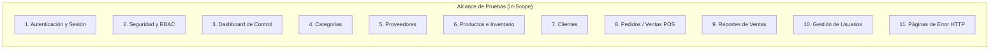
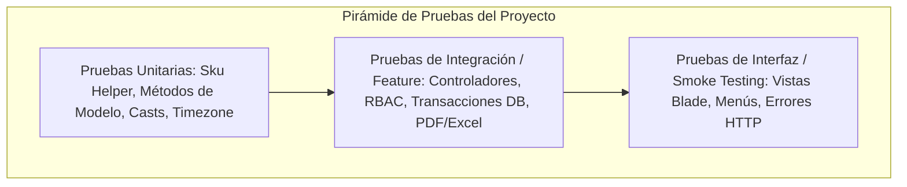
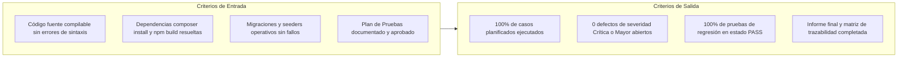

# 03 — Plan Maestro de Pruebas de Software (SISMICRO / Supermarket)

> **Plan de Pruebas de Software (Master Test Plan)**  
> **Proyecto:** Sistema Web de Ventas e Inventario para el Micromercado SuperMarket  
> **Ámbito:** Proyecto de Grado / Titulación Académica  
> **Fecha de Emisión:** Septiembre 2026  
> **Versión del Documento:** 1.0  
> **Estado del Plan:** PLANIFICADO (Aprobado para diseño y ejecución; no contiene resultados de ejecución)  
> **Estado de Ejecución:** PENDIENTE (los casos derivados serán ejecutados formalmente en fases posteriores)  

---

## 1. Introducción

El presente Plan Maestro de Pruebas establece el marco metodológico, técnico y organizativo para evaluar la calidad, seguridad, fiabilidad e integridad del **Sistema Web de Ventas e Inventario del Micromercado SuperMarket (SISMICRO)**. 

El sistema ha sido desarrollado sobre el framework **Laravel 12** y **PHP 8.2+**, integrando persistencia relacional en **MySQL/MariaDB**, soporte de base de datos en memoria **SQLite** para pruebas automatizadas, interfaz de usuario basada en **Blade + Bootstrap 5.3.2**, y librerías especializadas para la generación de reportes contables (PDF/Excel) y trazabilidad de productos (códigos QR y códigos de barras Code128).

Este documento asegura que la verificación del software se realice de manera estructurada, rigurosa y reproducible, garantizando la trazabilidad bidireccional desde los requisitos de software (`RF-001` a `RF-072`, `RNF-001` a `RNF-012`) hasta los casos de prueba, evidencias y reportes finales.

---

## 2. Objetivos del Plan de Pruebas

### 2.1. Objetivo General
Planificar, estructurar y coordinar el proceso de aseguramiento de calidad y verificación integral del sistema SuperMarket, certificando que todas las reglas de negocio, controles de inventario, mecanismos de seguridad RBAC y transacciones comerciales operen de acuerdo con las especificaciones técnicas y estándares de fiabilidad antes de su liberación a un entorno productivo.

### 2.2. Objetivos Específicos
1. **Validar la Transaccionalidad y Atomicidad en Ventas:** Garantizar que el registro de pedidos descuente el inventario de forma atómica mediante bloqueos pesimistas (`lockForUpdate`), aplicando reversión completa (*rollback*) ante stock insuficiente.
2. **Verificar el Control de Acceso Basado en Roles (RBAC):** Comprobar que los privilegios asignados a los roles `administrador` e `invitado` se cumplan estrictamente tanto a nivel de middleware en rutas como en controladores y vistas, impidiendo accesos indebidos (HTTP 403).
3. **Certificar la Integridad Referencial y Trazabilidad:** Evaluar las restricciones de clave foránea (`RESTRICT`, `SET NULL`, `CASCADE`) y el comportamiento de borrado no destructivo (*soft deletes*), asegurando que no existan eliminaciones en cascada que destruyan el historial contable o inventario.
4. **Validar la Precisión de Métricas y Reportes:** Verificar que los cálculos monetarios utilicen aritmética de precisión arbitraria (`bcmath`) y que las métricas agregadas del Dashboard y de los Reportes de Ventas excluyan sistemáticamente los pedidos anulados.
5. **Asegurar la Resiliencia de la Interfaz y Manejo de Errores:** Validar que las páginas de error personalizadas (403, 404, 419, 500) y los flujos de interfaz respondan adecuadamente ante datos inválidos y excepciones no controladas.

---

## 3. Alcance de las Pruebas (Scope)

### 3.1. Elementos Dentro del Alcance (In-Scope)
El alcance de este plan contempla la verificación integral de los siguientes componentes verificados en el repositorio:



- **Módulos Funcionales:**
  - Autenticación (Login, Logout, Rate Limiting / Throttling, Remember Me).
  - Panel de Control / Dashboard (KPIs, valuación de inventario, series temporales, rankings Top 5).
  - Gestión de Categorías (CRUD, restauración de papelera, restricción por productos asociados).
  - Gestión de Proveedores (CRUD, búsqueda dinámica, soft delete, restricción por productos).
  - Catálogo de Productos (CRUD, imágenes, stock crítico/agotado, papelera, forceDelete, QR, Barcode, PDF, Excel).
  - Gestión de Clientes (CRUD, búsqueda por nombre/email, restauración, restricción por pedidos).
  - Pedidos y Ventas (FormRequest, transacción ACID, descuento de stock concurrente, cálculo con bcmath, anulación, reactivación, eliminación y control de stock fantasma).
  - Reportes de Ventas (Filtros por fecha/cliente/estado, métricas globales filtradas, exportación PDF landscape y Excel).
  - Gestión de Usuarios (CRUD, asignación de roles, contraseñas alfanuméricas, protección anti auto-degradación y auto-eliminación).
  - Vistas de Error HTTP (403, 404, 419, 429, 500, 503).
- **Dimensiones Técnicas:**
  - Pruebas unitarias sobre helpers (`Sku::format`) y métodos de modelo.
  - Pruebas de integración sobre rutas HTTP, controladores, middleware y transacciones de base de datos.
  - Pruebas de regresión sobre defectos y correcciones históricas documentadas en el repositorio.

### 3.2. Elementos Fuera del Alcance (Out-of-Scope)
Se excluyen formalmente de este plan las siguientes áreas por no formar parte del sistema implementado o por exceder los límites del proyecto:
1. **Pasarelas de Pago Externas en Línea:** El sistema opera bajo modalidad de venta presencial/mostrador en efectivo o medios directos; no existen integraciones con APIs bancarias, Stripe, PayPal ni cobros por tarjeta de crédito.
2. **Facturación Fiscal Oficial / Facturación Electrónica:** No se contempla la integración con los servicios web del Servicio de Impuestos Nacionales (SIN) ni generación de firma digital XML.
3. **Vistas Huérfanas de Scaffold:** Los archivos heredados `resources/views/home.blade.php`, `resources/views/welcome.blade.php` y el controlador `HomeController.php` no tienen rutas activas en `routes/web.php` y quedan excluidos.
4. **Infraestructura Cloud de Alta Disponibilidad:** Pruebas de balanceadores de carga multinodo, clusters Kubernetes o arquitecturas de microservicios.

---

## 4. Descripción del Sistema y Arquitectura Bajo Prueba

El sistema **SuperMarket** responde a una arquitectura monolítica clásica basada en el patrón Modelo-Vista-Controlador (MVC) potenciada por Laravel 12:

| Capa Arquitectónica | Componente Implementado | Rol en el Proceso de Pruebas |
| :--- | :--- | :--- |
| **Presentación (UI)** | Blade Templates, Bootstrap 5.3.2, DataTables, FontAwesome, JavaScript para lectura de códigos | Verificación de renderizado de vistas, navegación por rol, modales y validación de cliente. |
| **Control / Aplicación** | Controladores HTTP, FormRequests (`StorePedidoRequest`, `UpdatePedidoRequest`), Middleware `CheckRol` | Verificación de sanitización, autorización RBAC y orquestación transaccional. |
| **Dominio y Negocio** | Modelos Eloquent (`Producto`, `Pedido`, etc.), Trait `SoftDeletes`, Helper `Sku`, Precisión `bcmath` | Verificación de reglas de stock, cálculos financieros y transiciones de estado. |
| **Persistencia** | MySQL 8.0.16+ / MariaDB 10.2.1+ (Producción/Demo) · SQLite 3 (Testing automatizado) | Verificación de constraints (`CHECK`, `UNSIGNED`), índices de búsqueda y llaves foráneas. |
| **Almacenamiento** | Trait `SincronizaImagenPublica` en disco local (`storage/app/public` y `public/storage`) | Verificación de subida, sustitución física y eliminación de archivos de imagen. |

---

## 5. Tipos y Niveles de Pruebas Aplicables



### 5.1. Pruebas Unitarias (Unit Testing)
- **Foco:** Métodos individuales, clases auxiliares aisladas y lógica pura sin dependencias de red ni servidor web.
- **Alcance Específico:**
  - `App\Support\Sku::format(int $id)`: Comprobar padding de 6 ceros (`PRD-000001`) e inmunidad ante IDs grandes.
  - Métodos de modelo: `Producto::tieneStock(int $cant)`, `User::esAdmin()`, `User::esInvitado()`.
  - Configuración del sistema: Zona horaria `America/La_Paz` y variables globales.

### 5.2. Pruebas de Integración y Funcionales (Feature Testing)
- **Foco:** Flujos completos de petición-respuesta HTTP simulando clientes autenticados.
- **Alcance Específico:**
  - Flujo de autenticación y bloqueo de fuerza bruta (Rate Limiting).
  - Evaluación de middleware `rol:administrador` en todas las rutas de modificación.
  - Validación de esquemas en FormRequests ante datos inválidos, tipos incorrectos y campos nulos.
  - Ejecución transaccional de ventas: verificación de decremento de stock y reversión completa ante fallos.
  - Manejo de estados de pedido: `completado -> anulado`, `anulado -> completado`, `anulado -> anulado`.
  - Integridad referencial: bloqueo de eliminación en cascada destructiva.
  - Generación de salidas binarias: descargas de PNG (códigos QR y barras) y archivos PDF/Excel.

### 5.3. Pruebas de Seguridad y Autorización (RBAC Testing)
- **Foco:** Validación de matrices de privilegios y aislamiento de roles.
- **Alcance Específico:**
  - Verificación de código HTTP 403 al emitir verbos POST, PUT o DELETE desde cuentas con rol `invitado`.
  - Verificación de bloqueo de rutas de administración (`/usuarios`, `/reportes`, `/productos/papelera`) para invitados.
  - Verificación de reglas de integridad de cuenta: prohibición de auto-degradación de rol y auto-eliminación de cuenta propia.

### 5.4. Pruebas de Concurrencia e Integridad Transaccional
- **Foco:** Preservación de la consistencia de inventario bajo accesos simultáneos.
- **Alcance Específico:**
  - Evaluación del bloqueo pesimista `lockForUpdate()` para prevenir sobreventa (*double-spending* de inventario).
  - Verificación de integridad de base de datos (`CHECK (stock >= 0)` en MySQL).

### 5.5. Pruebas de Regresión
- **Foco:** Asegurar que modificaciones previas en el código no hayan introducido nuevos defectos.
- **Alcance Específico:**
  - Prevención del defecto de "stock fantasma" al eliminar pedidos previamente anulados.
  - Verificación del cálculo contable sin desbordamiento de punto flotante mediante `bcmath`.
  - Comprobación de que la migración de base de datos se ejecute limpia desde cero (`migrate:fresh --seed`).

### 5.6. Pruebas de Interfaz de Usuario y Humo (Smoke Testing)
- **Foco:** Verificación rápida de la estabilidad de las vistas y componentes visuales.
- **Alcance Específico:**
  - Comprobación de carga sin error 500 en todas las pantallas principales para ambos roles.
  - Renderizado de vistas de error HTTP (403, 404, 500).
  - Verificación del mecanismo anti-parpadeo (*anti-FOUC*) en la selección de tema oscuro.

---

## 6. Estrategia y Metodología de Pruebas

### 6.1. Enfoque de Automatización vs. Pruebas Manuales
1. **Automatización (PHPUnit / TestBench):**
   - El 100% de las reglas de negocio, transacciones, restricciones de seguridad y validaciones de formularios serán cubiertas mediante pruebas automatizadas repetibles que aprovechan el trait `RefreshDatabase` de Laravel.
2. **Pruebas Manuales Estructuradas:**
   - Se utilizarán para inspección visual de interfaces, legibilidad y escaneo de códigos QR/barras con lectores físicos, diseño responsivo en navegadores y validación estética de reportes PDF descargados.

### 6.2. Técnicas de Diseño de Casos de Prueba
- **Partición de Equivalencia:** División de entradas en clases válidas e inválidas (ej. cantidades de producto $1 \le x \le 9999$).
- **Análisis de Valores Límite (BVA):** Evaluación en los bordes críticos: stock exacto ($stock = cantidad$), stock insuficiente ($stock = cantidad - 1$), stock cero, precio cero, contraseñas de exactamente 6 caracteres vs. 5 caracteres.
- **Pruebas de Transición de Estados:** Matriz de estados en pedidos (`completado` $\rightarrow$ `anulado` $\rightarrow$ `completado` $\rightarrow$ `eliminado`).
- **Pruebas de Tabla de Decisión:** Combinatoria de roles (`administrador` vs. `invitado`) vs. acciones permitidas/bloqueadas en cada endpoint.

---

## 7. Ambientes de Prueba (Test Environments)

Para asegurar la validez técnica, se definen dos configuraciones de ambiente:

### 7.1. Ambiente de Pruebas Automatizadas (Local / CI)
- **Propósito:** Ejecución ágil y aislada de la suite PHPUnit completa.
- **Sistema Operativo:** Windows 11 / Linux.
- **Motor PHP:** PHP 8.2 o superior con extensiones activas: `pdo_sqlite`, `mbstring`, `bcmath`, `gd`, `zip`.
- **Motor de Base de Datos:** SQLite 3 en memoria (`:memory:`).
- **Configuración de Entorno (`phpunit.xml`):**
  ```xml
  <env name="APP_ENV" value="testing"/>
  <env name="BCRYPT_ROUNDS" value="4"/>
  <env name="CACHE_STORE" value="array"/>
  <env name="DB_CONNECTION" value="sqlite"/>
  <env name="DB_DATABASE" value=":memory:"/>
  <env name="MAIL_MAILER" value="array"/>
  <env name="QUEUE_CONNECTION" value="sync"/>
  <env name="SESSION_DRIVER" value="array"/>
  ```

### 7.2. Ambiente de Homologación y Verificación de Motor (Staging Local)
- **Propósito:** Comprobación de restricciones nativas de motor (`CHECK`, `UNSIGNED`), consultas SQL específicas (`DATE_FORMAT`) y subida física de archivos.
- **Servidor Web:** PHP Built-in Server (`php artisan serve`) o Apache (XAMPP).
- **Motor de Base de Datos:** MySQL 8.0.16+ o MariaDB 10.2.1+ en puerto 3306 (`utf8mb4_unicode_ci`).
- **Node.js / Asset Bundler:** Node.js 18+ con npm y Vite para compilación de estilos y librerías de códigos.
- **Configuración de Entorno (`.env`):**
  ```ini
  APP_ENV=local
  APP_DEBUG=true
  DB_CONNECTION=mysql
  DB_HOST=127.0.0.1
  DB_PORT=3306
  DB_DATABASE=supermarket
  DB_USERNAME=root
  DB_PASSWORD=
  ```

---

## 8. Herramientas y Tecnologías de Prueba

| Herramienta / Paquete | Versión | Rol en las Pruebas |
| :--- | :--- | :--- |
| **PHPUnit** | 11.5.50 | Motor principal de ejecución y aserciones de pruebas automatizadas. |
| **Laravel Testing Toolkit** | 12.0 (`Illuminate\Foundation\Testing`) | Provisión de helpers HTTP (`actingAs`, `post`, `get`), aserciones de base de datos (`assertDatabaseHas`, `assertSoftDeleted`) y aserciones de sesión. |
| **FakerPHP** | ^1.23 | Generación determinista o pseudoaleatoria de datos sintéticos de prueba. |
| **Google Chrome / DevTools** | Última versión estable | Inspección de consola, análisis de cookies de sesión, emulación responsiva y pruebas visuales. |
| **Lector QR / Barcode App** | Dispositivo móvil o emulador | Verificación física de escaneo del JSON en QR y lectura de cadena SKU en Code128. |

---

## 9. Gestión de Datos de Prueba (Test Data Management)

### 9.1. Estrategia de Creación y Destrucción
1. **Aislamiento por Caso:** En pruebas automatizadas se utiliza `RefreshDatabase`, migrando el esquema en memoria antes de cada caso y revirtiéndolo al finalizar para evitar colisiones de estado entre pruebas.
2. **Conjunto Base de Demostración (Seeders):**
   - `DatabaseSeeder.php` orquesta la carga de usuarios estándar:
     - Administrador: `dueno@supermarket.com` / `password123`.
     - Invitado: `empleado@supermarket.com` / `password123`.
   - `CategoriaSeeder`, `ProveedorSeeder`, `ProductoSeeder`, `ClienteSeeder` y `PedidoSeeder` proporcionan 30 productos con stocks variados (12 a 200 unidades), precios diversos y clientes con ventas históricas.

### 9.2. Perfiles Específicos de Datos para Casos Límite
- **Productos:**
  - Producto A: Stock abundante ($stock = 50$).
  - Producto B: Stock crítico ($stock = 5$).
  - Producto C: Stock agotado ($stock = 0$).
  - Producto D: En papelera (`deleted_at != null`).
  - Producto E: Con ventas históricas registradas en `detalle_pedidos`.
- **Clientes:**
  - Cliente sin compras previas (apto para borrado).
  - Cliente con compras registradas (bloqueado para borrado).
- **Pedidos:**
  - Pedido completado de 1 producto.
  - Pedido completado multi-línea (3 a 5 productos).
  - Pedido anulado.

---

## 10. Roles y Responsabilidades (Matriz RACI)

| Actividad del Plan de Pruebas | Tesista / Desarrollador | Revisor Académico / Tutor | Tribunal Calificador |
| :--- | :---: | :---: | :---: |
| **Elaboración del Plan de Pruebas** | **R / A** | **C** | **I** |
| **Diseño de Casos de Prueba (CP-001+)** | **R / A** | **C** | **I** |
| **Preparación de Ambientes y Datos** | **R / A** | **I** | **I** |
| **Ejecución de Pruebas Automatizadas** | **R / A** | **I** | **I** |
| **Ejecución de Pruebas Manuales / UI** | **R / A** | **C** | **I** |
| **Reporte y Seguimiento de Defectos** | **R / A** | **I** | **I** |
| **Elaboración del Informe de Resultados** | **R / A** | **C** | **A** |
| **Evaluación y Aprobación de Calidad** | **R** | **C** | **A** |

*Leyenda: **R** = Responsable (ejecuta), **A** = Aprobador (rinde cuentas), **C** = Consultado, **I** = Informado.*

---

## 11. Criterios de Entrada y Criterios de Salida



### 11.1. Criterios de Entrada (Entry Criteria)
Para dar inicio formal a la fase de ejecución de pruebas se debe cumplir:
1. El repositorio debe compilar y cargar sin errores de sintaxis en PHP 8.2+.
2. El comando `composer install` y `npm run build` deben finalizar con éxito.
3. El comando `php artisan migrate:fresh --seed` debe ejecutarse al 100% sin excepciones de base de datos.
4. El Plan de Pruebas (`03_Plan_Pruebas.md`) y la Matriz de Requisitos (`02_Requisitos_Verificables.md`) deben estar aprobados.

### 11.2. Criterios de Salida (Exit Criteria)
Para considerar concluida la fase de pruebas y avalar la calidad del sistema se exige:
1. **Ejecución Total:** El 100% de los casos de prueba diseñados deben haber sido ejecutados y registrados con evidencia verificable.
2. **Defectos Críticos Resueltos:** Cero (0) defectos de severidad **Crítica** o **Mayor** en estado abierto.
3. **Estabilidad de Regresión:** El 100% de los tests unitarios y de integración de reglas de negocio en PHPUnit deben finalizar con veredicto **PASS**.
4. **Trazabilidad Integral:** Cada requisito funcional (`RF-001` a `RF-072`) y no funcional (`RNF-001` a `RNF-012`) debe contar con al menos una prueba vinculada.

---

## 12. Gestión de Riesgos y Planes de Contingencia

| ID | Riesgo Identificado | Probabilidad | Impacto | Plan de Mitigación y Contingencia |
| :--- | :--- | :---: | :---: | :--- |
| **RSK-001** | **Divergencia entre motores SQL (SQLite vs MySQL):** SQLite omite el constraint `CHECK (stock >= 0)` y el tipo `UNSIGNED`. | Alta | Alto | Ejecutar una sesión de validación funcional directamente sobre una base de datos MySQL 8 real para certificar que el motor rechaza inserciones de stock negativo. |
| **RSK-002** | **Ausencia de extensión `ext-bcmath` en el servidor:** Provoca caída fatal en cálculos de pedidos. | Baja | Crítico | Validación previa de prerrequisitos mediante verificación en `composer.json` y test unitario de arranque comprobando `extension_loaded('bcmath')`. |
| **RSK-003** | **Desincronización de imágenes en almacenamiento Windows:** La copia manual a `public/storage` puede desincronizarse si se manipulan archivos por fuera de Laravel. | Media | Medio | Probar de forma estricta el trait `SincronizaImagenPublica` en operaciones de creación, edición con sustitución y borrado de imágenes. |
| **RSK-004** | **Falsa sensación de seguridad en tests síncronos de concurrencia:** PHPUnit corre secuencialmente y no produce condiciones de carrera reales. | Media | Alto | Diseñar pruebas analíticas de bloqueo de transacciones y planificar pruebas de estrés concurrentes con herramientas de carga externa (Apache Benchmark / Postman Runner). |
| **RSK-005** | **Discrepancia en la UI para enlace de Reportes:** El sidebar muestra "Reportes" a invitados pero genera error 403. | Alta | Medio | Registrar el hallazgo como defecto menor de UI y verificar si el equipo de desarrollo aprueba la inclusión de `@if(auth()->user()->rol === 'administrador')` en la vista. |

---

## 13. Procedimiento de Gestión de Defectos (Bug Tracking)

### 13.1. Niveles de Severidad
- **Crítica (Bloqueante):** Caída fatal del sistema (HTTP 500 no controlado), pérdida o corrupción de datos financieros, sobreventa de stock en pedidos o brecha de seguridad grave (acceso de invitado a funciones de administrador).
- **Mayor:** Funcionalidad principal no operativa sin solución alternativa (ej. fallo en generación de PDF de ventas o imposibilidad de registrar clientes).
- **Menor:** Funcionalidad operativa con defectos cosméticos, inconsistencias menores en mensajes de error o fallos en filtros secundarios con solución alternativa evidente.
- **Trivial:** Errores ortográficos, alineación tipográfica o pequeñas inconsistencias visuales que no alteran la lógica de negocio.

### 13.2. Ciclo de Vida del Defecto
```
[Identificado] ──► [Reportado en Matriz] ──► [En Corrección] ──► [Regresión / Re-test] ──► [Cerrado]
```

### 13.3. Estructura Estándar de Reporte de Defectos
Cada defecto detectado se registrará en el documento de defectos con la siguiente ficha técnica:
- **ID Defecto:** `DEF-001`, `DEF-002`, ...
- **Título Descriptivo:** Resumen conciso del comportamiento anómalo.
- **Requisito Afectado:** Código `RF-XXX` o `RNF-XXX`.
- **Caso de Prueba Origen:** Código `CP-XXX`.
- **Severidad / Prioridad:** Crítica / Mayor / Menor / Trivial — Alta / Media / Baja.
- **Ambiente:** Motor BD utilizado (SQLite / MySQL), navegador y rol de usuario.
- **Pasos para Reproducir:** Secuencia numerada y exacta de acciones.
- **Resultado Esperado:** Lo que estipula la regla de negocio.
- **Resultado Obtenido:** Lo que ocurrió efectivamente en el sistema.
- **Evidencia Adjunta:** Trazas de logs (`storage/logs/laravel.log`), capturas de pantalla o fragmentos de respuesta HTTP.

---

## 14. Registro y Gestión de Evidencias

Para avalar académicamente cada prueba ejecutada, se recolectarán evidencias objetivas:
1. **Pruebas Automatizadas:** Salidas de consola de PHPUnit registrando tiempo de ejecución, número de pruebas, aserciones realizadas y estado del test runner.
2. **Pruebas de Interfaz y Navegación:** Capturas de pantalla fechadas mostrando estado HTTP, URL activa, estado de sesión y elementos visuales.
3. **Pruebas de Integridad de Persistencia:** Consultas directas a tablas de base de datos (`productos`, `pedidos`, `detalle_pedidos`) verificando valores numéricos antes y después de la operación.
4. **Archivos Generados:** Documentos binarios resultantes archivados en carpeta de evidencias (PDFs de catálogo y ventas, hojas `.xlsx` y archivos PNG de QR y código de barras).

---

## 15. Cronograma Sugerido de Pruebas

El ciclo completo de pruebas se estructura en **6 fases consecutivas**:

| Fase | Actividades Principales | Entregables Clave |
| :---: | :--- | :--- |
| **Fase 1: Preparación** | Revisión de stack, configuración de ambientes (SQLite y MySQL), verificación de dependencias PHP. | Documento `01_Analisis_Sistema.md` y `02_Requisitos_Verificables.md`. |
| **Fase 2: Planificación** | Estructuración formal del Plan Maestro de Pruebas, definición de criterios y riesgos. | Documento `03_Plan_Pruebas.md`. |
| **Fase 3: Diseño de Casos** | Especificación detallada de casos de prueba (`CP-001` a `CP-084+`) con pasos, datos y resultados esperados. | Documento `04_Casos_Prueba.md`. |
| **Fase 4: Ejecución** | Ejecución de la suite automatizada en PHPUnit y ejecución de pruebas manuales exploratorias. | Registro de evidencias y Documento `05_Matriz_Trazabilidad.md`. |
| **Fase 5: Defectos y Regresión**| Documentación de defectos hallados, corrección y verificación de regresión. | Documento `06_Registro_Defectos.md` y suite de regresión en verde. |
| **Fase 6: Cierre e Informe** | Consolidación de métricas finales, evaluación de criterios de salida y conclusiones de calidad. | Documento `07_Informe_Pruebas.md`. |

---

## 16. Criterios de Preparación para Producción (Release Readiness)

Antes de considerar el sistema apto para despliegue en producción o defensa formal de titulación, deben cumplirse las siguientes condiciones obligatorias:

1. **Variables de Seguridad en `.env`:**
   - Cambiar estrictamente `APP_ENV=local` a `APP_ENV=production`.
   - Desactivar el modo depuración: `APP_DEBUG=false` (evita la exposición de trazas de base de datos y variables de entorno ante fallos).
2. **Optimización de Caché de Laravel:**
   - Ejecutar `php artisan config:cache` para consolidar variables de configuración.
   - Ejecutar `php artisan route:cache` para acelerar el enrutamiento.
   - Ejecutar `php artisan view:cache` para compilar plantillas Blade.
3. **Persistencia sobre Motor Homologado:**
   - Despliegue sobre MySQL 8.0.16+ o MariaDB 10.2.1+ ejecutando `php artisan migrate --force` para activar el constraint nativo `CHECK (stock >= 0)` y columnas `UNSIGNED`.
4. **Seguridad de Archivos Multimedia:**
   - Verificar permisos de lectura/escritura en `storage/app/public` y `public/storage`.
5. **Alineación de Interfaz:**
   - Resolver la visibilidad del enlace de Reportes para el rol invitado en `app.blade.php`.

---

## 17. Conclusiones del Plan de Pruebas

1. **Rigor y Fidelidad al Código Real:** El presente plan ha sido diseñado exclusivamente a partir de la arquitectura, rutas, controladores, migraciones y modelos existentes en el repositorio, sin asumir dependencias inexistentes ni inventar funcionalidades.
2. **Cobertura Integral y Transaccional:** Se prioriza la validación de las áreas de mayor criticidad económica y operativa del micromercado: la atomicidad en la venta, la prevención de sobreventa, la inmutabilidad histórica de precios y el control de acceso por roles.
3. **Estado del Proceso:** Este documento concluye la fase de **Planificación** (`PLANIFICADO`). No contiene resultados de pruebas ni calificaciones PASS/FAIL; constituye la base directiva para el diseño de casos de prueba y la ejecución formal de las etapas subsiguientes.
