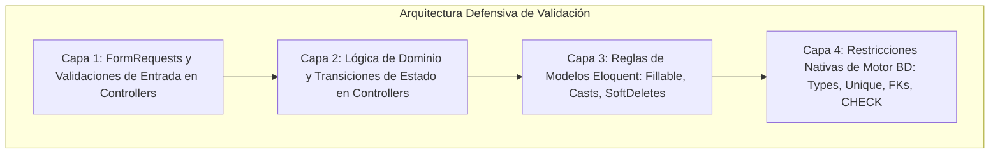
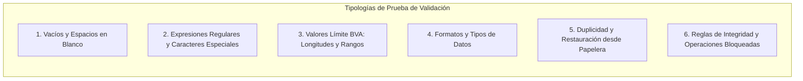

# 05 — Especificación de Pruebas de Validación (SISMICRO / Supermarket)

> **Documento de Auditoría y Pruebas de Validación de Software**  
> **Proyecto:** Sistema Web de Ventas e Inventario para el Micromercado SuperMarket  
> **Ámbito:** Proyecto de Grado / Titulación Académica  
> **Fecha de Emisión:** Septiembre 2026  
> **Versión:** 1.0  
> **Fuente de Verdad:** Código fuente real (FormRequests, Controllers, Models, Migraciones y Esquema BD)  
> **Estado de las Validaciones:** VERIFICADO (mapeadas directamente desde el código fuente)  
> **Estado de las Pruebas:** PENDIENTE DE EJECUCIÓN (ningún veredicto PASS/FAIL ha sido anticipado)  

---

## 1. Metodología de Auditoría de Validaciones

El aseguramiento de la integridad de los datos en el sistema **SuperMarket** se articula a través de **cuatro capas defensivas complementarias**:

1. **Capa 1 (HTTP / Entrada):** Reglas declaradas en FormRequests (`StorePedidoRequest`, `UpdatePedidoRequest`) y métodos `$request->validate()` en controladores con mensajes en español personalizados.
2. **Capa 2 (Dominio / Negocio):** Verificaciones operativas en controladores: transacciones atómicas (`DB::transaction`), bloqueo pesimista de concurrencia (`lockForUpdate`), consultas con papelera (`withTrashed()`) y lógica anti-degradación de cuentas.
3. **Capa 3 (ORM Eloquent):** Configuración de atributos `$fillable`, ocultamiento de credenciales (`$hidden`), casts nativos (`decimal:2`, `date`, `boolean`, `hashed`) y relaciones de modelo.
4. **Capa 4 (Motor de Base de Datos):** Índices `UNIQUE`, claves foráneas con reglas `RESTRICT`/`SET NULL`/`CASCADE`, constraints `CHECK (stock >= 0)` y tipos `INT UNSIGNED` en MySQL/MariaDB.

---

## 2. Diccionario Exhaustivo de Campos y Reglas de Validación

A continuación se detalla la especificación técnica verificada para cada entidad del sistema:

### 2.1. Entidad: Autenticación (`LoginController`)

| Campo | Obligatoriedad | Tipo / Longitud | Formato / Valores Permitidos | Regla de Unicidad / BD | Mensaje Real en Código | Capa de Control |
| :--- | :---: | :---: | :--- | :---: | :--- | :---: |
| `email` | Requerido | String (max 255) | Formato email estándar | N/A | "El correo es obligatorio." / "Ingrese un correo válido." / "El correo no debe superar los 255 caracteres." | Controller (L21) |
| `password` | Requerido | String (6 - 255) | Texto plano (se coteja con hash bcrypt) | N/A | "La contraseña es obligatoria." / "La contraseña debe tener al menos 6 caracteres." / "La contraseña no debe superar los 255 caracteres." | Controller (L22) |
| `remember` | Opcional | Booleano | `true`, `false`, `1`, `0` | N/A | N/A (conversión mediante `$request->boolean()`) | Controller (L46) |
| `g-recaptcha-response` | Opcional | String | Nullable (sin widget en vista) | N/A | N/A *(REQUIERE VERIFICACIÓN)* | Controller (L23) |
| *Throttle Key* | N/A | String compuesto | `mb_strtolower(email) . '\|' . ip()` | Max 5 intentos / 120 seg | "Demasiados intentos de inicio de sesión. Por favor, inténtelo de nuevo en X segundos." | Controller (L39) |

---

### 2.2. Entidad: Categorías (`CategoriaController` / Modelo `Categoria`)

| Campo | Obligatoriedad | Tipo / Longitud | Formato / Expresión Regular | Regla de Unicidad / BD | Mensaje Real en Código | Capa de Control |
| :--- | :---: | :---: | :--- | :---: | :--- | :---: |
| `nombre` | Requerido | String (2 - 100) | `regex:/^[a-zA-ZáéíóúÁÉÍÓÚñÑ0-9\s\.\,\-\_]+$/` | `UNIQUE` en BD (`categorias.nombre`). Si existe en papelera, se restaura; si existe activa, error. | "El nombre es obligatorio." / "El nombre debe tener al menos 2 caracteres." / "El nombre no debe superar los 100 caracteres." / "El nombre solo puede contener letras, números, espacios y . , - _" / "Ya existe una categoría activa con este nombre." | Controller (L27, L42-55) y Migración |
| `descripcion` | Opcional | String (max 500) | Texto libre | Nullable en BD (`table->text()`) | "La descripción no debe superar los 500 caracteres." | Controller (L28) y BD |
| `deleted_at` | N/A | Timestamp | Fecha y hora de baja lógica | Nullable | N/A (gestionado por trait `SoftDeletes`) | Modelo y BD |
| *Baja de Categoría* | N/A | Lógica | `cantProductos == 0` | FK `RESTRICT` desde `productos.idCategoria` | "No se puede eliminar la categoría \"...\" porque tiene X producto(s) asociado(s). Reasigne o elimine primero sus productos." | Controller (L111) y Migración |

---

### 2.3. Entidad: Proveedores (`ProveedorController` / Modelo `Proveedor`)

| Campo | Obligatoriedad | Tipo / Longitud | Formato / Expresión Regular | Regla de Unicidad / BD | Mensaje Real en Código | Capa de Control |
| :--- | :---: | :---: | :--- | :---: | :--- | :---: |
| `nombre` | Requerido | String (2 - 150) | `regex:/^[a-zA-ZáéíóúÁÉÍÓÚñÑ0-9\s\.\,\-\_\'\&]+$/` | Unicidad en controlador vía `withTrashed()`. Si está en papelera se restaura; si está activo, error. | "El nombre del proveedor es obligatorio." / "El nombre debe tener al menos 2 caracteres." / "El nombre no debe superar los 150 caracteres." / "El nombre contiene caracteres no permitidos." / "Ya existe un proveedor activo..." | Controller (L44, L64-79) |
| `nit` | Opcional | String (max 20) | `regex:/^[0-9\-]+$/` | Nullable en BD | "El NIT solo puede contener números y guiones." | Controller (L45) |
| `telefono` | Opcional | String (7 - 20) | `regex:/^[\+]?[0-9\s\-\(\)]+$/` | Nullable en BD | "El teléfono solo puede contener números, espacios y signos (+, -, ())." | Controller (L46) |
| `email` | Opcional | String (max 100) | Formato email estándar | Nullable en BD | "Ingrese un correo electrónico válido." | Controller (L47) |
| `direccion` | Opcional | String (4 - 150) | Texto libre | Nullable en BD | "La dirección debe tener al menos 4 caracteres." | Controller (L48) |
| `activo` | Opcional | Booleano | `true`, `false`, `1`, `0` (default: true) | Default `true` en BD | N/A (cast booleano en Eloquent) | Controller (L61) y BD |
| *Baja de Proveedor* | N/A | Lógica | `cantProductos == 0` | Controller bloquea si hay productos vinculados. En BD es `SET NULL`. | "No se puede eliminar el proveedor \"...\" porque tiene X producto(s) asociado(s)..." | Controller (L150) *(Nota: discrepancia con BD, ver Sec. 4)* |

---

### 2.4. Entidad: Productos (`ProductoController` / Modelo `Producto`)

| Campo | Obligatoriedad | Tipo / Longitud | Formato / Expresión Regular | Regla de Unicidad / BD | Mensaje Real en Código | Capa de Control |
| :--- | :---: | :---: | :--- | :---: | :--- | :---: |
| `nombre` | Requerido | String (2 - 100) | `regex:/^[a-zA-ZáéíóúÁÉÍÓÚñÑ0-9\s\.\,\-\_\']+$/` | `UNIQUE` en BD (`productos.nombre`). Auto-restauración si está en papelera. | "El nombre es obligatorio." / "El nombre debe tener al menos 2 caracteres." / "El nombre no debe superar los 100 caracteres." / "El nombre solo puede contener letras..." / "Ya existe un producto activo con este nombre." | Controller (L47, L78) y Migración |
| `precio` | Requerido | Decimal (0 a 999,999.99) | `numeric`, `min:0`, `max:999999.99`, `regex:/^\d+(\.\d{1,2})?$/` | Decimal(8,2) en BD | "El precio es obligatorio." / "El precio debe ser un número." / "El precio no puede ser negativo." / "El precio no debe superar 999,999.99." / "El precio solo puede tener hasta 2 decimales." | Controller (L48) y BD |
| `stock` | Requerido | Entero (0 a 99,999) | `integer`, `min:0`, `max:99999` | `CHECK (stock >= 0)` y `INT UNSIGNED` en MySQL | "El stock es obligatorio." / "El stock debe ser un número entero." / "El stock no puede ser negativo." / "El stock no debe superar 99,999." | Controller (L49) y Migraciones |
| `idCategoria` | Requerido | BigInt Unsigned | Clave foránea existente (`exists:categorias,idCategoria`) | FK `RESTRICT` en BD | "Seleccione una categoría." / "La categoría seleccionada no existe o no es válida." | Controller (L50) y BD |
| `idProveedor` | Opcional | BigInt Unsigned | Clave foránea existente (`exists:proveedores,idProveedor`) | FK `SET NULL` en BD | "El proveedor seleccionado no existe o no es válido." | Controller (L51) y BD |
| `imagen` | Opcional | Archivo Imagen | `image`, `mimes:jpg,jpeg,png,webp`, `max:2048` (2 MB) | Nullable en BD | "El archivo debe ser una imagen." / "La imagen debe ser de tipo JPG, JPEG, PNG o WEBP." / "La imagen no debe superar 2MB." | Controller (L52) y Storage |
| *ForceDelete* | N/A | Lógica | `detallePedidos()->count() == 0` | FK `RESTRICT` desde `detalle_pedidos.idProducto` | "No se puede eliminar permanentemente el producto \"...\" porque tiene ventas registradas en el historial." | Controller (L234) y Migración |

---

### 2.5. Entidad: Clientes (`ClienteController` / Modelo `Cliente`)

| Campo | Obligatoriedad | Tipo / Longitud | Formato / Expresión Regular | Regla de Unicidad / BD | Mensaje Real en Código | Capa de Control |
| :--- | :---: | :---: | :--- | :---: | :--- | :---: |
| `nombre` | Requerido | String (2 - 100) | `regex:/^[a-zA-ZáéíóúÁÉÍÓÚñÑ\s\.\,\-\']+$/` | Texto en BD | "El nombre es obligatorio." / "El nombre debe tener al menos 2 caracteres." / "El nombre no debe superar los 100 caracteres." / "El nombre solo puede contener letras, espacios y . , - '" | Controller (L37) |
| `email` | Requerido | String (max 100) | Formato email estándar | `UNIQUE` en BD (`clientes.email`). Auto-restaura desde papelera. | "El correo es obligatorio." / "Ingrese un correo válido." / "El correo no debe superar los 100 caracteres." / "Este correo ya está registrado por un cliente activo." | Controller (L38, L58-75) y Migración |
| `telefono` | Opcional | String (7 - 20) | `regex:/^[\+]?[0-9\s\-\(\)]+$/` | Nullable en BD | "El teléfono debe tener al menos 7 caracteres." / "El teléfono no debe superar los 20 caracteres." / "El teléfono solo puede contener números, espacios, guiones y paréntesis." | Controller (L39) |
| `direccion` | Opcional | String (5 - 150) | `regex:/^[a-zA-ZáéíóúÁÉÍÓÚñÑ0-9\s\.\,\-\#\/]+$/` | Nullable en BD | "La dirección debe tener al menos 5 caracteres." / "La dirección no debe superar los 150 caracteres." / "La dirección solo puede contener letras, números, espacios y . , - # /" | Controller (L40) |
| *Baja de Cliente* | N/A | Lógica | `pedidos()->count() == 0` | FK `RESTRICT` desde `pedidos.idCliente` | "No se puede eliminar el cliente \"...\" porque tiene X pedido(s) asociado(s)." | Controller (L140) y Migración |

---

### 2.6. Entidad: Pedidos y Detalles (`StorePedidoRequest`, `UpdatePedidoRequest`, `PedidoController`)

| Campo | Obligatoriedad | Tipo / Longitud | Formato / Valores Permitidos | Regla de Unicidad / BD | Mensaje Real en Código | Capa de Control |
| :--- | :---: | :---: | :--- | :---: | :--- | :---: |
| `idCliente` | Requerido | BigInt Unsigned | `exists:clientes,idCliente` | FK `RESTRICT` en BD | "Seleccione un cliente." / "El cliente seleccionado no existe o no es válido." | FormRequest (L17) y BD |
| `fecha` | Requerido | Date | `date`, `before_or_equal:today` | Cast `date` en Eloquent | "Seleccione una fecha." / "La fecha no es válida." / "La fecha no puede ser futura." | FormRequest (L18) |
| `estado` | Requerido (en Update) | String | `in:completado,anulado` | Columna `estado` en tabla `pedidos` | "Seleccione un estado." / "El estado seleccionado no es válido." | UpdatePedidoRequest (L19) |
| `items` | Requerido | Array (1 a 100) | `array`, `min:1`, `max:100` | N/A | "Agregue al menos un producto al pedido." / "El listado de productos tiene un formato no válido." / "No puede agregar más de 100 productos en un pedido." | FormRequest (L19) |
| `items.*.idProducto` | Requerido | BigInt Unsigned | `exists:productos,idProducto`, `distinct` | FK `RESTRICT` en detalle_pedidos | "Seleccione un producto en cada línea." / "Uno de los productos seleccionados no existe o fue eliminado." / "No repita el mismo producto en dos líneas; sume la cantidad en una sola." | FormRequest (L20) |
| `items.*.cantidad` | Requerido | Entero (1 a 9999) | `integer`, `min:1`, `max:9999` | `INT UNSIGNED` en MySQL | "Ingrese una cantidad para cada producto." / "La cantidad debe ser un número entero." / "La cantidad debe ser al menos 1." / "La cantidad no debe superar 9,999." | FormRequest (L21) y Migración |
| *Stock Concurrente* | N/A | Lógica / ACID | `producto->stock >= item['cantidad']` | Transacción con `lockForUpdate()` | "Stock insuficiente para \"...\" (disponible: X)." | Controller (L152-156) |
| *Subtotal / Total* | N/A | Decimal (8,2) | Cálculo con `bcmath` | `bcmul` y `bcadd` a 2 decimales | N/A (exactitud financiera) | Controller (L158, 172) |

---

### 2.7. Entidad: Filtros de Reportes (`ReporteController`)

| Campo | Obligatoriedad | Tipo / Longitud | Formato / Valores Permitidos | Regla de Coherencia | Mensaje Real en Código | Capa de Control |
| :--- | :---: | :---: | :--- | :---: | :--- | :---: |
| `fecha_inicio` | Opcional | Date | `nullable|date` | Formato fecha válido | "La fecha de inicio no es válida." | Controller (L17) |
| `fecha_fin` | Opcional | Date | `nullable|date|after_or_equal:fecha_inicio` | Debe ser $\ge$ `fecha_inicio` | "La fecha final no es válida." / "La fecha final debe ser igual o posterior a la fecha inicial." | Controller (L18) |
| `id_cliente` | Opcional | BigInt Unsigned | `nullable|exists:clientes,idCliente` | Debe existir en BD | "El cliente seleccionado no es válido." | Controller (L19) |
| `estado` | Opcional | String | `nullable|in:todos,completado,anulado` | Valores enum válidos | Rechazo implícito ante valor no permitido | Controller (L20) |

---

### 2.8. Entidad: Usuarios (`UsuarioController` / Modelo `User`)

| Campo | Obligatoriedad | Tipo / Longitud | Formato / Expresión Regular | Regla de Unicidad / BD | Mensaje Real en Código | Capa de Control |
| :--- | :---: | :---: | :--- | :---: | :--- | :---: |
| `name` | Requerido | String (2 - 255) | `regex:/^[a-zA-ZáéíóúÁÉÍÓÚñÑ\s\.\,\-\']+$/` | Texto en BD | "El nombre es obligatorio." / "El nombre debe tener al menos 2 caracteres." / "El nombre no debe superar los 255 caracteres." / "El nombre solo puede contener letras..." | Controller (L36) |
| `email` | Requerido | String (max 255) | Formato email estándar | `UNIQUE` en BD (`users.email`) | "El correo es obligatorio." / "Ingrese un correo válido." / "El correo no debe superar los 255 caracteres." / "Este correo ya está registrado." | Controller (L37) y Migración |
| `password` | Requerido en Store / Opcional en Update | String (6 - 255) | `min:6`, `max:255`, `confirmed`, `regex:/^(?=.*[A-Za-z])(?=.*\d).+$/` | Hash Bcrypt (cost 12) | "La contraseña es obligatoria." / "La contraseña debe tener al menos 6 caracteres." / "La contraseña no debe superar los 255 caracteres." / "Las contraseñas no coinciden." / "La contraseña debe contener al menos una letra y un número." | Controller (L38, L133) |
| `rol` | Requerido | String | `in:administrador,invitado` | Restricción por whitelist | "Seleccione un rol." / "El rol seleccionado no es válido." | Controller (L39) |
| `foto` | Opcional | Archivo Imagen | `image`, `mimes:jpg,jpeg,png,webp`, `max:2048` | Nullable en BD | "El archivo debe ser una imagen." / "La foto debe ser de tipo JPG, JPEG, PNG o WEBP." / "La foto no debe superar 2MB." | Controller (L40) y Storage |
| *Auto-Degradación* | N/A | Lógica | `auth()->id() == user->id && rol != rol_actual` | Bloqueo en controlador | "No puedes cambiar tu propio rol. Pide a otro administrador que lo realice." | Controller (L124-128) |
| *Auto-Eliminación* | N/A | Lógica | `auth()->id() == user->id` | Bloqueo en controlador | "No puedes eliminar tu propio usuario." | Controller (L172-177) |

---

## 3. Matriz de Casos de Prueba de Validación (CP-VAL-001 a CP-VAL-060)

A continuación se formulan los casos de prueba específicos para comprobar cada frontera, formato, condición nula, duplicado y regla de negocio.

| ID Caso | Módulo | Campo / Regla | Tipología de Prueba | Entrada de Prueba (Datos) | Resultado Esperado | Estado |
| :--- | :--- | :--- | :---: | :--- | :--- | :---: |
| **CP-VAL-001** | Categorías | `nombre` | Vacío | `nombre: ""` | HTTP 302 con error: "El nombre es obligatorio." | PENDIENTE |
| **CP-VAL-002** | Categorías | `nombre` | Espacios puros | `nombre: "     "` | HTTP 302 con error: "El nombre es obligatorio." (afectado por TrimStrings) | PENDIENTE |
| **CP-VAL-003** | Categorías | `nombre` | Límite inferior - 1 | `nombre: "A"` (1 caracter) | HTTP 302 con error: "El nombre debe tener al menos 2 caracteres." | PENDIENTE |
| **CP-VAL-004** | Categorías | `nombre` | Límite inferior exacto | `nombre: "AB"` (2 caracteres) | Validación exitosa (HTTP 302 a index con éxito) | PENDIENTE |
| **CP-VAL-005** | Categorías | `nombre` | Límite superior exacto | `nombre: cadena de 100 caracteres permitidos` | Validación exitosa | PENDIENTE |
| **CP-VAL-006** | Categorías | `nombre` | Límite superior + 1 | `nombre: cadena de 101 caracteres` | HTTP 302 con error: "El nombre no debe superar los 100 caracteres." | PENDIENTE |
| **CP-VAL-007** | Categorías | `nombre` | Regex / Caracteres especiales | `nombre: "Lácteos & Bebidas #1 <script>"` | HTTP 302 con error: "El nombre solo puede contener letras, números, espacios y . , - _" | PENDIENTE |
| **CP-VAL-008** | Categorías | `descripcion` | Límite superior + 1 | `descripcion: cadena de 501 caracteres` | HTTP 302 con error: "La descripción no debe superar los 500 caracteres." | PENDIENTE |
| **CP-VAL-009** | Categorías | `nombre` | Duplicado activo | `nombre: "Limpieza"` (categoría activa preexistente) | HTTP 302 con error: "Ya existe una categoría activa con este nombre." | PENDIENTE |
| **CP-VAL-010** | Categorías | `nombre` | Duplicado papelera | `nombre: "Panadería"` (categoría en soft delete) | Restaura el registro, actualiza datos y muestra mensaje de éxito | PENDIENTE |
| **CP-VAL-011** | Categorías | Integridad | Borrado bloqueado | `DELETE /categorias/{id}` con productos asignados | Bloquea eliminación con mensaje: "No se puede eliminar la categoría... tiene X producto(s)..." | PENDIENTE |
| **CP-VAL-012** | Proveedores | `nombre` | Vacío | `nombre: ""` | HTTP 302 con error: "El nombre del proveedor es obligatorio." | PENDIENTE |
| **CP-VAL-013** | Proveedores | `nombre` | Límite inferior - 1 | `nombre: "P"` | HTTP 302 con error: "El nombre debe tener al menos 2 caracteres." | PENDIENTE |
| **CP-VAL-014** | Proveedores | `nombre` | Límite superior + 1 | `nombre: cadena de 151 caracteres` | HTTP 302 con error: "El nombre no debe superar los 150 caracteres." | PENDIENTE |
| **CP-VAL-015** | Proveedores | `nit` | Inválido / Regex | `nit: "NIT-12345-ABC"` | HTTP 302 con error: "El NIT solo puede contener números y guiones." | PENDIENTE |
| **CP-VAL-016** | Proveedores | `nit` | Válido con guiones | `nit: "10203040-5"` | Validación exitosa | PENDIENTE |
| **CP-VAL-017** | Proveedores | `telefono` | Límite inferior - 1 | `telefono: "123456"` (6 caracteres) | HTTP 302 con error: "El teléfono debe tener al menos 7 caracteres." | PENDIENTE |
| **CP-VAL-018** | Proveedores | `telefono` | Límite inferior exacto | `telefono: "4422110"` (7 caracteres) | Validación exitosa | PENDIENTE |
| **CP-VAL-019** | Proveedores | `telefono` | Formato internacional | `telefono: "+591 (4) 4455667"` | Validación exitosa (regex soporta +, -, espacios, paréntesis) | PENDIENTE |
| **CP-VAL-020** | Proveedores | `telefono` | Inválido / Caracteres | `telefono: "telefono-invalido*"` | HTTP 302 con error: "El teléfono solo puede contener números, espacios y signos..." | PENDIENTE |
| **CP-VAL-021** | Proveedores | `direccion` | Límite inferior - 1 | `direccion: "Av."` (3 caracteres) | HTTP 302 con error: "La dirección debe tener al menos 4 caracteres." | PENDIENTE |
| **CP-VAL-022** | Proveedores | `activo` | Booleano omitido | Checkbox 'activo' desmarcado en update | Persiste `activo = 0` (false) | PENDIENTE |
| **CP-VAL-023** | Proveedores | Integridad | Borrado bloqueado | `DELETE /proveedores/{id}` con productos asignados | Bloquea borrado con mensaje: "No se puede eliminar el proveedor... tiene X producto(s)..." | PENDIENTE |
| **CP-VAL-024** | Productos | `nombre` | Vacío | `nombre: ""` | HTTP 302 con error: "El nombre es obligatorio." | PENDIENTE |
| **CP-VAL-025** | Productos | `precio` | Vacío | `precio: ""` | HTTP 302 con error: "El precio es obligatorio." | PENDIENTE |
| **CP-VAL-026** | Productos | `precio` | No numérico | `precio: "gratis"` | HTTP 302 con error: "El precio debe ser un número." | PENDIENTE |
| **CP-VAL-027** | Productos | `precio` | Límite inferior - 0.01 | `precio: -0.01` | HTTP 302 con error: "El precio no puede ser negativo." | PENDIENTE |
| **CP-VAL-028** | Productos | `precio` | Límite inferior exacto | `precio: 0.00` | Validación exitosa (precio cero admitido por min:0) | PENDIENTE |
| **CP-VAL-029** | Productos | `precio` | Límite superior exacto | `precio: 999999.99` | Validación exitosa | PENDIENTE |
| **CP-VAL-030** | Productos | `precio` | Límite superior + 1 | `precio: 1000000.00` | HTTP 302 con error: "El precio no debe superar 999,999.99." | PENDIENTE |
| **CP-VAL-031** | Productos | `precio` | Exceso de decimales | `precio: "15.999"` (3 decimales) | HTTP 302 con error: "El precio solo puede tener hasta 2 decimales." | PENDIENTE |
| **CP-VAL-032** | Productos | `stock` | No entero / Decimal | `stock: 10.5` | HTTP 302 con error: "El stock debe ser un número entero." | PENDIENTE |
| **CP-VAL-033** | Productos | `stock` | Límite inferior - 1 | `stock: -1` | HTTP 302 con error: "El stock no puede ser negativo." | PENDIENTE |
| **CP-VAL-034** | Productos | `stock` | Límite superior + 1 | `stock: 100000` | HTTP 302 con error: "El stock no debe superar 99,999." | PENDIENTE |
| **CP-VAL-035** | Productos | `idCategoria` | Foránea inexistente | `idCategoria: 888888` | HTTP 302 con error: "La categoría seleccionada no existe o no es válida." | PENDIENTE |
| **CP-VAL-036** | Productos | `idProveedor` | Foránea inexistente | `idProveedor: 888888` | HTTP 302 con error: "El proveedor seleccionado no existe o no es válida." | PENDIENTE |
| **CP-VAL-037** | Productos | `imagen` | Formato no imagen | `imagen: archivo 'script.php'` | HTTP 302 con error: "El archivo debe ser una imagen." | PENDIENTE |
| **CP-VAL-038** | Productos | `imagen` | Extensión no permitida | `imagen: archivo 'vector.svg'` | HTTP 302 con error: "La imagen debe ser de tipo JPG, JPEG, PNG o WEBP." | PENDIENTE |
| **CP-VAL-039** | Productos | `imagen` | Límite de tamaño + 1 | `imagen: archivo PNG de 2049 KB` | HTTP 302 con error: "La imagen no debe superar 2MB." | PENDIENTE |
| **CP-VAL-040** | Productos | Integridad | ForceDelete con ventas | `DELETE /productos/{id}/force-delete` con ventas | Bloquea eliminación definitiva con error explicativo | PENDIENTE |
| **CP-VAL-041** | Clientes | `email` | Formato inválido | `email: "cliente@invalido"` | HTTP 302 con error: "Ingrese un correo válido." | PENDIENTE |
| **CP-VAL-042** | Clientes | `email` | Duplicado activo | `email: "juan@test.com"` (cliente activo) | HTTP 302 con error: "Este correo ya está registrado por un cliente activo." | PENDIENTE |
| **CP-VAL-043** | Clientes | `direccion` | Regex caracteres raros | `direccion: "Calle Falsa @@@ <>"` | HTTP 302 con error: "La dirección solo puede contener letras, números, espacios y . , - # /" | PENDIENTE |
| **CP-VAL-044** | Clientes | Integridad | Borrado con pedidos | `DELETE /clientes/{id}` con pedidos asociados | Bloquea borrado con mensaje: "No se puede eliminar el cliente... tiene X pedido(s)..." | PENDIENTE |
| **CP-VAL-045** | Pedidos | `idCliente` | Foránea inexistente | `idCliente: 999999` | HTTP 302 con error: "El cliente seleccionado no existe o no es válido." | PENDIENTE |
| **CP-VAL-046** | Pedidos | `fecha` | Fecha futura | `fecha: mañana (now() + 1 day)` | HTTP 302 con error: "La fecha no puede ser futura." | PENDIENTE |
| **CP-VAL-047** | Pedidos | `fecha` | Fecha actual | `fecha: today (now()->toDateString())`| Validación exitosa | PENDIENTE |
| **CP-VAL-048** | Pedidos | `items` | Array vacío | `items: []` | HTTP 302 con error: "Agregue al menos un producto al pedido." | PENDIENTE |
| **CP-VAL-049** | Pedidos | `items` | Límite superior + 1 | `items: array con 101 elementos` | HTTP 302 con error: "No puede agregar más de 100 productos en un pedido." | PENDIENTE |
| **CP-VAL-050** | Pedidos | `items.*.idProducto` | Duplicado en array | `items: [[idProd: 1, cant: 1], [idProd: 1, cant: 2]]` | HTTP 302 con error: "No repita el mismo producto en dos líneas; sume la cantidad..." | PENDIENTE |
| **CP-VAL-051** | Pedidos | `items.*.cantidad` | Límite inferior - 1 | `cantidad: 0` | HTTP 302 con error: "La cantidad debe ser al menos 1." | PENDIENTE |
| **CP-VAL-052** | Pedidos | `items.*.cantidad` | Límite superior + 1 | `cantidad: 10000` | HTTP 302 con error: "La cantidad no debe superar 9,999." | PENDIENTE |
| **CP-VAL-053** | Pedidos | Stock Concurrente | Sobreventa por 1 unidad | `producto->stock = 3`, solicita `cantidad = 4` | ValidationException en 'items': "Stock insuficiente para \"...\" (disponible: 3)." | PENDIENTE |
| **CP-VAL-054** | Pedidos | `estado` | Estado inválido en update | `estado: "pendiente_aprobacion"` | HTTP 302 con error: "El estado seleccionado no es válido." | PENDIENTE |
| **CP-VAL-055** | Reportes | `fecha_fin` | Incoherencia temporal | `fecha_inicio: 2026-09-20`, `fecha_fin: 2026-09-10` | HTTP 302 con error: "La fecha final debe ser igual o posterior a la fecha inicial." | PENDIENTE |
| **CP-VAL-056** | Reportes | `id_cliente` | Cliente inexistente | `id_cliente: 777777` | HTTP 302 con error: "El cliente seleccionado no es válido." | PENDIENTE |
| **CP-VAL-057** | Usuarios | `password` | Límite inferior - 1 | `password: "Abc1"` (4 caracteres) | HTTP 302 con error: "La contraseña debe tener al menos 6 caracteres." | PENDIENTE |
| **CP-VAL-058** | Usuarios | `password` | Sin números (solo letras) | `password: "PalabraSegura"` | HTTP 302 con error: "La contraseña debe contener al menos una letra y un número." | PENDIENTE |
| **CP-VAL-059** | Usuarios | `password` | No coincidente | `password: "Pass123"`, `confirmation: "Pass456"` | HTTP 302 con error: "Las contraseñas no coinciden." | PENDIENTE |
| **CP-VAL-060** | Usuarios | Seguridad | Auto-degradación de rol | Admin ID 1 envía `rol: "invitado"` para ID 1 | Bloquea operación con error: "No puedes cambiar tu propio rol..." | PENDIENTE |

---

## 4. Discrepancias Identificadas y Reglas que `REQUIEREN VERIFICACIÓN`

Durante la auditoría del código se identificaron las siguientes discrepancias entre capas que requieren atención técnica:

1. **Discrepancia en Borrado de Proveedores (Controller vs. Migración):**
   - *Hallazgo en Migración:* La clave foránea `productos.idProveedor` tiene configurado `onDelete('set null')` (migración `2026_07_30_020000_add_id_proveedor_to_productos_table.php`).
   - *Hallazgo en Controller:* `ProveedorController::destroy` verifica `$cantProductos = $proveedor->productos()->count(); if ($cantProductos > 0) return redirect()->with('error', ...);`, bloqueando el borrado en la capa de aplicación.
   - *Clasificación:* `REQUIERE VERIFICACIÓN` (A nivel de negocio prevalece la regla restrictiva del controlador, pero la BD permitiría el borrado si se ejecuta por fuera de Laravel).

2. **Divergencia en Expresiones Regulares de Nombre entre Entidades:**
   - En `Categorias`: `regex:/^[a-zA-ZáéíóúÁÉÍÓÚñÑ0-9\s\.\,\-\_]+$/` (permite guion bajo, no permite apóstrofe).
   - En `Proveedores`: `regex:/^[a-zA-ZáéíóúÁÉÍÓÚñÑ0-9\s\.\,\-\_\'\&]+$/` (permite ampersand `&` y apóstrofe `'`).
   - En `Productos`: `regex:/^[a-zA-ZáéíóúÁÉÍÓÚñÑ0-9\s\.\,\-\_\']+$/` (permite apóstrofe, no permite ampersand).
   - En `Clientes`: `regex:/^[a-zA-ZáéíóúÁÉÍÓÚñÑ\s\.\,\-\']+$/` (no permite números).
   - En `Usuarios`: `regex:/^[a-zA-ZáéíóúÁÉÍÓÚñÑ\s\.\,\-\']+$/` (no permite números).
   - *Clasificación:* `VERIFICADO` (Comportamiento intencional documentado para cada modelo).

3. **reCAPTCHA Declarado pero Inactivo en Frontend:**
   - *Hallazgo:* `LoginController` valida `'g-recaptcha-response' => 'nullable'`, pero la vista de login carece de integración con la API de Google reCAPTCHA.
   - *Clasificación:* `REQUIERE VERIFICACIÓN`.

---

## 5. Resumen de la Auditoría de Validaciones

- **Entidades Auditadas:** 8 (`Login`, `Categorias`, `Proveedores`, `Productos`, `Clientes`, `Pedidos/Detalles`, `Reportes`, `Usuarios`).
- **Campos Mapeados con Reglas Formales:** 35 campos con especificación completa.
- **Casos de Prueba de Validación Definidos:** 60 casos (`CP-VAL-001` a `CP-VAL-060`).
- **Estado de Ejecución:** `PENDIENTE` (listos para ejecución automatizada en PHPUnit y homologación).
