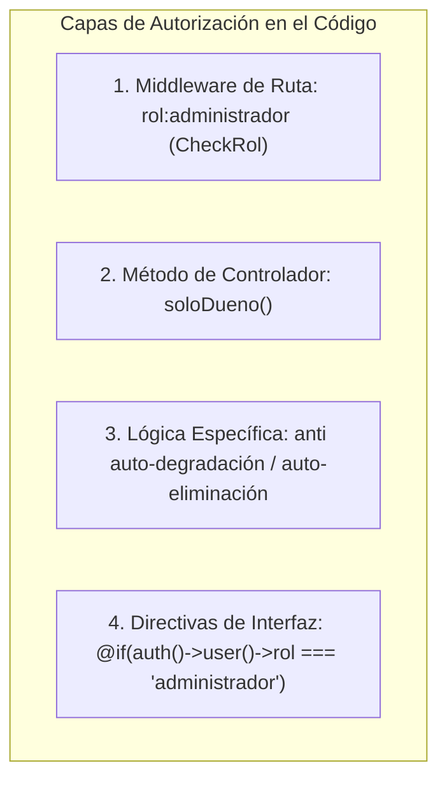

# 06 — Pruebas de Autenticación y Autorización (SISMICRO / Supermarket)

> **Documento de Seguridad, Autenticación y Control de Acceso (RBAC)**  
> **Proyecto:** Sistema Web de Ventas e Inventario para el Micromercado SuperMarket  
> **Ámbito:** Proyecto de Grado / Titulación Académica  
> **Fecha de Emisión:** Septiembre 2026  
> **Versión:** 1.0  
> **Fuente de Verdad:** Repositorio real (`routes/web.php`, `LoginController.php`, `CheckRol.php`, `Controller.php`, `User.php`, `config/auth.php`)  
> **Estado del Análisis:** VERIFICADO (inspección directa del código fuente y flujo de peticiones)  
> **Estado de las Pruebas:** PENDIENTE DE EJECUCIÓN (casos especificados sin resultados ejecutados ni PASS/FAIL anticipados)  

---

## 1. Arquitectura Real de Autenticación y Autorización

### 1.1. Configuración de Guards y Providers (`config/auth.php`)
- **Guard por Defecto:** `web` con driver de almacenamiento en sesión (`session`).
- **User Provider:** `users` con driver Eloquent apuntando al modelo `App\Models\User::class`.
- **Password Broker:** `users` utilizando la tabla `password_reset_tokens` con caducidad de 60 minutos y throttle de 60 segundos.
- **Password Timeout:** 10,800 segundos (3 horas) para re-confirmación de contraseña.

### 1.2. Almacenamiento Criptográfico de Credenciales
- **Algoritmo:** `bcrypt` con costo de trabajo 12 (`BCRYPT_ROUNDS=12` en `.env.example`).
- **Implementación:** `Illuminate\Support\Facades\Hash::make()` en `UsuarioController` y `DatabaseSeeder`; cast `'password' => 'hashed'` en `User.php`.
- **Ocultamiento:** El campo `password` y `remember_token` están declarados en `$hidden` en el modelo `User`, impidiendo su fuga accidental en serializaciones JSON.

### 1.3. Roles y Modelo de Autorización (RBAC)
El sistema opera con dos roles mutuamente excluyentes almacenados en la columna `users.rol` (tipo `string`, valor por defecto `'invitado'`):
1. **`administrador`:** Privilegios absolutos de administración, modificación de catálogo, reportes contables, auditoría y control de usuarios.
2. **`invitado`:** Privilegios de solo lectura sobre catálogo, proveedores y clientes; capacidad operativa de caja en punto de venta (`/pedidos/create` y `POST /pedidos`); descarga de códigos QR/barras y exportación de productos. Prohibición estricta sobre operaciones destructivas, modificaciones y reportes.



### 1.4. Inspección de Policies y Gates
- **Hallazgo Verificado:** En el proyecto **NO** existen clases de políticas en `app/Policies` ni definiciones de `Gate::define()` en `app/Providers/AppServiceProvider.php`.
- **Mecanismo Real Utilizado:** La autorización se implementa mediante tres capas secuenciales:
  1. **Middleware de Ruta:** `App\Http\Middleware\CheckRol` asignado con el alias `'rol'` en `bootstrap/app.php`.
  2. **Método Protegido en Base Controller:** `App\Http\Controllers\Controller::soloDueno()`, el cual evalúa `if (strtolower(auth()->user()->rol) !== 'administrador') abort(403);`.
  3. **Directivas Condicionales en Blade:** Ocultamiento de botones de acción en vistas según el rol (`@if(auth()->user()->rol === 'administrador')`).
  4. **Helpers en Modelo `User`:** `esAdmin(): bool` y `esInvitado(): bool` disponibles para evaluación booleana.

---

## 2. Mapa Completo de Rutas y Matriz RBAC Verificada

A continuación se detalla la accesibilidad y los códigos HTTP esperados para cada endpoint del sistema:

| Endpoint / Verbo HTTP | Nombre de Ruta | Middleware Aplicado | Acceso Administrador | Acceso Invitado | No Autenticado |
| :--- | :--- | :--- | :---: | :---: | :---: |
| `GET /` | `home` | Público | 302 a `/dashboard` | 302 a `/dashboard` | 302 a `/login` |
| `GET /login` | `login` | Público | 200 (Form Login) | 200 (Form Login) | 200 (Form Login) |
| `POST /login` | N/A | Público | 302 a `/dashboard` | 302 a `/dashboard` | 302 con error |
| `POST /logout` | `logout` | `auth` | 302 a `/login` | 302 a `/login` | 302 a `/login` |
| `GET /dashboard` | `dashboard` | `auth` | 200 OK | 200 OK | 302 a `/login` |
| `GET /categorias` | `categorias.index` | `auth` | 200 OK | 200 OK | 302 a `/login` |
| `GET /categorias/create` | `categorias.create` | `auth, rol:administrador` | 200 OK | **403 Forbidden** | 302 a `/login` |
| `POST /categorias` | `categorias.store` | `auth, rol:administrador` | 302 a index | **403 Forbidden** | 302 a `/login` |
| `GET /categorias/{id}/edit` | `categorias.edit` | `auth, rol:administrador` | 200 OK | **403 Forbidden** | 302 a `/login` |
| `PUT /categorias/{id}` | `categorias.update` | `auth, rol:administrador` | 302 a index | **403 Forbidden** | 302 a `/login` |
| `DELETE /categorias/{id}` | `categorias.destroy` | `auth, rol:administrador` | 302 a index | **403 Forbidden** | 302 a `/login` |
| `GET /proveedores` | `proveedores.index` | `auth` | 200 OK | 200 OK | 302 a `/login` |
| `GET /proveedores/create` | `proveedores.create` | `auth, rol:administrador` + `soloDueno` | 200 OK | **403 Forbidden** | 302 a `/login` |
| `POST /proveedores` | `proveedores.store` | `auth, rol:administrador` + `soloDueno` | 302 a index | **403 Forbidden** | 302 a `/login` |
| `GET /proveedores/{id}/edit` | `proveedores.edit` | `auth, rol:administrador` + `soloDueno` | 200 OK | **403 Forbidden** | 302 a `/login` |
| `PUT /proveedores/{id}` | `proveedores.update` | `auth, rol:administrador` + `soloDueno` | 302 a index | **403 Forbidden** | 302 a `/login` |
| `DELETE /proveedores/{id}` | `proveedores.destroy`| `auth, rol:administrador` + `soloDueno` | 302 a index | **403 Forbidden** | 302 a `/login` |
| `GET /productos` | `productos.index` | `auth` | 200 OK | 200 OK | 302 a `/login` |
| `GET /productos-pdf` | `productos.pdf` | `auth` | 200 Descarga | 200 Descarga | 302 a `/login` |
| `GET /productos-excel` | `productos.excel` | `auth` | 200 Descarga | 200 Descarga | 302 a `/login` |
| `GET /productos/{id}/qr` | `productos.qr` | `auth` | 200 Descarga | 200 Descarga | 302 a `/login` |
| `GET /productos/{id}/barcode`| `productos.barcode` | `auth` | 200 Descarga | 200 Descarga | 302 a `/login` |
| `GET /productos/create` | `productos.create` | `auth, rol:administrador` + `soloDueno` | 200 OK | **403 Forbidden** | 302 a `/login` |
| `POST /productos` | `productos.store` | `auth, rol:administrador` + `soloDueno` | 302 a index | **403 Forbidden** | 302 a `/login` |
| `GET /productos/{id}/edit` | `productos.edit` | `auth, rol:administrador` + `soloDueno` | 200 OK | **403 Forbidden** | 302 a `/login` |
| `PUT /productos/{id}` | `productos.update` | `auth, rol:administrador` + `soloDueno` | 302 a index | **403 Forbidden** | 302 a `/login` |
| `DELETE /productos/{id}` | `productos.destroy` | `auth, rol:administrador` + `soloDueno` | 302 a index | **403 Forbidden** | 302 a `/login` |
| `GET /productos/papelera` | `productos.papelera`| `auth, rol:administrador` + `soloDueno` | 200 OK | **403 Forbidden** | 302 a `/login` |
| `PUT /productos/{id}/restore`| `productos.restore` | `auth, rol:administrador` + `soloDueno` | 302 a papelera | **403 Forbidden** | 302 a `/login` |
| `DELETE /productos/{id}/force-delete`| `productos.forceDelete`| `auth, rol:administrador` + `soloDueno` | 302 a papelera | **403 Forbidden** | 302 a `/login` |
| `GET /clientes` | `clientes.index` | `auth` | 200 OK | 200 OK | 302 a `/login` |
| `GET /clientes/create` | `clientes.create` | `auth, rol:administrador` | 200 OK | **403 Forbidden** | 302 a `/login` |
| `POST /clientes` | `clientes.store` | `auth, rol:administrador` | 302 a index | **403 Forbidden** | 302 a `/login` |
| `GET /clientes/{id}/edit` | `clientes.edit` | `auth, rol:administrador` | 200 OK | **403 Forbidden** | 302 a `/login` |
| `PUT /clientes/{id}` | `clientes.update` | `auth, rol:administrador` | 302 a index | **403 Forbidden** | 302 a `/login` |
| `DELETE /clientes/{id}` | `clientes.destroy` | `auth, rol:administrador` | 302 a index | **403 Forbidden** | 302 a `/login` |
| `GET /pedidos` | `pedidos.index` | `auth` | 200 OK | 200 OK | 302 a `/login` |
| `GET /pedidos/create` | `pedidos.create` | `auth` | 200 OK | **200 OK (Permitido)**| 302 a `/login` |
| `POST /pedidos` | `pedidos.store` | `auth` | 302 a index | **302 a index (Permitido)**| 302 a `/login` |
| `GET /pedidos/{id}/edit` | `pedidos.edit` | `auth, rol:administrador` | 200 OK | **403 Forbidden** | 302 a `/login` |
| `PUT /pedidos/{id}` | `pedidos.update` | `auth, rol:administrador` | 302 a index | **403 Forbidden** | 302 a `/login` |
| `DELETE /pedidos/{id}` | `pedidos.destroy` | `auth, rol:administrador` | 302 a index | **403 Forbidden** | 302 a `/login` |
| `GET /reportes/ventas` | `reportes.ventas` | `auth, rol:administrador` | 200 OK | **403 Forbidden** *(UI desalineada)* | 302 a `/login` |
| `GET /reportes/ventas/pdf` | `reportes.ventas.pdf` | `auth, rol:administrador` | 200 Descarga | **403 Forbidden** | 302 a `/login` |
| `GET /reportes/ventas/excel` | `reportes.ventas.excel`| `auth, rol:administrador`| 200 Descarga | **403 Forbidden** | 302 a `/login` |
| `RESOURCE /usuarios` | `usuarios.*` | `auth, rol:administrador` + `soloDueno` | 200 / 302 | **403 Forbidden** | 302 a `/login` |

---

## 3. Mecanismos de Seguridad y Resiliencia Verificados

1. **Defensa contra Ataques de Fuerza Bruta (Throttling):**
   - Utiliza el trait `Illuminate\Foundation\Auth\ThrottlesLogins`.
   - Clave de bloqueo: `mb_strtolower($request->input('email')) . '|' . $request->ip()`.
   - Umbral: Máximo 5 intentos fallidos (`maxAttempts = 5`).
   - Penalización: Bloqueo de 2 minutos (`decayMinutes = 2`).
2. **Protección de Sesión y CSRF:**
   - En login exitoso: `$request->session()->regenerate()` (mitiga Session Fixation).
   - En logout: `Auth::logout()`, `$request->session()->invalidate()` y `$request->session()->regenerateToken()` (mitiga CSRF y reutilización de sesión).
   - Verificación CSRF en todas las peticiones POST/PUT/DELETE mediante token inyectado en plantillas.
3. **Protección de la Integridad de la Cuenta Administradora:**
   - **Anti Auto-Degradación (`UsuarioController:L124`):** Un administrador no puede cambiar su propio rol a invitado para evitar bloquearse a sí mismo el acceso al panel.
   - **Anti Auto-Eliminación (`UsuarioController:L172`):** Un administrador no puede borrar su propio usuario del sistema.

---

## 4. Casos de Prueba de Autenticación y Autorización (CP-AUTH-001 a CP-AUTH-040)

A continuación se especifican los casos de prueba con sus datos, precondiciones y resultados esperados. Todos permanecen con **Resultado Obtenido vacío** y **Estado PENDIENTE**:

| ID Caso | Módulo | Requisito | Tipo de Prueba | Nombre del Escenario | Prioridad | Estado |
| :--- | :--- | :---: | :---: | :--- | :---: | :---: |
| **CP-AUTH-001** | Autenticación | RF-001 | Positivo | Login correcto con credenciales de Administrador | Alta | PENDIENTE |
| **CP-AUTH-002** | Autenticación | RF-001 | Positivo | Login correcto con credenciales de Invitado | Alta | PENDIENTE |
| **CP-AUTH-003** | Autenticación | RF-002 | Negativo | Login fallido por contraseña errónea en cuenta válida | Alta | PENDIENTE |
| **CP-AUTH-004** | Autenticación | RF-002 | Negativo | Login fallido con dirección de correo no registrada | Alta | PENDIENTE |
| **CP-AUTH-005** | Autenticación | RF-003 | Obligatorio | Envío de formulario de login con campos 'email' y 'password' vacíos | Media | PENDIENTE |
| **CP-AUTH-006** | Autenticación | RF-003 | Inválido | Envío de login con sintaxis de correo no válida | Media | PENDIENTE |
| **CP-AUTH-007** | Autenticación | RF-004 | Seguridad / Límite| Activación del bloqueo temporal al alcanzar 5 intentos fallidos | Alta | PENDIENTE |
| **CP-AUTH-008** | Autenticación | RF-004 | Seguridad | Rechazo de login correcto durante el periodo de bloqueo de 120 seg | Alta | PENDIENTE |
| **CP-AUTH-009** | Autenticación | RF-004 | Seguridad | Desbloqueo y login exitoso una vez transcurrido el tiempo de penalización | Alta | PENDIENTE |
| **CP-AUTH-010** | Autenticación | RF-005 | Positivo | Emisión de cookie de persistencia con checkbox 'remember' | Media | PENDIENTE |
| **CP-AUTH-011** | Autenticación | RF-006 | Seguridad | Cierre de sesión exitoso con destrucción de sesión activa | Alta | PENDIENTE |
| **CP-AUTH-012** | Autenticación | RF-006 | Seguridad | Regeneración de token CSRF tras ejecutar logout | Alta | PENDIENTE |
| **CP-AUTH-013** | Autenticación | RF-007 | Navegación | Redirección de GET / hacia /dashboard cuando el usuario está logueado | Media | PENDIENTE |
| **CP-AUTH-014** | Autenticación | RF-007 | Navegación | Redirección de GET / hacia /login cuando el usuario no tiene sesión | Media | PENDIENTE |
| **CP-AUTH-015** | Control Acceso | RF-009 | Seguridad | Acceso a URL protegida (/dashboard) sin autenticación previa | Alta | PENDIENTE |
| **CP-AUTH-016** | Control Acceso | RF-009 | Seguridad | Acceso a ruta administrativa (/usuarios) sin autenticación previa | Alta | PENDIENTE |
| **CP-AUTH-017** | Control Acceso | RF-009 | Seguridad | Intento de acceso a rutas protegidas utilizando el botón 'Atrás' tras logout | Alta | PENDIENTE |
| **CP-AUTH-018** | Control Acceso | RF-010 | RBAC / Negativo | Invitado intenta acceder a GET /categorias/create | Alta | PENDIENTE |
| **CP-AUTH-019** | Control Acceso | RF-010 | RBAC / Negativo | Invitado intenta enviar POST /categorias | Alta | PENDIENTE |
| **CP-AUTH-020** | Control Acceso | RF-010 | RBAC / Negativo | Invitado intenta acceder a GET /proveedores/create | Alta | PENDIENTE |
| **CP-AUTH-021** | Control Acceso | RF-010 | RBAC / Negativo | Invitado intenta acceder a GET /productos/create | Alta | PENDIENTE |
| **CP-AUTH-022** | Control Acceso | RF-010 | RBAC / Negativo | Invitado intenta enviar DELETE /productos/{id} | Alta | PENDIENTE |
| **CP-AUTH-023** | Control Acceso | RF-010 | RBAC / Negativo | Invitado intenta acceder a GET /productos/papelera | Alta | PENDIENTE |
| **CP-AUTH-024** | Control Acceso | RF-010 | RBAC / Negativo | Invitado intenta enviar PUT /productos/{id}/restore | Alta | PENDIENTE |
| **CP-AUTH-025** | Control Acceso | RF-010 | RBAC / Negativo | Invitado intenta enviar DELETE /productos/{id}/force-delete | Alta | PENDIENTE |
| **CP-AUTH-026** | Control Acceso | RF-010 | RBAC / Negativo | Invitado intenta acceder a GET /clientes/create | Alta | PENDIENTE |
| **CP-AUTH-027** | Control Acceso | RF-011 | RBAC / Positivo | Invitado accede a GET /pedidos/create y visualiza el formulario de venta | Alta | PENDIENTE |
| **CP-AUTH-028** | Control Acceso | RF-011 | RBAC / Positivo | Invitado envía POST /pedidos y registra venta exitosa en el sistema | Alta | PENDIENTE |
| **CP-AUTH-029** | Control Acceso | RF-012 | RBAC / Negativo | Invitado intenta acceder a GET /pedidos/{id}/edit | Alta | PENDIENTE |
| **CP-AUTH-030** | Control Acceso | RF-012 | RBAC / Negativo | Invitado intenta enviar PUT /pedidos/{id} para anular pedido | Alta | PENDIENTE |
| **CP-AUTH-031** | Control Acceso | RF-012 | RBAC / Negativo | Invitado intenta enviar DELETE /pedidos/{id} | Alta | PENDIENTE |
| **CP-AUTH-032** | Control Acceso | RF-012 | RBAC / Negativo | Invitado intenta acceder a GET /reportes/ventas | Alta | PENDIENTE |
| **CP-AUTH-033** | Control Acceso | RF-012 | RBAC / Negativo | Invitado intenta descargar GET /reportes/ventas/pdf | Alta | PENDIENTE |
| **CP-AUTH-034** | Control Acceso | RF-012 | RBAC / Negativo | Invitado intenta acceder a GET /usuarios | Alta | PENDIENTE |
| **CP-AUTH-035** | Control Acceso | RF-011 | RBAC / Positivo | Invitado descarga código QR de producto (/productos/{id}/qr) | Media | PENDIENTE |
| **CP-AUTH-036** | Control Acceso | RF-011 | RBAC / Positivo | Invitado descarga código de barras (/productos/{id}/barcode) | Media | PENDIENTE |
| **CP-AUTH-037** | Control Acceso | RF-011 | RBAC / Positivo | Invitado descarga exportaciones de productos (PDF y Excel) | Media | PENDIENTE |
| **CP-AUTH-038** | Seguridad Crítica | RF-069 | Regla de Cuenta | Administrador intenta cambiar su propio rol a invitado vía PUT | Alta | PENDIENTE |
| **CP-AUTH-039** | Seguridad Crítica | RF-070 | Regla de Cuenta | Administrador intenta eliminar su propia cuenta de usuario vía DELETE | Alta | PENDIENTE |
| **CP-AUTH-040** | Sesión | RNF-003 | Seguridad | Regeneración de session ID al pasar de estado guest a autenticado | Alta | PENDIENTE |

---

## 5. Especificación Pormenorizada de Escenarios Críticos

```
CASO DE PRUEBA: CP-AUTH-007
Requisito: RF-004 / RNF-002
Módulo: Autenticación
Nombre: Activación del bloqueo temporal al alcanzar 5 intentos fallidos (Throttling)
Objetivo: Verificar que el método hasTooManyLoginAttempts active la protección por fuerza bruta.
Prioridad: Alta
Precondiciones: Throttler en cero para la IP de prueba.
Datos de Prueba: email: "dueno@supermarket.com", passwords erróneas ("bad1", "bad2", "bad3", "bad4", "bad5").
Pasos de Ejecución:
  1. Enviar 5 peticiones POST consecutivas a /login con contraseñas inválidas.
  2. Enviar una 6ta petición POST con cualquier dato.
Resultado Esperado: La 6ta petición es interceptada con HTTP 302 hacia /login, sin consultar la base de datos, mostrando el error: "Demasiados intentos de inicio de sesión. Por favor, inténtelo de nuevo en 120 segundos.".
Resultado Obtenido: 
Estado: PENDIENTE
Evidencia: Aserción assertSessionHasErrors('email') con mensaje coincidente.
Observaciones: Comprueba LoginController::maxAttempts() y decayMinutes().
```

```
CASO DE PRUEBA: CP-AUTH-017
Requisito: RF-006 / RF-009
Módulo: Autenticación / Sesión
Nombre: Intento de acceso a rutas protegidas utilizando el botón 'Atrás' tras logout
Objetivo: Garantizar que la sesión previa quede invalidada e impida navegar a páginas protegidas tras desautenticarse.
Prioridad: Alta
Precondiciones: Usuario autenticado navega a /dashboard y posteriormente ejecuta POST /logout.
Datos de Prueba: GET /dashboard posterior al logout.
Pasos de Ejecución:
  1. Iniciar sesión en el sistema.
  2. Navegar a /dashboard (recibe HTTP 200).
  3. Ejecutar POST /logout (redirige a /login).
  4. Intentar acceder nuevamente a GET /dashboard con las cabeceras previas.
Resultado Esperado: El sistema responde con HTTP 302 redirigiendo a /login; la sesión anterior no es reconocida.
Resultado Obtenido: 
Estado: PENDIENTE
Evidencia: assertRedirect(route('login')) tras invalidación de sesión.
Observaciones: Valida $request->session()->invalidate() en LoginController:L77.
```

```
CASO DE PRUEBA: CP-AUTH-027
Requisito: RF-011 / RF-050
Módulo: Seguridad / RBAC
Nombre: Invitado accede a crear pedido y registra venta en el punto de venta
Objetivo: Confirmar que el rol 'invitado' tiene permiso de negocio para atender ventas y emitir pedidos.
Prioridad: Alta
Precondiciones: Usuario 'invitado' autenticado ('empleado@supermarket.com'); cliente y producto disponibles.
Datos de Prueba: GET /pedidos/create y POST /pedidos con items válidos.
Pasos de Ejecución:
  1. Autenticar como 'invitado'.
  2. Solicitar GET /pedidos/create.
  3. Enviar POST /pedidos con idCliente: 1 y producto con stock disponible.
Resultado Esperado: GET /pedidos/create responde con HTTP 200 OK. POST /pedidos responde con HTTP 302 hacia /pedidos con mensaje de éxito. El pedido queda registrado con idUsuario del empleado.
Resultado Obtenido: 
Estado: PENDIENTE
Evidencia: Verificado en suite de tests tests/Feature/PedidoInvitadoYDescargasTest.php.
Observaciones: Decisión de diseño: el invitado actúa como cajero de ventas.
```

```
CASO DE PRUEBA: CP-AUTH-030
Requisito: RF-012 / RF-054
Módulo: Seguridad / RBAC
Nombre: Invitado intenta anular un pedido registrado vía PUT /pedidos/{id}
Objetivo: Impedir que un cajero/invitado anule ventas sin la debida autorización de un administrador.
Prioridad: Alta
Precondiciones: Pedido existente con ID 5 en estado 'completado'; usuario 'invitado' autenticado.
Datos de Prueba: PUT /pedidos/5 con estado: 'anulado'.
Pasos de Ejecución:
  1. Autenticar como 'invitado'.
  2. Enviar petición PUT a /pedidos/5 intentando cambiar el estado a 'anulado'.
Resultado Esperado: La petición es interceptada por el middleware 'rol:administrador' y rechazada con código HTTP 403 Forbidden. El pedido mantiene su estado 'completado' y el inventario no se altera.
Resultado Obtenido: 
Estado: PENDIENTE
Evidencia: assertForbidden() y comprobación de persistencia del estado en tabla pedidos.
Observaciones: Rutas edit y update reservadas exclusivamente para administradores.
```

```
CASO DE PRUEBA: CP-AUTH-038
Requisito: RF-069
Módulo: Seguridad Crítica / Usuarios
Nombre: Administrador intenta auto-degradar su propio rol a invitado
Objetivo: Prevenir que el administrador activo pierda acceso irrevocable al panel por error o manipulación.
Prioridad: Alta
Precondiciones: Usuario administrador autenticado con ID 1.
Datos de Prueba: PUT /usuarios/1 con name: "Dueño", email: "dueno@supermarket.com", rol: "invitado".
Pasos de Ejecución:
  1. Estando autenticado con el usuario ID 1, enviar PUT a /usuarios/1 enviando rol = 'invitado'.
Resultado Esperado: La operación es cancelada por el controlador, el rol permanece como 'administrador' y se redirige con mensaje de error: "No puedes cambiar tu propio rol. Pide a otro administrador que lo realice.".
Resultado Obtenido: 
Estado: PENDIENTE
Evidencia: assertDatabaseHas('users', ['id' => 1, 'rol' => 'administrador']) y aserción de error en sesión.
Observaciones: Regla de integridad en UsuarioController:L124-128.
```

```
CASO DE PRUEBA: CP-AUTH-039
Requisito: RF-070
Módulo: Seguridad Crítica / Usuarios
Nombre: Administrador intenta eliminar su propia cuenta de usuario
Objetivo: Impedir el suicidio de cuenta que dejaría el sistema sin administradores activos.
Prioridad: Alta
Precondiciones: Administrador autenticado con ID 1.
Datos de Prueba: DELETE /usuarios/1.
Pasos de Ejecución:
  1. Autenticado como usuario ID 1, emitir DELETE a /usuarios/1.
Resultado Esperado: La petición es bloqueada, el usuario no se elimina de la base de datos y se retorna error: "No puedes eliminar tu propio usuario.".
Resultado Obtenido: 
Estado: PENDIENTE
Evidencia: assertDatabaseHas('users', ['id' => 1]) y comprobación de error flash.
Observaciones: Regla en UsuarioController:L172-177.
```

---

## 6. Análisis de Hallazgos y Puntos que Requieren Verificación

1. **Discrepancia en Menú Lateral vs. Backend (Reportes):**
   - *Hallazgo en Código:* En `resources/views/layouts/app.blade.php` (línea 2693), el botón "Reportes" (`route('reportes.ventas')`) no está envuelto en la directiva `@if(strtolower(auth()->user()->rol) === 'administrador')`, por lo que es visible para el rol invitado. Sin embargo, al pulsar el enlace, la ruta ejecuta el middleware `rol:administrador` y genera un error **403 Forbidden**.
   - *Clasificación:* `REQUIERE VERIFICACIÓN` (Inconsistencia de interfaz frente a la política de seguridad).
2. **Defensa en Doble Capa en Controladores Administrativos:**
   - *Hallazgo:* Los controladores `ProductoController`, `ProveedorController` y `UsuarioController` combinan el middleware de ruta `rol:administrador` con una llamada interna `$this->soloDueno()`. Esta redundancia es positiva porque protege el endpoint incluso si en el futuro se altera el archivo `routes/web.php`.
   - *Clasificación:* `VERIFICADO`.
3. **Ausencia de Políticas (Policies) Centralizadas:**
   - *Hallazgo:* No se emplean Policies de Laravel (`Gate::authorize`). La seguridad se concentra en el middleware `CheckRol` y en validaciones manuales.
   - *Clasificación:* `VERIFICADO` (Patrón arquitectónico implementado en el repositorio).

---

## 7. Conclusiones del Documento

- **Cobertura de Casos de Seguridad:** 40 casos de prueba (`CP-AUTH-001` a `CP-AUTH-040`) cubren integralmente el flujo de autenticación, Throttling, RBAC y operaciones críticas.
- **Trazabilidad:** Cada caso está vinculado a los requisitos `RF-001` a `RF-013`, `RF-069`, `RF-070` y `RNF-001` a `RNF-003`.
- **Estado:** Todos los casos están en estado `PENDIENTE` y con resultado obtenido vacío, cumpliendo con la directiva de no adelantar ejecuciones antes de la fase de pruebas formales.
