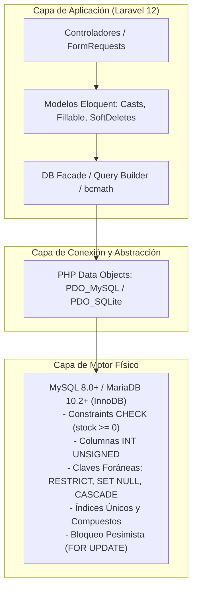
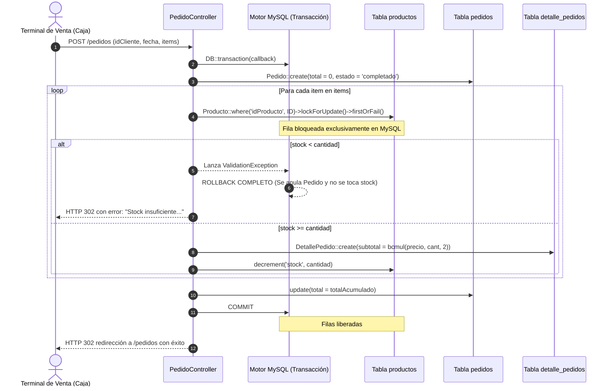

# 07 — Pruebas de Persistencia, Modelo Relacional y Base de Datos (SISMICRO / Supermarket)

> **Documento de Auditoría y Especificación de Pruebas de Base de Datos y Persistencia**  
> **Proyecto:** Sistema Web de Ventas e Inventario para el Micromercado SuperMarket  
> **Ámbito:** Proyecto de Grado / Titulación Académica  
> **Fecha de Emisión:** Septiembre 2026  
> **Versión:** 1.0  
> **Fuente de Verdad:** Repositorio real (`database/migrations/`, `database/schema_supermarket_completo.sql`, `app/Models/`, `app/Http/Controllers/`, `config/database.php`, `.env.example`, `phpunit.xml`)  
> **Estado del Análisis:** VERIFICADO (mapeo directo del esquema físico de tablas, claves, índices, modelos Eloquent y controladores)  
> **Estado de las Pruebas:** PENDIENTE DE EJECUCIÓN (especificación formal de casos de prueba sin resultados ejecutados ni dictámenes PASS/FAIL inventados)  

---

## 1. Arquitectura de Persistencia y Motor de Base de Datos

### 1.1. Configuración de Entornos y Motores Compatibles (`config/database.php` y `.env.example`)
El sistema interactúa con el motor de base de datos a través de la capa de abstracción PDO y el ORM Eloquent de Laravel 12.0:

| Parámetro | Configuración de Producción / Staging | Configuración de Testing Automatizado | Evidencia en Repositorio |
| :--- | :--- | :--- | :--- |
| **Driver de Conexión** | `mysql` / `mariadb` | `sqlite` | `config/database.php`, `phpunit.xml` |
| **Versión de Motor Mínima** | MySQL 8.0.16+ / MariaDB 10.2.1+ | SQLite 3.35.0+ | `docs/BASE_DE_DATOS.md`, `.env.example` |
| **Nombre de Base de Datos** | `supermarket` | `:memory:` (en memoria RAM) | `.env.example`, `phpunit.xml` |
| **Motor de Almacenamiento** | `InnoDB` (soporte transaccional ACID) | N/A (formato B-Tree SQLite) | `schema_supermarket_completo.sql` |
| **Juego de Caracteres** | `utf8mb4` | `UTF-8` | `config/database.php` (L56) |
| **Collation** | `utf8mb4_unicode_ci` | `BINARY` | `config/database.php` (L57) |
| **Modo Estricto (`strict`)** | `true` (`STRICT_TRANS_TABLES`, `ERROR_FOR_DIVISION_BY_ZERO`, `NO_ZERO_DATE`) | N/A | `config/database.php` (L60) |
| **Integridad Referencial** | Nativa en InnoDB (`FOREIGN KEY`) | Activada vía `foreign_key_constraints => true` | `config/database.php` (L40) |



---

## 2. Mapeo Objeto-Relacional Exhaustivo (Eloquent ORM vs Esquema Físico)

A partir de la inspección de los modelos en `app/Models/` y las migraciones en `database/migrations/`:

| Tabla Física | Modelo Eloquent | Clave Primaria (PK) | Estrategia Borrado | Atributos Asignables (`$fillable`) | Atributos Ocultos (`$hidden`) | Conversión de Tipos (`$casts`) | Relaciones Declaradas en el Modelo |
| :--- | :--- | :--- | :---: | :--- | :--- | :--- | :--- |
| `users` | `App\Models\User` | `id` (BigInt Unsigned, AI) | Físico (Hard Delete) | `name`, `email`, `password`, `rol`, `foto` | `password`, `remember_token` | `email_verified_at => datetime`, `password => hashed` | Sin relación inversa directa hacia pedidos (declarada en `Pedido`) |
| `categorias` | `App\Models\Categoria` | `idCategoria` (BigInt Unsigned, AI) | Lógico (`SoftDeletes`) | `nombre`, `descripcion` | Ninguno | `deleted_at => datetime` | `hasMany(Producto::class, 'idCategoria', 'idCategoria')` |
| `proveedores` | `App\Models\Proveedor` | `idProveedor` (BigInt Unsigned, AI) | Lógico (`SoftDeletes`) | `nombre`, `nit`, `telefono`, `email`, `direccion`, `activo` | Ninguno | `deleted_at => datetime`, `activo => boolean` | `hasMany(Producto::class, 'idProveedor', 'idProveedor')` |
| `productos` | `App\Models\Producto` | `idProducto` (BigInt Unsigned, AI) | Lógico (`SoftDeletes`) + Papelera (`forceDelete`) | `nombre`, `precio`, `stock`, `imagen`, `idCategoria`, `idProveedor` | Ninguno | `deleted_at => datetime`, `precio => decimal:2` | `belongsTo(Categoria, 'idCategoria')`, `belongsTo(Proveedor, 'idProveedor')`, `hasMany(DetallePedido, 'idProducto')` |
| `clientes` | `App\Models\Cliente` | `idCliente` (BigInt Unsigned, AI) | Lógico (`SoftDeletes`) | `nombre`, `email`, `telefono`, `direccion` | Ninguno | `deleted_at => datetime` | `hasMany(Pedido::class, 'idCliente', 'idCliente')` |
| `pedidos` | `App\Models\Pedido` | `idPedido` (BigInt Unsigned, AI) | Lógico (`SoftDeletes`) | `idCliente`, `idUsuario`, `total`, `estado`, `fecha` | Ninguno | `deleted_at => datetime`, `total => decimal:2`, `fecha => date` | `belongsTo(Cliente, 'idCliente')`, `belongsTo(User, 'idUsuario')`, `hasMany(DetallePedido, 'idPedido')` |
| `detalle_pedidos` | `App\Models\DetallePedido` | `idDetalle` (BigInt Unsigned, AI) | Físico / Cascada | `idPedido`, `idProducto`, `cantidad`, `precio_unitario`, `subtotal` | Ninguno | `precio_unitario => decimal:2`, `subtotal => decimal:2` | `belongsTo(Pedido, 'idPedido')`, `belongsTo(Producto, 'idProducto')` |

---

## 3. Matriz de Integridad Referencial y Reglas de Claves Foráneas (FK)

Cada clave foránea fue revisada tanto en su migración original como en la migración de consolidación `2026_07_30_070000_fix_database_consistency.php` y el script oficial `database/schema_supermarket_completo.sql`:

| Tabla Origen (FK) | Columna FK | Tabla Destino (PK) | Regla `ON DELETE` | Regla `ON UPDATE` | Razón de Dominio / Negocio | Doble Capa: Control Aplicación vs Motor |
| :--- | :--- | :--- | :---: | :---: | :--- | :--- |
| `productos` | `idCategoria` | `categorias(idCategoria)` | **`RESTRICT`** | `CASCADE` | Un producto no puede existir sin su categoría clasificatoria. No se permite eliminar una categoría con productos asignados. | **App:** `CategoriaController::destroy` comprueba `$categoria->productos()->count() > 0`.<br>**BD:** Clave foránea rechaza con error de integridad 1451. |
| `productos` | `idProveedor` (nullable) | `proveedores(idProveedor)` | **`SET NULL`** | `CASCADE` | La relación con el proveedor es opcional. Si un proveedor desaparece a nivel relacional, los productos permanecen en el catálogo con proveedor nulo. | **App:** `ProveedorController::destroy` bloquea si hay productos vinculados (defensa adicional).<br>**BD:** Si se ejecutara forzadamente, `idProveedor` pasa a `NULL`. |
| `pedidos` | `idCliente` | `clientes(idCliente)` | **`RESTRICT`** | `CASCADE` | Nunca se debe suprimir un cliente que tenga un historial transaccional de compras (auditoría comercial y tributaria). | **App:** `ClienteController::destroy` comprueba `$cliente->pedidos()->count() > 0`.<br>**BD:** Clave foránea rechaza el borrado físico si existen compras asociadas. |
| `pedidos` | `idUsuario` (nullable) | `users(id)` | **`SET NULL`** | `CASCADE` | Si se elimina físicamente la cuenta de un empleado/cajero, sus ventas históricas no se pierden ni se anulan: permanecen registradas con `idUsuario = NULL`. | **App:** `UsuarioController::destroy` elimina la fila.<br>**BD:** Motor actualiza automáticamente las filas de `pedidos` dependientes dejando `idUsuario = NULL`. |
| `detalle_pedidos` | `idPedido` | `pedidos(idPedido)` | **`CASCADE`** | `CASCADE` | El detalle no tiene sentido sin su cabecera. Si un pedido es purgado físicamente, todas sus líneas asociadas se eliminan en cascada. | **App:** En soft delete las líneas se conservan. En hard delete el motor purga las filas hijas en `detalle_pedidos`. |
| `detalle_pedidos` | `idProducto` | `productos(idProducto)` | **`RESTRICT`** | `CASCADE` | Protege el registro histórico de ventas: es imposible borrar físicamente un producto del catálogo si figura en líneas de pedidos pasados. | **App:** `ProductoController::forceDelete` verifica `$producto->detallePedidos()->count() > 0`.<br>**BD:** Clave foránea impide la eliminación física. |

---

## 4. Restricciones de Dominio, Claves Únicas y Defensa en Profundidad

### 4.1. Restricciones de Unicidad (`UNIQUE KEY`)
- **`users.email`:** `UNIQUE KEY users_email_unique (email)`. Impide duplicidad de cuentas en el sistema.
- **`categorias.nombre`:** `UNIQUE KEY categorias_nombre_unique (nombre)` añadida en `fix_database_consistency`. Impide colisión de nombres de familias de productos.
- **`clientes.email`:** `UNIQUE KEY clientes_email_unique (email)`. Garantiza identificación unívoca por correo electrónico.
- **`productos.nombre`:** `UNIQUE KEY productos_nombre_unique (nombre)` añadida en migración `2026_09_11_054459`. Impide que dos productos compartan idéntica denominación comercial.

### 4.2. Restricciones de Chequeo (`CHECK`) y Atributos sin Signo (`UNSIGNED`)
- **`chk_productos_stock_no_negativo`:** Restricción nativa de MySQL/MariaDB (`CHECK (stock >= 0)`) aplicada en `fix_database_consistency`. Garantiza que ninguna transacción o consulta directa pueda dejar el inventario en saldo negativo.
- **`stock INT UNSIGNED NOT NULL`:** Aplicado en `productos` mediante la migración `2026_09_14_044922`. Añade una segunda barrera física a nivel de tipo de dato en MySQL.
- **`cantidad INT UNSIGNED NOT NULL`:** Aplicado en `detalle_pedidos` en la misma migración. Impide que se guarden líneas de venta con cantidades negativas.

### 4.3. Índices Secundarios de Rendimiento
- **`pedidos.fecha` (`KEY pedidos_fecha_index`):** Optimiza las búsquedas y ordenamientos cronológicos del historial y reportes.
- **`pedidos (estado, fecha)` (`KEY pedidos_estado_fecha_index`):** Añadido en migración `2026_09_13_193245`. Índice compuesto de alta selectividad que permite al optimizador de MySQL resolver consultas de ventas completadas en un rango temporal (`where estado != 'anulado' and fecha between ...`) mediante un solo recorrido de índice (*index scan*) sin filtrar fila por fila en memoria.

---

## 5. Auditoría de Consultas Críticas, Transaccionalidad y Concurrencia

### 5.1. Transaccionalidad Atómica y Bloqueo Pesimista en `PedidoController`
El sistema implementa transacciones ACID en las tres operaciones críticas sobre pedidos:



1. **`lockForUpdate()`:** Utiliza la cláusula `SELECT ... FOR UPDATE` de InnoDB sobre cada registro de producto. Bloquea la fila frente a lecturas con intención de escritura de otras transacciones concurrentes, impidiendo ventas simultáneas que sobregiren el stock.
2. **Cálculos con `bcmath`:** La multiplicación de subtotales (`bcmul($precio, $cantidad, 2)`) y la adición del total general (`bcadd($total, $subtotal, 2)`) se ejecutan con precisión binaria arbitraria en cadena de caracteres, erradicando los errores de redondeo por representación de punto flotante de PHP (`float IEEE 754`).
3. **Manejo de Reversión (Rollback):** Si cualquier producto de la lista carece de existencias suficientes, `ValidationException` provoca el aborto automático del closure de `DB::transaction()`. El motor ejecuta `ROLLBACK`, de modo que no queda creada ninguna cabecera huérfana en `pedidos` ni detalles incompletos.

### 5.2. Prevención de Problema de Consultas N+1 mediante Eager Loading
Se auditó la presencia de cargas ansiosas (*eager loading*) en las pantallas principales:
- **`PedidoController::index`:** Invoca `Pedido::with(['cliente', 'usuario', 'detalles.producto'])`. Reduce la carga de $1 + 3N$ consultas a únicamente 4 consultas SQL independientes indexadas.
- **`ProductoController::index`:** Invoca `Producto::with(['categoria', 'proveedor'])`.
- **`CategoriaController::index`:** Invoca `Categoria::with('productos')`.
- **`ProveedorController::index`:** Invoca `Proveedor::withCount('productos')` para calcular la cantidad de productos asociados mediante un subquery agregado sin cargar todas las instancias en memoria.

### 5.3. Consultas Agregadas del Dashboard (`routes/web.php`)
- **Adaptabilidad Multi-motor:** La ruta `/dashboard` detecta dinámicamente el driver de conexión:
  ```php
  $driver = DB::connection()->getDriverName();
  $mesExpr = $driver === 'sqlite' ? "strftime('%Y-%m', fecha)" : 'DATE_FORMAT(fecha,"%Y-%m")';
  $diaExpr = $driver === 'sqlite' ? "date(fecha)" : 'DATE(fecha)';
  ```
- **JOINs Crudos:** Para los rankings de mejores productos y clientes se emplean `DetallePedido::join('productos', ...)` y `Pedido::join('clientes', ...)`.

---

## 6. Especificación de Casos de Prueba de Persistencia y Base de Datos

A continuación se especifica la suite integral de pruebas para validar la interacción con MySQL/MariaDB. Ninguna prueba ha sido ejecutada previamente ni calificada con PASS/FAIL.

---

### Grupo 1: Operaciones INSERT, Generación de Claves Primarias y `$fillable`

```
CASO DE PRUEBA: CP-BD-001
Tabla / Módulo: categorias / Catálogo
Objetivo: Verificar la inserción física de un registro en 'categorias' con generación autoincremental de 'idCategoria' y marcas de tiempo 'created_at' / 'updated_at'.
Precondiciones: Tabla 'categorias' migrada en MySQL. Conexión de base de datos activa.
Datos de Prueba: ['nombre' => 'Lácteos Frescos', 'descripcion' => 'Productos derivados de la leche refrigerados']
Pasos de Ejecución:
  1. Instanciar y persistir el registro mediante Categoria::create($datos).
  2. Consultar directamente la base de datos para obtener el registro recién insertado.
  3. Verificar que 'idCategoria' sea un número entero mayor a cero.
  4. Verificar que 'created_at' y 'updated_at' contengan la marca de tiempo actual del servidor.
Resultado Esperado: El registro se inserta exitosamente en MySQL. La columna 'idCategoria' se autoincrementa. Los timestamps no son nulos y coinciden con la hora de ejecución.
Resultado Obtenido: 
Estado: PENDIENTE
Evidencia Necesaria: assertDatabaseHas('categorias', ['nombre' => 'Lácteos Frescos']) e inspección del valor de idCategoria > 0.
```

```
CASO DE PRUEBA: CP-BD-002
Tabla / Módulo: proveedores / Proveedores
Objetivo: Comprobar el valor por defecto a nivel de motor ('activo' = 1) cuando no se provee el campo explícitamente en el INSERT.
Precondiciones: Tabla 'proveedores' en estado limpio.
Datos de Prueba: ['nombre' => 'Avícola Santa Rosa', 'nit' => '99887766'] (sin pasar 'activo')
Pasos de Ejecución:
  1. Ejecutar Proveedor::create($datos) omitiendo la clave 'activo'.
  2. Recargar el modelo desde la base de datos mediante fresh().
  3. Inspeccionar el valor de la columna 'activo' tanto en el modelo como en la tabla física.
Resultado Esperado: La fila física en MySQL almacena 'activo = 1' en virtud del valor por defecto de la migración (`$table->boolean('activo')->default(true)`), y Eloquent lo castea a booleano true.
Resultado Obtenido: 
Estado: PENDIENTE
Evidencia Necesaria: assertDatabaseHas('proveedores', ['nombre' => 'Avícola Santa Rosa', 'activo' => 1]).
```

```
CASO DE PRUEBA: CP-BD-003
Tabla / Módulo: productos / Seguridad ORM
Objetivo: Demostrar que los atributos no declarados en el arreglo '$fillable' son descartados por Eloquent durante la inserción masiva.
Precondiciones: Categoría válida preexistente (idCategoria = 1).
Datos de Prueba: ['nombre' => 'Galletas Saladas', 'precio' => 4.50, 'stock' => 20, 'idCategoria' => 1, 'idProducto' => 9999, 'campo_inventado' => 'valor_hack']
Pasos de Ejecución:
  1. Enviar el arreglo asociativo al método Producto::create($datos).
  2. Verificar si el id autoincremental respeta la secuencia natural y no el valor forzado '9999'.
  3. Verificar que la columna no existente 'campo_inventado' no provoque error de sintaxis SQL al ser descartada por MassAssignmentException / Eloquent protection.
Resultado Esperado: El producto se crea con su ID correlativo natural. Los atributos no definidos en `$fillable` son completamente ignorados sin alterar el esquema ni la consulta SQL resultante.
Resultado Obtenido: 
Estado: PENDIENTE
Evidencia Necesaria: assertDatabaseMissing('productos', ['idProducto' => 9999]) y assertDatabaseHas('productos', ['nombre' => 'Galletas Saladas']).
```

```
CASO DE PRUEBA: CP-BD-004
Tabla / Módulo: users / Criptografía y Persistencia
Objetivo: Confirmar que el atributo 'password' se almacena como hash bcrypt irreversible y que se asigna el rol 'invitado' por defecto a nivel de base de datos.
Precondiciones: Conexión MySQL activa.
Datos de Prueba: ['name' => 'Operador Caja 1', 'email' => 'caja1@supermarket.com', 'password' => 'secret1234']
Pasos de Ejecución:
  1. Hashear la contraseña mediante Hash::make() y persistir User::create($datos).
  2. Consultar la fila cruda mediante DB::table('users')->where('email', 'caja1@supermarket.com')->first().
  3. Comparar el contenido de la columna 'password' contra el texto plano 'secret1234'.
  4. Comprobar el valor de la columna 'rol'.
Resultado Esperado: La columna 'password' almacena una cadena de 60 caracteres que inicia con `$2y$12$`. La función password_verify('secret1234', $hash) retorna true. La columna 'rol' almacena 'invitado'.
Resultado Obtenido: 
Estado: PENDIENTE
Evidencia Necesaria: Inspección del hash en BD y verificación mediante Hash::check('secret1234', $rawUser->password).
```

---

### Grupo 2: Operaciones SELECT, Eager Loading y Consultas Agregadas

```
CASO DE PRUEBA: CP-BD-005
Tabla / Módulo: pedidos / Rendimiento ORM
Objetivo: Demostrar que el Eager Loading con 'with()' en PedidoController::index resuelve las relaciones en un número constante de 4 consultas SQL independientes, erradicando el problema de consultas N+1.
Precondiciones: Base de datos poblada con 15 pedidos, cada uno con 2 líneas de detalle, productos, clientes y usuarios asociados. Habilitar DB::enableQueryLog().
Datos de Prueba: Petición GET a la ruta '/pedidos'.
Pasos de Ejecución:
  1. Limpiar el registro de consultas previas con DB::flushQueryLog().
  2. Ejecutar la consulta controlada: Pedido::with(['cliente', 'usuario', 'detalles.producto'])->paginate(15).
  3. Obtener el log con DB::getQueryLog() y contar el número total de sentencias ejecutadas.
Resultado Esperado: Se ejecutan exactamente 4 consultas SQL (o 5 incluyendo el count de paginación): 1 para pedidos, 1 para clientes (`WHERE idCliente IN (...)`), 1 para users (`WHERE id IN (...)`) y 1 para detalles con sus productos. No se ejecutan consultas individuales por cada fila renderizada.
Resultado Obtenido: 
Estado: PENDIENTE
Evidencia Necesaria: Conteo de sentencias en DB::getQueryLog() <= 5 y ausencia de consultas repetitivas dentro de ciclos.
```

```
CASO DE PRUEBA: CP-BD-006
Tabla / Módulo: productos / Ámbito Global SoftDeletes
Objetivo: Validar que las consultas SELECT regulares mediante el modelo Producto excluyan automáticamente los registros marcados como eliminados (`deleted_at IS NOT NULL`).
Precondiciones: Producto activo 'Arroz 1kg' y producto en papelera 'Fideos 500g' (`deleted_at` establecido en fecha pasada).
Datos de Prueba: Producto::all() y Producto::where('nombre', 'Fideos 500g')->first().
Pasos de Ejecución:
  1. Ejecutar Producto::all().
  2. Comprobar si el producto en papelera figura en la colección resultante.
  3. Ejecutar la búsqueda directa de 'Fideos 500g' sin cláusula withTrashed().
Resultado Esperado: Producto::all() no incluye 'Fideos 500g'. La búsqueda directa retorna null. La cláusula `WHERE deleted_at IS NULL` es inyectada automáticamente por el trait SoftDeletes en la sentencia SQL emitida a MySQL.
Resultado Obtenido: 
Estado: PENDIENTE
Evidencia Necesaria: assertNull(Producto::where('nombre', 'Fideos 500g')->first()) y assertNotNull(Producto::withTrashed()->where('nombre', 'Fideos 500g')->first()).
```

```
CASO DE PRUEBA: CP-BD-007
Tabla / Módulo: pedidos, detalle_pedidos, productos / Reportes Agregados
Objetivo: Verificar la consistencia de la consulta agregada de 'Top 5 Productos con mayores ingresos' en el Dashboard de ventas.
Precondiciones: Datos históricos con pedidos en estado 'completado' y al menos un pedido en estado 'anulado'.
Datos de Prueba: Consulta SQL del Dashboard (`routes/web.php` L71-80).
Pasos de Ejecución:
  1. Ejecutar la consulta agregada de productos más vendidos en el Dashboard.
  2. Verificar que las ventas provenientes de pedidos con `estado = 'anulado'` queden estrictamente excluidas de la sumatoria de ingresos y unidades.
  3. Verificar que el ordenamiento sea estrictamente descendente por la columna virtual `ingresos`.
Resultado Esperado: Los ingresos calculados coinciden exactamente con la suma de `detalle_pedidos.subtotal` de pedidos completados. Las ventas anuladas no se suman. El resultado contiene máximo 5 filas.
Resultado Obtenido: 
Estado: PENDIENTE
Evidencia Necesaria: Cotejo entre resultado de la consulta del Dashboard y cálculo manual de subtotales de pedidos completados en base de datos.
```

```
CASO DE PRUEBA: CP-BD-008
Tabla / Módulo: productos / Valuación de Inventario
Objetivo: Confirmar el cálculo correcto de la sumatoria ponderada de inventario mediante `Producto::sum(DB::raw('stock * precio'))`.
Precondiciones: 3 productos en catálogo: Prod A (stock: 10, precio: 5.00 -> 50.00), Prod B (stock: 4, precio: 12.50 -> 50.00), Prod C (stock: 0, precio: 100.00 -> 0.00).
Datos de Prueba: Ejecución de `Producto::sum(DB::raw('stock * precio'))`.
Pasos de Ejecución:
  1. Insertar los productos de prueba asegurando que sus campos stock y precio estén persistidos.
  2. Ejecutar la expresión agregada en el motor MySQL.
  3. Evaluar el valor retornado frente al total teórico esperado (100.00).
Resultado Esperado: El motor MySQL evalúa la expresión aritmética fila por fila y retorna exactamente '100.00' sin desbordamiento ni truncamiento de decimales.
Resultado Obtenido: 
Estado: PENDIENTE
Evidencia Necesaria: assertEquals(100.00, (float) Producto::sum(DB::raw('stock * precio'))).
```

---

### Grupo 3: Operaciones UPDATE, Casts y Consistencia Numérica

```
CASO DE PRUEBA: CP-BD-009
Tabla / Módulo: productos / Casts Numéricos
Objetivo: Verificar que la actualización de la columna 'precio' respete la precisión decimal (8,2) y que el cast de Eloquent `decimal:2` retorne una cadena formateada con exactamente 2 decimales.
Precondiciones: Producto preexistente con ID 1 y precio inicial 10.00.
Datos de Prueba: Actualización con precio: 19.9
Pasos de Ejecución:
  1. Ejecutar $producto->update(['precio' => 19.9]).
  2. Refrescar el modelo desde la base de datos con $producto->refresh().
  3. Consultar directamente el valor de la columna cruda en MySQL.
Resultado Esperado: En la base de datos la columna `decimal(8,2)` almacena `19.90`. En el modelo Eloquent, `$producto->precio` se evalúa como la cadena `'19.90'` gracias al cast `'precio' => 'decimal:2'`.
Resultado Obtenido: 
Estado: PENDIENTE
Evidencia Necesaria: assertSame('19.90', $producto->fresh()->precio) y assertDatabaseHas('productos', ['idProducto' => 1, 'precio' => '19.90']).
```

```
CASO DE PRUEBA: CP-BD-010
Tabla / Módulo: proveedores / Cast Booleano
Objetivo: Confirmar la persistencia y conversión de tipos del atributo 'activo' en la tabla 'proveedores'.
Precondiciones: Proveedor activo preexistente (`activo = 1`).
Datos de Prueba: Petición de actualización enviando 'activo' desmarcado (equivalente a false / 0).
Pasos de Ejecución:
  1. Ejecutar $proveedor->update(['activo' => false]).
  2. Consultar el registro crudo en MySQL mediante DB::table('proveedores').
  3. Evaluar el valor del modelo `$proveedor->fresh()->activo`.
Resultado Esperado: En MySQL la columna almacena `0` (tinyint). En el modelo Eloquent, el valor es casteado estrictamente al booleano nativo `false` (no al entero 0).
Resultado Obtenido: 
Estado: PENDIENTE
Evidencia Necesaria: assertSame(false, $proveedor->fresh()->activo) y assertDatabaseHas('proveedores', ['idProveedor' => $proveedor->idProveedor, 'activo' => 0]).
```

```
CASO DE PRUEBA: CP-BD-011
Tabla / Módulo: pedidos, detalle_pedidos, productos / Actualización Transaccional
Objetivo: Verificar que al actualizar un pedido completado a otro conjunto de productos, el stock previo se restituya íntegramente y el nuevo stock se descuente en una sola transacción atómica.
Precondiciones: Producto A (stock inicial: 10), Producto B (stock inicial: 20). Pedido completado existente con 3 unidades de Producto A (stock actual de A: 7).
Datos de Prueba: PUT /pedidos/{id} modificando el pedido para que contenga 2 unidades de Producto B en lugar de Producto A.
Pasos de Ejecución:
  1. Ejecutar la actualización a través de PedidoController::update.
  2. Comprobar el stock final de Producto A.
  3. Comprobar el stock final de Producto B.
  4. Verificar las líneas de 'detalle_pedidos' vinculadas al pedido.
Resultado Esperado: El stock de Producto A regresa a 10 (+3). El stock de Producto B disminuye a 18 (-2). Las líneas de detalle anteriores se eliminan y se crean las nuevas líneas. El total del pedido se recalcula congruentemente.
Resultado Obtenido: 
Estado: PENDIENTE
Evidencia Necesaria: assertSame(10, Producto::find($idA)->stock) y assertSame(18, Producto::find($idB)->stock).
```

---

### Grupo 4: Operaciones DELETE, Soft Deletes y Papelera de Reciclaje

```
CASO DE PRUEBA: CP-BD-012
Tabla / Módulo: categorias / Eliminación Lógica
Objetivo: Confirmar que la eliminación de una categoría sin productos hijos ejecute un UPDATE de 'deleted_at' (Soft Delete) y no un DELETE físico de la fila.
Precondiciones: Categoría huérfana 'Jardinería' (idCategoria = 99, 0 productos asignados).
Datos de Prueba: DELETE /categorias/99
Pasos de Ejecución:
  1. Ejecutar la petición de eliminación vía controlador o Categoria::find(99)->delete().
  2. Consultar directamente la tabla física 'categorias' en MySQL.
  3. Verificar el valor de la columna 'deleted_at'.
Resultado Esperado: La fila física permanece en la tabla `categorias`. La columna `deleted_at` contiene la fecha y hora de la operación. La categoría desaparece del listado `Categoria::all()` pero existe en `Categoria::withTrashed()`.
Resultado Obtenido: 
Estado: PENDIENTE
Evidencia Necesaria: assertSoftDeleted('categorias', ['idCategoria' => 99]) y conteo de filas en tabla física inalterado.
```

```
CASO DE PRUEBA: CP-BD-013
Tabla / Módulo: categorias / Restauración de Papelera
Objetivo: Validar que al intentar crear una categoría cuyo nombre ya existe en la papelera, el sistema no duplique la fila física sino que ejecute un restore() y actualice sus datos.
Precondiciones: Categoría 'Carnicería' previamente enviada a la papelera (`deleted_at IS NOT NULL`).
Datos de Prueba: POST /categorias con nombre: 'Carnicería', descripcion: 'Carnes rojas y blancas de primera calidad'.
Pasos de Ejecución:
  1. Enviar formulario de creación con el nombre duplicado en papelera.
  2. Inspeccionar el total de registros en la tabla 'categorias'.
  3. Comprobar el valor de 'deleted_at' y 'descripcion' del registro existente.
Resultado Esperado: No se crea una nueva fila (el conteo total de categorías no aumenta). La fila existente pasa a tener `deleted_at = NULL`. La columna `descripcion` se actualiza con el nuevo texto ingresado.
Resultado Obtenido: 
Estado: PENDIENTE
Evidencia Necesaria: assertDatabaseHas('categorias', ['nombre' => 'Carnicería', 'deleted_at' => null, 'descripcion' => 'Carnes rojas y blancas de primera calidad']) y count() de categorias con ese nombre == 1.
```

```
CASO DE PRUEBA: CP-BD-014
Tabla / Módulo: productos / Papelera y Restauración
Objetivo: Verificar el ciclo de vida completo de un producto en papelera: soft-delete -> consulta en papelera (`onlyTrashed`) -> restauración (`restore`).
Precondiciones: Producto activo 'Detergente Líquido 1L' (idProducto = 50).
Datos de Prueba: Ejecución de destroy() y posterior llamada a restore(50).
Pasos de Ejecución:
  1. Enviar DELETE /productos/50. Verificar soft-delete.
  2. Consultar Producto::onlyTrashed()->where('idProducto', 50)->first().
  3. Enviar PUT /productos/50/restore.
  4. Consultar Producto::find(50).
Resultado Esperado: El producto es enviado a la papelera (deleted_at establecido). Se lista correctamente en la vista de papelera. Al restaurarse, `deleted_at` vuelve a ser `NULL` y reaparece en el listado activo regular sin pérdida de datos.
Resultado Obtenido: 
Estado: PENDIENTE
Evidencia Necesaria: Transición de assertSoftDeleted a assertDatabaseHas('productos', ['idProducto' => 50, 'deleted_at' => null]).
```

```
CASO DE PRUEBA: CP-BD-015
Tabla / Módulo: pedidos / Eliminación Lógica y Stock de Pedido Anulado
Objetivo: Demostrar que al eliminar (soft delete) un pedido que ya se encontraba en estado 'anulado', NO se restituye stock al inventario, evitando la creación de "stock fantasma".
Precondiciones: Producto con stock 10. Pedido que fue completado (stock pasó a 7) y luego anulado formalmente (stock restituido a 10). Pedido mantiene estado 'anulado'.
Datos de Prueba: DELETE /pedidos/{idPedidoAnulado}
Pasos de Ejecución:
  1. Comprobar que el producto tiene stock = 10 y el pedido tiene estado = 'anulado'.
  2. Ejecutar la eliminación del pedido mediante PedidoController::destroy.
  3. Verificar el stock final del producto.
  4. Verificar el estado del pedido en la base de datos.
Resultado Esperado: El stock del producto permanece inalterado en 10 unidades (NO sube a 13). El pedido es marcado con soft delete (`deleted_at IS NOT NULL`).
Resultado Obtenido: 
Estado: PENDIENTE
Evidencia Necesaria: assertSame(10, Producto::find($idProd)->stock) y assertSoftDeleted('pedidos', ['idPedido' => $idPedido]).
```

---

### Grupo 5: Eliminación Física (Hard Delete) y Limpieza de Recursos

```
CASO DE PRUEBA: CP-BD-016
Tabla / Módulo: productos / Eliminación Permanente (ForceDelete)
Objetivo: Comprobar la eliminación física irreversible (`forceDelete`) de un producto en papelera que no cuenta con historial de ventas en 'detalle_pedidos'.
Precondiciones: Producto en papelera (idProducto = 77, sin ventas en detalle_pedidos) con archivo de imagen almacenado en el disco público.
Datos de Prueba: DELETE /productos/77/force-delete
Pasos de Ejecución:
  1. Verificar que el producto está en la papelera y no tiene detalles asociados.
  2. Ejecutar la acción forceDelete a través del controlador.
  3. Consultar la tabla física 'productos' mediante DB::table('productos')->where('idProducto', 77)->first().
  4. Comprobar la existencia del archivo de imagen en Storage::disk('public').
Resultado Esperado: La fila física desaparece completamente de la tabla MySQL (`DELETE FROM productos WHERE idProducto = 77`). La consulta cruda retorna null. El archivo de imagen físico es suprimido del almacenamiento.
Resultado Obtenido: 
Estado: PENDIENTE
Evidencia Necesaria: assertDatabaseMissing('productos', ['idProducto' => 77]) y Storage::disk('public')->assertMissing($rutaImagen).
```

```
CASO DE PRUEBA: CP-BD-017
Tabla / Módulo: users / Eliminación Física de Cuenta
Objetivo: Confirmar que la eliminación de un usuario en UsuarioController ejecuta un borrado físico de la fila en 'users' (User no implementa SoftDeletes).
Precondiciones: Usuario 'empleado2@supermarket.com' registrado en la base de datos.
Datos de Prueba: DELETE /usuarios/{id}
Pasos de Ejecución:
  1. Ejecutar UsuarioController::destroy para el usuario de prueba.
  2. Consultar directamente DB::table('users')->where('id', $id)->first().
Resultado Esperado: La fila física es purgada de la tabla `users`. No existe columna `deleted_at`. El registro no se puede recuperar con withTrashed().
Resultado Obtenido: 
Estado: PENDIENTE
Evidencia Necesaria: assertDatabaseMissing('users', ['email' => 'empleado2@supermarket.com']).
```

---

### Grupo 6: Integridad Referencial y Reglas ON DELETE (RESTRICT, SET NULL, CASCADE)

```
CASO DE PRUEBA: CP-BD-018
Tabla / Módulo: productos -> categorias / FK RESTRICT
Objetivo: Demostrar que el motor MySQL rechaza con error de violación de clave foránea cualquier intento de borrado físico directo de una categoría que contenga productos asociados.
Precondiciones: Categoría 'Bebidas' (idCategoria = 1) con 5 productos asignados. Desactivar validación de aplicación ejecutando sentencia SQL directa `DELETE FROM categorias WHERE idCategoria = 1`.
Datos de Prueba: Sentencia directa DB::statement("DELETE FROM categorias WHERE idCategoria = 1").
Pasos de Ejecución:
  1. Intentar ejecutar la supresión SQL física directa sobre la categoría padre.
  2. Capturar la excepción emitida por el driver PDO / MySQL.
Resultado Esperado: MySQL rechaza la operación arrojando PDOException con código de error MySQL 1451 (*Cannot delete or update a parent row: a foreign key constraint fails*). La fila de la categoría permanece intacta en la base de datos.
Resultado Obtenido: 
Estado: PENDIENTE
Evidencia Necesaria: Captura de QueryException con SQLSTATE[23000] y código de error 1451.
```

```
CASO DE PRUEBA: CP-BD-019
Tabla / Módulo: productos -> proveedores / FK SET NULL
Objetivo: Verificar que si un proveedor es eliminado físicamente a nivel relacional, los productos vinculados actualizan automáticamente su columna 'idProveedor' a NULL sin eliminarse.
Precondiciones: Proveedor 'Distribuidora Temporal' (idProveedor = 90). Producto 'Aceite de Girasol' vinculado a dicho proveedor (`idProveedor = 90`).
Datos de Prueba: Borrado físico directo mediante DB::table('proveedores')->where('idProveedor', 90)->delete().
Pasos de Ejecución:
  1. Ejecutar la eliminación directa del proveedor en la tabla física.
  2. Consultar el estado de la fila del producto en la tabla 'productos'.
Resultado Esperado: El producto continúa existiendo en la tabla. Su columna `idProveedor` pasa automáticamente a ser `NULL` por efecto de la regla `ON DELETE SET NULL` de la clave foránea `productos_idproveedor_foreign`.
Resultado Obtenido: 
Estado: PENDIENTE
Evidencia Necesaria: assertDatabaseHas('productos', ['nombre' => 'Aceite de Girasol', 'idProveedor' => null]).
```

```
CASO DE PRUEBA: CP-BD-020
Tabla / Módulo: pedidos -> clientes / FK RESTRICT
Objetivo: Comprobar que no es posible eliminar un cliente que posea pedidos registrados, tanto por bloqueo defensivo en el controlador como por restricción foránea en el motor MySQL.
Precondiciones: Cliente 'María Pérez' (idCliente = 1) con al menos 1 pedido registrado en la tabla 'pedidos'.
Datos de Prueba: DELETE /clientes/1 y posterior intento con DB::table('clientes')->where('idCliente', 1)->delete().
Pasos de Ejecución:
  1. Enviar petición HTTP DELETE /clientes/1 al controlador.
  2. Comprobar que el controlador rechaza la acción con mensaje de error sin tocar el registro.
  3. Ejecutar intento directo con Query Builder saltándose el controlador.
Resultado Esperado: La petición HTTP redirige con mensaje: "No se puede eliminar el cliente... porque tiene X pedido(s) asociado(s)". La ejecución SQL cruda falla por violación de FK RESTRICT (código MySQL 1451). El cliente no sufre soft delete ni hard delete.
Resultado Obtenido: 
Estado: PENDIENTE
Evidencia Necesaria: assertDatabaseHas('clientes', ['idCliente' => 1, 'deleted_at' => null]) y captura de QueryException en borrado directo.
```

```
CASO DE PRUEBA: CP-BD-021
Tabla / Módulo: pedidos -> users / FK SET NULL
Objetivo: Validar que al eliminar físicamente una cuenta de usuario en 'users', los pedidos registrados por dicho usuario conservan su integridad asignando NULL a 'idUsuario'.
Precondiciones: Usuario cajero (id = 8) que registró un pedido (idPedido = 100).
Datos de Prueba: DB::table('users')->where('id', 8)->delete().
Pasos de Ejecución:
  1. Purgar físicamente el usuario de la tabla 'users'.
  2. Consultar la fila del pedido en la tabla 'pedidos'.
  3. Verificar el valor de la columna 'idUsuario' y el total del pedido.
Resultado Esperado: El pedido #100 continúa existiendo en la base de datos con su importe y detalles intactos. La columna `idUsuario` se actualiza a `NULL` en virtud de `CONSTRAINT pedidos_idusuario_foreign ... ON DELETE SET NULL`.
Resultado Obtenido: 
Estado: PENDIENTE
Evidencia Necesaria: assertDatabaseHas('pedidos', ['idPedido' => 100, 'idUsuario' => null]).
```

```
CASO DE PRUEBA: CP-BD-022
Tabla / Módulo: detalle_pedidos -> pedidos / FK CASCADE
Objetivo: Confirmar que si un pedido es eliminado físicamente de la base de datos, todas sus líneas de detalle asociadas son purgadas automáticamente en cascada por el motor.
Precondiciones: Pedido de prueba creado directamente con 3 líneas de detalle en 'detalle_pedidos'.
Datos de Prueba: DB::table('pedidos')->where('idPedido', $idPedido)->delete().
Pasos de Ejecución:
  1. Insertar pedido demo y sus 3 líneas de detalle.
  2. Ejecutar borrado físico directo del pedido en la tabla 'pedidos'.
  3. Consultar las filas correspondientes en 'detalle_pedidos'.
Resultado Esperado: El motor MySQL elimina en cascada las 3 filas hijas de `detalle_pedidos` asociadas a dicho `idPedido` (`CONSTRAINT detalle_pedidos_idpedido_foreign ... ON DELETE CASCADE`).
Resultado Obtenido: 
Estado: PENDIENTE
Evidencia Necesaria: assertDatabaseMissing('detalle_pedidos', ['idPedido' => $idPedido]).
```

```
CASO DE PRUEBA: CP-BD-023
Tabla / Módulo: detalle_pedidos -> productos / FK RESTRICT
Objetivo: Verificar que la eliminación física (`forceDelete`) de un producto sea bloqueada si existen registros en 'detalle_pedidos' que hagan referencia a su 'idProducto'.
Precondiciones: Producto (idProducto = 10) que figura en las líneas de venta de pedidos anteriores. Producto enviado a papelera.
Datos de Prueba: Intento de forzar borrado físico mediante $producto->forceDelete() o llamada a la ruta correspondiente.
Pasos de Ejecución:
  1. Intentar ejecutar forceDelete sobre el producto con historial.
  2. Comprobar la respuesta del controlador y la persistencia en base de datos.
Resultado Esperado: El controlador intercepta la solicitud y retorna error impidiendo la eliminación. Cualquier intento directo a nivel SQL es abortado por la restricción `detalle_pedidos_idproducto_foreign` con `ON DELETE RESTRICT`. El producto permanece preservado en papelera.
Resultado Obtenido: 
Estado: PENDIENTE
Evidencia Necesaria: assertDatabaseHas('productos', ['idProducto' => 10]) y mensaje de error en sesión.
```

---

### Grupo 7: Restricciones de Unicidad (UNIQUE) y Colisiones de Datos

```
CASO DE PRUEBA: CP-BD-024
Tabla / Módulo: users / Unicidad de Correo
Objetivo: Demostrar que el motor MySQL rechaza la inserción de un correo duplicado mediante el índice único 'users_email_unique'.
Precondiciones: Usuario existente con email 'admin@supermarket.com'.
Datos de Prueba: Inserción directa saltándose la validación de FormRequest: DB::table('users')->insert(['name' => 'Otro Admin', 'email' => 'admin@supermarket.com', 'password' => 'xxx', 'rol' => 'administrador']).
Pasos de Ejecución:
  1. Ejecutar la sentencia de inserción cruda con el email repetido.
  2. Capturar la excepción emitida por MySQL.
Resultado Esperado: MySQL aborta la instrucción emitiendo un error de clave duplicada: SQLSTATE[23000]: Integrity constraint violation: 1062 Duplicate entry 'admin@supermarket.com' for key 'users_email_unique'.
Resultado Obtenido: 
Estado: PENDIENTE
Evidencia Necesaria: Captura de QueryException con código de error MySQL 1062.
```

```
CASO DE PRUEBA: CP-BD-025
Tabla / Módulo: productos / Unicidad de Denominación Comercial
Objetivo: Validar que dos productos no puedan coexistir con el mismo nombre en la base de datos gracias al índice 'productos_nombre_unique'.
Precondiciones: Producto existente 'Arroz Blanco Extra 1kg'.
Datos de Prueba: Intento de insertar un segundo producto con exactamente el mismo nombre 'Arroz Blanco Extra 1kg'.
Pasos de Ejecución:
  1. Ejecutar la inserción mediante DB::table('productos')->insert([...]).
  2. Evaluar el rechazo a nivel de motor.
Resultado Esperado: MySQL rechaza la inserción con error de violación de unicidad 1062 (`Duplicate entry for key 'productos_nombre_unique'`).
Resultado Obtenido: 
Estado: PENDIENTE
Evidencia Necesaria: Captura de QueryException con código de error 1062.
```

```
CASO DE PRUEBA: CP-BD-026
Tabla / Módulo: categorias / Unicidad de Nombre de Categoría
Objetivo: Confirmar que la restricción UNIQUE sobre 'categorias.nombre' previene la duplicación de nombres de categorías a nivel de base de datos.
Precondiciones: Categoría 'Limpieza' preexistente.
Datos de Prueba: Inserción directa de otra categoría con nombre: 'Limpieza'.
Pasos de Ejecución:
  1. Ejecutar DB::table('categorias')->insert(['nombre' => 'Limpieza']).
  2. Verificar la excepción generada.
Resultado Esperado: El motor MySQL rechaza la operación por violación de la restricción `categorias_nombre_unique` con error 1062.
Resultado Obtenido: 
Estado: PENDIENTE
Evidencia Necesaria: Captura de QueryException con SQLSTATE[23000] y código 1062.
```

```
CASO DE PRUEBA: CP-BD-027
Tabla / Módulo: clientes / Unicidad de Correo de Cliente
Objetivo: Verificar que la columna 'clientes.email' impida colisiones de correos electrónicos entre clientes distintos.
Precondiciones: Cliente existente con email 'carlos@cliente.test'.
Datos de Prueba: Inserción de nuevo cliente con email 'carlos@cliente.test'.
Pasos de Ejecución:
  1. Ejecutar DB::table('clientes')->insert(['nombre' => 'Carlos Perez', 'email' => 'carlos@cliente.test']).
  2. Evaluar la respuesta del motor relacional.
Resultado Esperado: Operación abortada con error MySQL 1062 para la clave `clientes_email_unique`.
Resultado Obtenido: 
Estado: PENDIENTE
Evidencia Necesaria: Captura de QueryException con código 1062.
```

---

### Grupo 8: Restricciones de Dominio (CHECK stock >= 0 y Tipos UNSIGNED)

```
CASO DE PRUEBA: CP-BD-028
Tabla / Módulo: productos / Restricción CHECK de Stock No Negativo
Objetivo: Demostrar que la restricción de motor `chk_productos_stock_no_negativo` impide que el stock de un producto alcance valores negativos mediante cualquier consulta SQL directa.
Precondiciones: Motor MySQL 8.0.16+ / MariaDB 10.2.1+. Producto existente con stock = 2 (idProducto = 5).
Datos de Prueba: Ejecución directa de sentencia decrementando en exceso: DB::statement("UPDATE productos SET stock = stock - 5 WHERE idProducto = 5").
Pasos de Ejecución:
  1. Ejecutar la sentencia de decremento excesivo directamente en la conexión MySQL.
  2. Capturar la excepción emitida por el motor.
  3. Verificar el valor de stock posterior al intento fallido.
Resultado Esperado: El motor MySQL rechaza la instrucción arrojando SQLSTATE[HY000]: General error: 3819 Check constraint 'chk_productos_stock_no_negativo' is violated. El stock del producto permanece en 2 unidades.
Resultado Obtenido: 
Estado: PENDIENTE
Evidencia Necesaria: Captura de QueryException con código de error MySQL 3819 y verificación de assertSame(2, Producto::find(5)->stock).
```

```
CASO DE PRUEBA: CP-BD-029
Tabla / Módulo: productos / Tipo INT UNSIGNED en Stock
Objetivo: Verificar que la columna 'stock' esté tipificada físicamente como UNSIGNED en MySQL y rechace valores negativos en modo estricto.
Precondiciones: Conexión MySQL activa con modo estricto activado (`STRICT_TRANS_TABLES`).
Datos de Prueba: Inserción directa con stock: -10 -> DB::table('productos')->insert(['nombre' => 'Test Unsigned', 'precio' => 10, 'stock' => -10, 'idCategoria' => 1]).
Pasos de Ejecución:
  1. Ejecutar la inserción enviando un valor explícitamente negativo.
  2. Observar la respuesta del motor relacional.
Resultado Esperado: MySQL rechaza la operación debido a que el tipo `INT UNSIGNED` no admite signo, disparando error de valor fuera de rango (*Out of range value for column 'stock'* - Error 1264 o Check Constraint violation 3819).
Resultado Obtenido: 
Estado: PENDIENTE
Evidencia Necesaria: Captura de QueryException con código de error MySQL 1264 o 3819.
```

```
CASO DE PRUEBA: CP-BD-030
Tabla / Módulo: detalle_pedidos / Tipo INT UNSIGNED en Cantidad
Objetivo: Confirmar que la columna 'cantidad' de la tabla 'detalle_pedidos' no admita cantidades negativas a nivel de tipo físico de columna en MySQL.
Precondiciones: Pedido de prueba y producto de prueba existentes.
Datos de Prueba: Inserción directa en 'detalle_pedidos' con cantidad = -1.
Pasos de Ejecución:
  1. Ejecutar DB::table('detalle_pedidos')->insert(['idPedido' => $idPed, 'idProducto' => $idProd, 'cantidad' => -1, 'precio_unitario' => 10, 'subtotal' => -10]).
  2. Evaluar el rechazo del motor.
Resultado Esperado: MySQL rechaza la inserción arrojando error 1264 (*Out of range value for column 'cantidad'*) por estar tipificada como `INT UNSIGNED NOT NULL`.
Resultado Obtenido: 
Estado: PENDIENTE
Evidencia Necesaria: Captura de QueryException con código de error MySQL 1264.
```

---

### Grupo 9: Transacciones ACID, Rollback y Consistencia de Inventario

```
CASO DE PRUEBA: CP-BD-031
Tabla / Módulo: pedidos, detalle_pedidos, productos / Atomicidad y Rollback por Falta de Stock
Objetivo: Verificar que si un pedido incluye múltiples productos y el último de ellos no tiene stock suficiente, la transacción se revierte al 100% sin dejar registros parciales.
Precondiciones: Producto 1 (stock: 10), Producto 2 (stock: 1). Cliente válido y usuario autenticado.
Datos de Prueba: POST /pedidos con items: [['idProducto' => 1, 'cantidad' => 2], ['idProducto' => 2, 'cantidad' => 5]].
Pasos de Ejecución:
  1. Enviar solicitud de creación de pedido solicitando 2 unidades del Producto 1 y 5 unidades del Producto 2 (disponible solo 1).
  2. Comprobar la respuesta HTTP retornada (debe redirigir con error de validación de items).
  3. Consultar la tabla 'pedidos' para verificar si se creó la cabecera.
  4. Consultar la tabla 'detalle_pedidos'.
  5. Consultar el stock actual de Producto 1 y Producto 2.
Resultado Esperado: Se emite ValidationException y la transacción ejecuta ROLLBACK completo. No se crea ningún registro en `pedidos`. No se inserta ninguna fila en `detalle_pedidos`. El stock de Producto 1 permanece intacto en 10 (no se descontaron las 2 unidades procesadas al inicio del bucle) y el de Producto 2 permanece en 1.
Resultado Obtenido: 
Estado: PENDIENTE
Evidencia Necesaria: assertSame(10, Producto::find(1)->stock), assertSame(1, Producto::find(2)->stock) y assertDatabaseCount('pedidos', 0).
```

```
CASO DE PRUEBA: CP-BD-032
Tabla / Módulo: pedidos, detalle_pedidos / Consistencia Numérica de Totales (bcmath)
Objetivo: Comprobar la exactitud matemática de la cabecera del pedido frente a la suma de sus subtotales, eliminando discrepancias de redondeo monetario.
Precondiciones: Producto A (precio: 14.99), Producto B (precio: 7.33), Producto C (precio: 0.10).
Datos de Prueba: Pedido con: 3 unidades de A (44.97) + 2 unidades de B (14.66) + 1 unidad de C (0.10) = Total exacto 59.73.
Pasos de Ejecución:
  1. Registrar el pedido a través de PedidoController::store.
  2. Consultar el registro persistido en la tabla 'pedidos'.
  3. Sumar mediante consulta SQL los subtotales de 'detalle_pedidos'.
Resultado Esperado: La columna `pedidos.total` almacena exactamente `'59.73'`. La suma `SUM(subtotal)` de `detalle_pedidos` da exactamente `59.73`. Ambos valores coinciden al céntimo.
Resultado Obtenido: 
Estado: PENDIENTE
Evidencia Necesaria: assertSame('59.73', Pedido::first()->total) y assertSame('59.73', DetallePedido::sum('subtotal')).
```

---

### Grupo 10: Concurrencia, Bloqueo Pesimista (`lockForUpdate`) y Prevención de Carreras

```
CASO DE PRUEBA: CP-BD-033
Tabla / Módulo: productos / Bloqueo Pesimista (FOR UPDATE)
Objetivo: Demostrar que 'Producto::where(...)->lockForUpdate()->firstOrFail()' emite la cláusula 'SELECT ... FOR UPDATE' bloqueando la fila a nivel de motor hasta el commit o rollback.
Precondiciones: Conexión MySQL con transacciones activas. Habilitar QueryLog.
Datos de Prueba: Consulta ejecutada dentro de DB::transaction().
Pasos de Ejecución:
  1. Abrir transacción con DB::beginTransaction().
  2. Ejecutar Producto::where('idProducto', 1)->lockForUpdate()->first().
  3. Inspeccionar la sentencia SQL registrada en DB::getQueryLog().
  4. Finalizar con DB::rollBack().
Resultado Esperado: La sentencia SQL registrada contiene exactamente la cláusula final `for update`. La fila queda bloqueada en InnoDB frente a modificaciones concurrentes de otras sesiones.
Resultado Obtenido: 
Estado: PENDIENTE
Evidencia Necesaria: Comprobación de que la consulta en el log finaliza con 'for update'.
```

```
CASO DE PRUEBA: CP-BD-034
Tabla / Módulo: pedidos / Bloqueo de Pedido en Edición Concurrente
Objetivo: Verificar que en PedidoController::update se aplique 'lockForUpdate()' sobre la cabecera del pedido para impedir que dos administradores editen y modifiquen stock del mismo pedido a la vez.
Precondiciones: Pedido existente con idPedido = 15. Habilitar QueryLog.
Datos de Prueba: Ejecución del bloque de actualización de PedidoController::update.
Pasos de Ejecución:
  1. Iniciar transacción manual emulando el controlador.
  2. Ejecutar Pedido::with('detalles')->lockForUpdate()->findOrFail(15).
  3. Inspeccionar el log de consultas emitidas.
Resultado Esperado: La consulta de selección incluye `for update`. La fila del pedido queda bloqueada en MySQL hasta el término de la transacción.
Resultado Obtenido: 
Estado: PENDIENTE
Evidencia Necesaria: Verificación en log de 'select * from `pedidos` ... for update'.
```

---

### Grupo 11: Manejo de Inexistentes, Claves Huérfanas y Excepciones del ORM

```
CASO DE PRUEBA: CP-BD-035
Tabla / Módulo: categorias / Búsqueda de Inexistente
Objetivo: Comprobar que Categoria::findOrFail(999999) dispare la excepción ModelNotFoundException y resulte en una respuesta HTTP 404 Not Found.
Precondiciones: Base de datos sin registro para idCategoria = 999999.
Datos de Prueba: GET /categorias/999999/edit
Pasos de Ejecución:
  1. Realizar petición autenticada como administrador a la ruta de edición de categoría inexistente.
  2. Verificar el código de estado HTTP retornado por la aplicación.
Resultado Esperado: El framework captura la ModelNotFoundException y responde con código HTTP 404 Not Found, impidiendo fallas de servidor (500) o referencias nulas.
Resultado Obtenido: 
Estado: PENDIENTE
Evidencia Necesaria: assertNotFound() en la respuesta del test.
```

```
CASO DE PRUEBA: CP-BD-036
Tabla / Módulo: productos / Inserción con Foránea Inexistente
Objetivo: Verificar el rechazo de inserción de un producto que referencia a una categoría inexistente (idCategoria = 888888).
Precondiciones: No existe ninguna categoría con idCategoria = 888888.
Datos de Prueba: Inserción directa con DB::table('productos')->insert(['nombre' => 'Prod Fantasma', 'precio' => 10, 'stock' => 5, 'idCategoria' => 888888]).
Pasos de Ejecución:
  1. Ejecutar la inserción directa con la foránea inválida.
  2. Capturar el error retornado por MySQL.
Resultado Esperado: MySQL rechaza la inserción arrojando error 1452 (*Cannot add or update a child row: a foreign key constraint fails*).
Resultado Obtenido: 
Estado: PENDIENTE
Evidencia Necesaria: Captura de QueryException con código de error MySQL 1452.
```

```
CASO DE PRUEBA: CP-BD-037
Tabla / Módulo: pedidos / Inserción con Cliente Inexistente
Objetivo: Verificar el rechazo en MySQL al intentar registrar un pedido con un idCliente no registrado en la tabla 'clientes'.
Precondiciones: No existe cliente con idCliente = 777777.
Datos de Prueba: DB::table('pedidos')->insert(['idCliente' => 777777, 'total' => 50, 'estado' => 'completado', 'fecha' => now()]).
Pasos de Ejecución:
  1. Ejecutar la sentencia de inserción con el cliente inválido.
  2. Verificar la excepción de integridad referencial.
Resultado Esperado: El motor MySQL rechaza la operación por violación de la clave foránea `pedidos_idcliente_foreign` con error 1452.
Resultado Obtenido: 
Estado: PENDIENTE
Evidencia Necesaria: Captura de QueryException con código 1452.
```

```
CASO DE PRUEBA: CP-BD-038
Tabla / Módulo: detalle_pedidos / Inserción con Producto Inexistente
Objetivo: Comprobar el bloqueo en MySQL al intentar agregar una línea de detalle con idProducto inexistente.
Precondiciones: Pedido válido existente (idPedido = 1). idProducto = 666666 no existe.
Datos de Prueba: Inserción directa en 'detalle_pedidos' con idProducto = 666666.
Pasos de Ejecución:
  1. Ejecutar la inserción cruda en 'detalle_pedidos'.
  2. Capturar la respuesta del motor.
Resultado Esperado: Inserción rechazada con error 1452 para la clave foránea `detalle_pedidos_idproducto_foreign`.
Resultado Obtenido: 
Estado: PENDIENTE
Evidencia Necesaria: Captura de QueryException con código de error 1452.
```

---

## 7. Matriz de Trazabilidad entre Requisitos, Esquema y Casos de Prueba

| Requisito | Descripción del Requisito | Entidad / Tabla BD | Restricciones / Reglas Involucradas | Casos de Prueba Asociados |
| :---: | :--- | :--- | :--- | :--- |
| **RF-013** | Registrar categorías en catálogo | `categorias` | PK autoincrement, NOT NULL, timestamps | `CP-BD-001` |
| **RF-015** | Control de duplicados en categorías | `categorias` | `UNIQUE (nombre)`, SoftDeletes restore | `CP-BD-013`, `CP-BD-026` |
| **RF-017** | Eliminación de categoría con productos | `categorias`, `productos` | FK `RESTRICT`, count de productos | `CP-BD-012`, `CP-BD-018` |
| **RF-020** | Registrar proveedores comerciales | `proveedores` | Default `activo = 1`, timestamps | `CP-BD-002` |
| **RF-024** | Eliminación de proveedor | `proveedores`, `productos` | FK `SET NULL` en BD, bloqueo en App | `CP-BD-010`, `CP-BD-019` |
| **RF-027** | Registrar producto con precio y stock | `productos` | PK autoincrement, `$fillable`, cast `decimal:2` | `CP-BD-003`, `CP-BD-009` |
| **RF-029** | Control de duplicados en productos | `productos` | `UNIQUE (nombre)`, papelera restore | `CP-BD-014`, `CP-BD-025` |
| **RF-031** | Restricción física de stock negativo | `productos` | `CHECK (stock >= 0)`, `INT UNSIGNED` | `CP-BD-028`, `CP-BD-029` |
| **RF-033** | Eliminación permanente (ForceDelete) | `productos`, `detalle_pedidos` | FK `RESTRICT` desde ventas pasadas | `CP-BD-016`, `CP-BD-023` |
| **RF-037** | Registro de clientes con correo único | `clientes` | `UNIQUE (email)`, timestamps | `CP-BD-027` |
| **RF-040** | Eliminación de cliente con historial | `clientes`, `pedidos` | FK `RESTRICT` en pedidos, bloqueo App | `CP-BD-020` |
| **RF-043** | Transacción atómica de pedido y stock | `pedidos`, `detalle_pedidos`, `productos` | `DB::transaction()`, `lockForUpdate()` | `CP-BD-011`, `CP-BD-031`, `CP-BD-033` |
| **RF-044** | Precisión de subtotales y total | `detalle_pedidos`, `pedidos` | Aritmética `bcmath`, `decimal:2` | `CP-BD-032` |
| **RF-046** | Restitución de stock al anular/eliminar | `pedidos`, `productos` | Control de estado ('completado' vs 'anulado') | `CP-BD-015` |
| **RF-048** | Auditoría de empleado que registró venta | `pedidos`, `users` | FK `idUsuario` con `ON DELETE SET NULL` | `CP-BD-021` |
| **RF-064** | Cifrado y registro de usuarios | `users` | Hash `bcrypt`, default `rol = invitado` | `CP-BD-004`, `CP-BD-017`, `CP-BD-024` |
| **RNF-001** | Integridad referencial en motor BD | Todas las tablas | Claves Foráneas nativas en InnoDB | `CP-BD-018` al `CP-BD-023` |
| **RNF-002** | Rendimiento y prevención de consultas N+1 | Todas las tablas | Eager loading con `with()`, índices | `CP-BD-005`, `CP-BD-007` |

---

## 8. Discrepancias Identificadas y Recomendaciones Técnicas

### 8.1. Diferencias entre Motor de Testing (SQLite) y Producción (MySQL 8)
- **Restricción `CHECK (stock >= 0)`:** En `database/migrations/2026_07_30_070000_fix_database_consistency.php` se condicionó la adición del `CHECK` con `if (DB::getDriverName() === 'mysql')` porque SQLite no admite agregar restricciones CHECK mediante `ALTER TABLE` a tablas existentes. Por tanto, en la suite de pruebas automatizadas que corre sobre SQLite en memoria (`phpunit.xml`), la regla de stock no negativo depende exclusivamente de la capa de aplicación (`lockForUpdate` y validación en `PedidoController`). Se recomienda ejecutar una suite específica sobre MySQL/MariaDB en el pipeline de CI/CD para validar la restricción física de motor.
- **Tipo de dato `UNSIGNED`:** En la migración `2026_09_14_044922_make_stock_and_cantidad_unsigned.php`, los statements de modificación a `INT UNSIGNED` están condicionados únicamente a MySQL. SQLite no posee tipo `UNSIGNED` nativo.

### 8.2. Declaración de Relación Inversa en Modelo `User`
- **Hallazgo:** El modelo `Pedido` define la relación `public function usuario() { return $this->belongsTo(User::class, 'idUsuario', 'id'); }`. Sin embargo, el modelo `User` en `app/Models/User.php` **no** tiene declarada la relación inversa `public function pedidos() { return $this->hasMany(Pedido::class, 'idUsuario', 'id'); }`.
- **Impacto:** Si se requiere auditar las ventas de un cajero específico desde el objeto de usuario (`$user->pedidos`), el código fallará por método inexistente.
- **Recomendación:** Declarar `public function pedidos()` en `App\Models\User`.

### 8.3. Comportamiento de `JOIN` Crudos en el Dashboard frente a `SoftDeletes`
- **Hallazgo:** En `routes/web.php` (L71-80 y L82-90), las consultas de `topProductos` y `topClientes` realizan `JOIN` crudos de SQL:
  ```php
  DetallePedido::join('productos', 'detalle_pedidos.idProducto', '=', 'productos.idProducto')
      ->join('pedidos', 'detalle_pedidos.idPedido', '=', 'pedidos.idPedido')
  ```
  Al usar `join()` del Query Builder en lugar de relaciones Eloquent con scopes, los registros que hayan sufrido soft delete en `productos` o `pedidos` **no** son filtrados automáticamente con `deleted_at IS NULL` a menos que se agregue dicha cláusula explícita.
- **Impacto:** Un producto enviado a la papelera o un pedido eliminado lógicamente podría seguir apareciendo en el top de ingresos si no se filtra explícitamente `whereNull('pedidos.deleted_at')`.

### 8.4. Doble Capa Defensiva en Proveedores: Aplicación vs Base de Datos
- **Hallazgo:** En la base de datos, la clave foránea `productos.idProveedor` está configurada como `ON DELETE SET NULL`. Esto significa que relacionalmente está permitido borrar un proveedor y dejar sus productos con proveedor nulo. Sin embargo, en `ProveedorController::destroy` (L150) el código bloquea deliberadamente el borrado si `$proveedor->productos()->count() > 0`.
- **Evaluación:** Es una política deliberada de "defensa en profundidad": la aplicación protege al usuario de desvincular catálogos accidentalmente, mientras que la base de datos garantiza que si ocurriese una purga forzada por SQL, no queden claves foráneas rotas.
