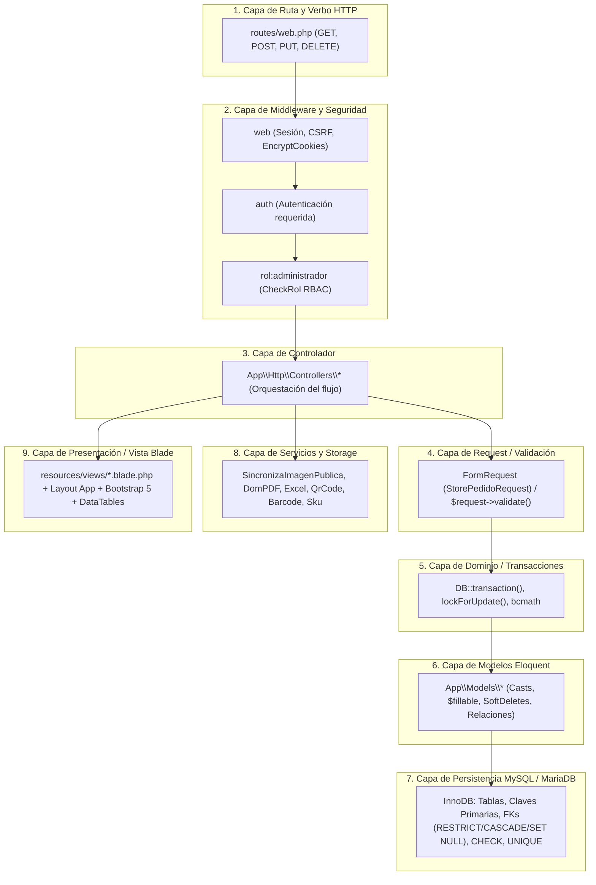
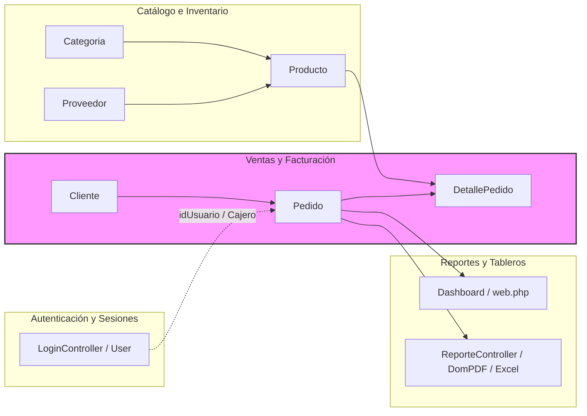

# 08 — Especificación de Pruebas de Integración End-to-End (SISMICRO / Supermarket)

> **Documento de Auditoría y Especificación de Pruebas de Integración entre Capas**  
> **Proyecto:** Sistema Web de Ventas e Inventario para el Micromercado SuperMarket  
> **Ámbito:** Proyecto de Grado / Titulación Académica  
> **Fecha de Emisión:** Septiembre 2026  
> **Versión:** 1.0  
> **Fuente de Verdad:** Repositorio real (`routes/web.php`, `bootstrap/app.php`, `app/Http/Controllers/`, `app/Http/Requests/`, `app/Models/`, `app/Support/`, `resources/views/`, `storage/`)  
> **Estado del Análisis:** VERIFICADO (mapeo directo de flujos transversales a través de todas las capas de la arquitectura)  
> **Estado de las Pruebas:** PENDIENTE DE EJECUCIÓN (casos de integración especificados con resultado obtenido vacío y sin PASS/FAIL anticipados)  

---

## 1. Arquitectura de Integración y Pipeline Transversal

El sistema **SuperMarket** implementa una arquitectura monolítica modular en Laravel 12.0 donde cada interacción de usuario atraviesa un pipeline secuencial de 9 capas acopladas:



### Descripción de Componentes Reales Involucrados por Capa

1. **Rutas (`routes/web.php`):** Define los endpoints RESTful para recursos de negocio (`categorias`, `proveedores`, `productos`, `clientes`, `pedidos`, `usuarios`, `reportes`) y endpoints auxiliares (`/dashboard`, `/login`, `/logout`, `/productos-pdf`, `/productos-excel`, `/productos/{id}/qr`, `/productos/{id}/barcode`).
2. **Middleware (`bootstrap/app.php` y `app/Http/Middleware/`):**
   - Grupo `web`: Inicia sesiones de usuario, gestiona cookies encriptadas, valida tokens CSRF (`VerifyCsrfToken`) y sanitiza entradas (`TrimStrings`, `ConvertEmptyStringsToNull`).
   - `auth`: Redirige a `/login` si el usuario no tiene una sesión activa.
   - `rol:administrador` (`App\Http\Middleware\CheckRol`): Comprueba que `strtolower(auth()->user()->rol) === 'administrador'`, retornando HTTP 403 Forbidden en caso contrario.
   - Método base `Controller::soloDueno()`: Barrera de software redundante dentro de los controladores administrativos.
3. **Controladores (`app/Http/Controllers/`):** Coordinan la recepción de la petición, invocan validaciones, ejecutan lógica transaccional y seleccionan la vista o descarga de archivo.
4. **FormRequests y Validaciones (`app/Http/Requests/`):** Clases dedicadas (`StorePedidoRequest`, `UpdatePedidoRequest`) o validaciones in-controller con mensajes personalizados en español y reglas de integridad.
5. **Transacciones y Concurrencia:** `DB::transaction()` para operaciones compuestas; `lockForUpdate()` sobre filas de producto para evitar sobreventa; `bcmath` (`bcmul`, `bcadd`) para precisión monetaria exacta.
6. **Modelos ORM (`app/Models/`):** `User`, `Categoria`, `Proveedor`, `Producto`, `Cliente`, `Pedido`, `DetallePedido`. Implementan traits como `SoftDeletes`, casts nativos (`decimal:2`, `date`, `boolean`, `hashed`) y relaciones (`belongsTo`, `hasMany`).
7. **Motor MySQL / MariaDB (InnoDB):** Tablas físicas, integridad referencial (`ON DELETE RESTRICT`, `ON DELETE SET NULL`, `ON DELETE CASCADE`), restricciones nativas `CHECK (stock >= 0)` e índices únicos/compuestos.
8. **Servicios y Storage:**
   - `App\Http\Controllers\Concerns\SincronizaImagenPublica`: Duplica físicamente imágenes entre `storage/app/public` y `public/storage` sin requerir symlinks.
   - `App\Support\Sku`: Formateo unificado de código comercial (`PRD-000001`).
   - Paquetes externos: `barryvdh/laravel-dompdf`, `maatwebsite/excel`, `endroid/qr-code`, `picqer/php-barcode-generator`.
9. **Vistas Blade (`resources/views/`):** Renderizado de interfaces Bootstrap 5, tablas DataTables, alertas de sesión (`@if(session('success'))`), directivas de autorización `@if(auth()->user()->rol === 'administrador')` y pantallas de error personalizadas (`errors/403.blade.php`, `errors/404.blade.php`).

---

## 2. Mapa de Dependencias y Acoplamiento Modular



---

## 3. Especificación Exhaustiva de Casos de Prueba de Integración (`CP-INT-001` a `CP-INT-035`)

A continuación se detalla la especificación formal de los 35 flujos de integración transversales del sistema. En cumplimiento de las reglas del proyecto, el **Resultado Obtenido** permanece vacío y el **Estado** se establece en **PENDIENTE** al tratarse de una fase de diseño previa a la ejecución.

---

### Módulo 1: Autenticación, Control de Sesión y Matriz RBAC

```
CASO DE PRUEBA: CP-INT-001
Flujo: Inicio de sesión exitoso de Administrador y redirección al Dashboard
Componentes:
  - Ruta: POST /login
  - Middleware: web, guest
  - Controller: App\Http\Controllers\Auth\LoginController::login
  - Validación: $request->validate(['email' => 'required|email', 'password' => 'required'])
  - Modelo: App\Models\User
  - Base de Datos: MySQL tabla 'users' (SELECT WHERE email = ?)
  - Servicios: Hash::check() con bcrypt (costo 12), session()->regenerate()
  - Vista / Respuesta: HTTP 302 hacia /dashboard -> Vista resources/views/dashboard.blade.php (HTTP 200)
Precondiciones: Usuario administrador registrado en base de datos ('dueno@supermarket.com' con contraseña 'password123').
Pasos:
  1. El cliente HTTP envía una petición POST a /login con credenciales válidas y token CSRF.
  2. El middleware 'web' procesa la cookie de sesión y verifica el token CSRF.
  3. LoginController ejecuta la validación de formato de los campos.
  4. Se consulta a MySQL el registro en la tabla 'users'.
  5. Se valida el hash de la contraseña mediante Hash::check().
  6. Se regenera el identificador de sesión para prevenir Session Fixation.
  7. El controlador retorna redirección 302 hacia /dashboard.
  8. La siguiente petición GET /dashboard es autorizada por el middleware 'auth' y renderiza la vista.
Resultado Esperado: Autenticación exitosa, cookie de sesión regenerada, redirección HTTP 302 a /dashboard y carga completa de la vista del panel con código HTTP 200 mostrando el nombre del usuario y métricas.
Resultado Obtenido: 
Estado: PENDIENTE
Evidencia: assertAuthenticatedAs(), assertRedirect(route('dashboard')), assertSee('Panel de Control').
```

```
CASO DE PRUEBA: CP-INT-002
Flujo: Bloqueo de inicio de sesión por Throttling tras superar 5 intentos fallidos
Componentes:
  - Ruta: POST /login
  - Middleware: web
  - Controller: App\Http\Controllers\Auth\LoginController::login
  - Mecanismo: Trait ThrottlesLogins (RateLimiter con clave email|IP)
  - Base de Datos / Cache: Almacén de cache (tabla 'cache' o driver array)
  - Vista / Respuesta: HTTP 302 de retorno a /login con errores en sesión y bloqueo temporal
Precondiciones: Servidor operativo; usuario objetivo existe o no en base de datos.
Pasos:
  1. Enviar consecutivamente 5 peticiones POST a /login con contraseña incorrecta desde la misma IP.
  2. Verificar que cada intento falle con HTTP 302 y error de credenciales.
  3. Enviar el 6to intento POST a /login (incluso con la contraseña correcta).
  4. Inspeccionar la respuesta y el mensaje de bloqueo devuelto.
Resultado Esperado: El sexto intento es interceptado por el mecanismo de rate limiting sin consultar la base de datos; la aplicación retorna HTTP 302 con mensaje en sesión: "Demasiados intentos de inicio de sesión. Por favor, inténtelo de nuevo en 120 segundos."
Resultado Obtenido: 
Estado: PENDIENTE
Evidencia: assertSessionHasErrors('email') con texto de throttle y verificación de hits en RateLimiter.
```

```
CASO DE PRUEBA: CP-INT-003
Flujo: Cierre de sesión, invalidación de sesión e invalidación de token CSRF
Componentes:
  - Ruta: POST /logout
  - Middleware: web, auth
  - Controller: App\Http\Controllers\Auth\LoginController::logout
  - Mecanismo: Auth::logout(), $request->session()->invalidate(), $request->session()->regenerateToken()
  - Base de Datos: Actualización de 'remember_token' si aplica; purga de sesión en MySQL/tabla 'sessions'
  - Vista / Respuesta: HTTP 302 hacia /login -> Vista resources/views/auth/login.blade.php
Precondiciones: Usuario autenticado activamente con sesión válida.
Pasos:
  1. Enviar petición POST a /logout con token CSRF válido.
  2. LoginController ejecuta Auth::logout().
  3. Se invalidan todos los datos de la sesión actual en el almacén de sesiones.
  4. Se regenera el token CSRF para peticiones futuras.
  5. Intentar realizar una petición posterior GET /dashboard con las cabeceras de la sesión anterior.
Resultado Esperado: La sesión se destruye completamente; la petición POST redirige a /login con HTTP 302; el intento posterior de acceder a /dashboard es interceptado por el middleware 'auth' y redirigido a /login.
Resultado Obtenido: 
Estado: PENDIENTE
Evidencia: assertGuest(), assertRedirect(route('login')) en acceso a rutas protegidas post-logout.
```

```
CASO DE PRUEBA: CP-INT-004
Flujo: Intercepción RBAC en ruta administrativa solicitada por usuario 'invitado'
Componentes:
  - Ruta: GET /productos/create
  - Middleware: web, auth, rol:administrador (App\Http\Middleware\CheckRol)
  - Controller: App\Http\Controllers\ProductoController::create
  - Vista / Respuesta: Abort HTTP 403 Forbidden -> Vista resources/views/errors/403.blade.php
Precondiciones: Usuario 'empleado@supermarket.com' autenticado con rol 'invitado'.
Pasos:
  1. Autenticar como 'invitado'.
  2. Enviar petición GET a /productos/create.
  3. El middleware CheckRol extrae `auth()->user()->rol` y compara contra `'administrador'`.
  4. Al detectar discrepancia, invoca `abort(403)`.
Resultado Esperado: La petición es bloqueada antes de alcanzar el método `create` del controlador; el servidor responde con código de estado HTTP 403 Forbidden renderizando la vista de error de permisos sin filtrar datos del formulario.
Resultado Obtenido: 
Estado: PENDIENTE
Evidencia: assertForbidden(), assertSee('No tienes permiso para acceder a esta sección').
```

```
CASO DE PRUEBA: CP-INT-005
Flujo: Redirección de usuario no autenticado en ruta raíz (home) y rutas protegidas
Componentes:
  - Ruta: GET / y GET /dashboard
  - Middleware: web (en `/`), auth (en `/dashboard`)
  - Controller / Closure: routes/web.php
  - Vista / Respuesta: HTTP 302 hacia /login
Precondiciones: Navegador o cliente sin cookie de sesión (usuario anónimo).
Pasos:
  1. Enviar petición GET a la raíz del sitio `/`.
  2. Comprobar la respuesta HTTP y la cabecera Location.
  3. Enviar petición GET directamente a `/dashboard`.
  4. Comprobar la respuesta del middleware 'auth'.
Resultado Esperado: Ambas peticiones son redirigidas con código HTTP 302 hacia la ruta `/login`. No se produce ninguna fuga de información de módulos internos.
Resultado Obtenido: 
Estado: PENDIENTE
Evidencia: assertRedirect(route('login')) para ambas URLs.
```

---

### Módulo 2: Ventas y Pedidos (Punto de Venta Transaccional y Flujo Crítico de Negocio)

```
CASO DE PRUEBA: CP-INT-006
Flujo: Registro completo de venta (Pedido) en caja por usuario Invitado (Cajero)
Componentes:
  - Ruta: POST /pedidos
  - Middleware: web, auth
  - Controller: App\Http\Controllers\PedidoController::store
  - FormRequest: App\Http\Requests\StorePedidoRequest
  - Transacción: DB::transaction()
  - Modelos: App\Models\Pedido, App\Models\DetallePedido, App\Models\Producto, App\Models\Cliente
  - Concurrencia: Producto::where('idProducto', ...)->lockForUpdate()->firstOrFail()
  - Aritmética: bcmath (bcmul, bcadd)
  - Base de Datos: Tablas 'pedidos', 'detalle_pedidos', 'productos' (InnoDB)
  - Vista / Respuesta: HTTP 302 hacia /pedidos con flash de éxito -> Vista resources/views/pedidos/index.blade.php
Precondiciones: Usuario 'invitado' autenticado. Cliente existente (idCliente = 1). Producto A (id = 1, precio = 100.00, stock = 10), Producto B (id = 2, precio = 25.50, stock = 20).
Pasos:
  1. El cajero envía POST /pedidos con idCliente: 1, fecha: hoy, e items: [[idProducto: 1, cantidad: 2], [idProducto: 2, cantidad: 4]].
  2. StorePedidoRequest valida que cliente exista, fecha sea válida y los productos sean distintos y no superen límites.
  3. PedidoController inicia DB::transaction.
  4. Se crea la cabecera en 'pedidos' con idUsuario del cajero autenticado, estado 'completado' y total inicial 0.
  5. En el bucle de items, se bloquea cada fila de producto en MySQL con SELECT ... FOR UPDATE.
  6. Se verifica que stock >= cantidad solicitada.
  7. Se calcula el subtotal con bcmul (2 * 100.00 = 200.00; 4 * 25.50 = 102.00).
  8. Se insertan las filas hijas en 'detalle_pedidos' con copia snapshot del precio_unitario.
  9. Se descuenta el stock en 'productos' (Producto A queda en 8, Producto B queda en 16).
  10. Se acumula el total general con bcadd (302.00) y se actualiza la cabecera del pedido.
  11. Se confirma la transacción (COMMIT).
  12. Redirección HTTP 302 a /pedidos.
Resultado Esperado: El pedido queda registrado con total '302.00', estado 'completado' y vinculado al idUsuario del cajero. Se generan 2 líneas en 'detalle_pedidos'. Los stocks en 'productos' se reducen atómicamente. Se muestra mensaje: "Pedido #X registrado correctamente."
Resultado Obtenido: 
Estado: PENDIENTE
Evidencia: assertDatabaseHas('pedidos', ['total' => '302.00']), assertDatabaseHas('detalle_pedidos', ['subtotal' => '200.00']), assertSame(8, Producto::find(1)->stock).
```

```
CASO DE PRUEBA: CP-INT-007
Flujo: Reversión atómica completa (Rollback) por intento de venta con stock insuficiente
Componentes:
  - Ruta: POST /pedidos
  - Middleware: web, auth
  - Controller: App\Http\Controllers\PedidoController::store
  - FormRequest: App\Http\Requests\StorePedidoRequest
  - Transacción: DB::transaction()
  - Modelos: App\Models\Pedido, App\Models\DetallePedido, App\Models\Producto
  - Excepción: Illuminate\Validation\ValidationException
  - Base de Datos: MySQL InnoDB ROLLBACK
  - Vista / Respuesta: HTTP 302 de retorno con errores en sesión -> Vista resources/views/pedidos/create.blade.php
Precondiciones: Producto 1 con stock = 10. Producto 2 con stock = 2.
Pasos:
  1. Enviar POST /pedidos solicitando 3 unidades del Producto 1 y 5 unidades del Producto 2.
  2. StorePedidoRequest aprueba la estructura del payload.
  3. Inicia DB::transaction. Se crea la cabecera temporal del pedido.
  4. Se procesa el Producto 1: hay stock (10 >= 3), se inserta detalle y se descuenta stock temporalmente a 7.
  5. Se procesa el Producto 2: no hay stock suficiente (2 < 5).
  6. El controlador lanza ValidationException con mensaje: "Stock insuficiente para...".
  7. El motor de Laravel captura la excepción y ejecuta ROLLBACK completo en MySQL.
Resultado Esperado: La transacción se revierte al 100%. No se crea ninguna fila en la tabla 'pedidos' ni en 'detalle_pedidos'. El stock del Producto 1 regresa intacto a 10 unidades. El cliente es redirigido con HTTP 302 con el error de stock en la bolsa de errores.
Resultado Obtenido: 
Estado: PENDIENTE
Evidencia: assertDatabaseCount('pedidos', 0), assertSame(10, Producto::find(1)->stock), assertSessionHasErrors('items').
```

```
CASO DE PRUEBA: CP-INT-008
Flujo: Anulación de pedido por Administrador con restitución de stock a inventario
Componentes:
  - Ruta: PUT /pedidos/{id}
  - Middleware: web, auth, rol:administrador
  - Controller: App\Http\Controllers\PedidoController::update
  - FormRequest: App\Http\Requests\UpdatePedidoRequest
  - Transacción: DB::transaction(), lockForUpdate()
  - Modelos: App\Models\Pedido, App\Models\DetallePedido, App\Models\Producto
  - Base de Datos: Tablas 'pedidos', 'detalle_pedidos', 'productos'
  - Vista / Respuesta: HTTP 302 hacia /pedidos con flash de éxito -> Vista resources/views/pedidos/index.blade.php
Precondiciones: Administrador autenticado. Pedido completado existente con 3 unidades de Producto A (stock actual del producto: 7; stock previo a la venta: 10).
Pasos:
  1. El administrador accede a /pedidos/{id}/edit y modifica el estado a 'anulado'.
  2. Envía petición PUT /pedidos/{id} con datos requeridos y estado: 'anulado'.
  3. UpdatePedidoRequest valida los campos.
  4. PedidoController inicia transacción y bloquea el pedido con lockForUpdate().
  5. Al detectar que el estado previo era 'completado', itera los detalles anteriores y ejecuta `Producto::increment('stock', 3)`.
  6. Elimina las líneas de detalle anteriores en 'detalle_pedidos'.
  7. Re-registra las líneas de detalle como histórico con flag `$descontarStock = false` (no valida ni descuenta inventario).
  8. Actualiza la cabecera del pedido asignando `estado = 'anulado'`.
  9. Confirma la transacción (COMMIT).
Resultado Esperado: El pedido pasa a estado 'anulado'. El inventario del Producto A regresa a 10 unidades (+3). Las líneas de detalle se conservan para auditoría histórica. El pedido ya no suma en los ingresos del Dashboard.
Resultado Obtenido: 
Estado: PENDIENTE
Evidencia: assertSame(10, Producto::find($idProd)->stock), assertDatabaseHas('pedidos', ['idPedido' => $id, 'estado' => 'anulado']).
```

```
CASO DE PRUEBA: CP-INT-009
Flujo: Eliminación lógica (Soft Delete) de pedido completado con restitución de inventario
Componentes:
  - Ruta: DELETE /pedidos/{id}
  - Middleware: web, auth, rol:administrador
  - Controller: App\Http\Controllers\PedidoController::destroy
  - Transacción: DB::transaction(), lockForUpdate()
  - Modelos: App\Models\Pedido (SoftDeletes), App\Models\Producto
  - Base de Datos: Tablas 'pedidos' (UPDATE deleted_at), 'productos' (UPDATE stock)
  - Vista / Respuesta: HTTP 302 hacia /pedidos -> Vista resources/views/pedidos/index.blade.php
Precondiciones: Administrador autenticado. Pedido existente en estado 'completado' con 2 unidades de un producto con stock actual 8.
Pasos:
  1. Enviar petición DELETE a /pedidos/{id}.
  2. PedidoController inicia DB::transaction y bloquea el pedido con lockForUpdate().
  3. Comprueba que el estado es 'completado'.
  4. Ejecuta `Producto::increment('stock', 2)`.
  5. Ejecuta `$pedido->delete()` (Soft Delete).
  6. COMMIT de la transacción.
Resultado Esperado: El pedido no se borra físicamente de la base de datos (su columna `deleted_at` almacena la fecha/hora actual). El stock del producto se incrementa en 2 unidades (pasa de 8 a 10).
Resultado Obtenido: 
Estado: PENDIENTE
Evidencia: assertSoftDeleted('pedidos', ['idPedido' => $id]), assertSame(10, Producto::find($idProd)->stock).
```

```
CASO DE PRUEBA: CP-INT-010
Flujo: Eliminación lógica de pedido anulado SIN incremento de stock fantasma
Componentes:
  - Ruta: DELETE /pedidos/{id}
  - Middleware: web, auth, rol:administrador
  - Controller: App\Http\Controllers\PedidoController::destroy
  - Transacción: DB::transaction()
  - Modelos: App\Models\Pedido, App\Models\Producto
  - Base de Datos: Tabla 'pedidos'
  - Vista / Respuesta: HTTP 302 hacia /pedidos
Precondiciones: Pedido previamente anulado (`estado = 'anulado'`), cuyo stock ya fue devuelto al inventario al momento de anular. Producto con stock = 10.
Pasos:
  1. Enviar DELETE /pedidos/{idPedidoAnulado}.
  2. PedidoController evalúa la condición `if ($pedido->estado === 'completado')`.
  3. Al ser 'anulado', omite el incremento de stock.
  4. Ejecuta `$pedido->delete()`.
Resultado Esperado: El pedido es marcado con Soft Delete. El stock del producto permanece estrictamente en 10 unidades (NO sube a 12 ni crea stock ficticio).
Resultado Obtenido: 
Estado: PENDIENTE
Evidencia: assertSame(10, Producto::find($idProd)->stock), assertSoftDeleted('pedidos', ['idPedido' => $idPedidoAnulado]).
```

```
CASO DE PRUEBA: CP-INT-011
Flujo: Carga del Punto de Venta (Create Pedido) con catálogo filtrado por existencia
Componentes:
  - Ruta: GET /pedidos/create
  - Middleware: web, auth
  - Controller: App\Http\Controllers\PedidoController::create
  - Modelos: App\Models\Cliente, App\Models\Producto
  - Base de Datos: SELECT * FROM clientes ORDER BY nombre; SELECT * FROM productos WHERE stock > 0 ORDER BY nombre
  - Vista / Respuesta: HTTP 200 OK -> Vista resources/views/pedidos/create.blade.php
Precondiciones: Usuario autenticado (administrador o invitado). Existen productos con stock > 0 y al menos un producto agotado (stock = 0).
Pasos:
  1. Enviar petición GET a /pedidos/create.
  2. PedidoController consulta los clientes ordenados por nombre.
  3. PedidoController consulta los productos aplicando la restricción `where('stock', '>', 0)`.
  4. Renderiza la vista pasando las colecciones.
Resultado Esperado: La vista carga con código HTTP 200 OK; el dropdown/selector de productos contiene únicamente los productos que tienen unidades disponibles para la venta; el producto con stock = 0 no aparece en las opciones seleccionables.
Resultado Obtenido: 
Estado: PENDIENTE
Evidencia: assertOk(), assertViewHas('productos'), verificación de que ningún producto en la vista tiene stock 0.
```

---

### Módulo 3: Catálogo de Productos, Imágenes, Papelera y Servicios de Exportación/Códigos

```
CASO DE PRUEBA: CP-INT-012
Flujo: Creación de producto con carga y sincronización física de imagen
Componentes:
  - Ruta: POST /productos
  - Middleware: web, auth, rol:administrador + Controller::soloDueno()
  - Controller: App\Http\Controllers\ProductoController::store
  - Validación: $request->validate() en controlador
  - Trait: App\Http\Controllers\Concerns\SincronizaImagenPublica
  - Storage: Storage::disk('public')->store('productos', 'public') y copy() hacia public/storage/productos/
  - Modelo: App\Models\Producto
  - Base de Datos: MySQL tabla 'productos'
  - Vista / Respuesta: HTTP 302 hacia /productos con mensaje de éxito -> Vista resources/views/productos/index.blade.php
Precondiciones: Administrador autenticado. Categoría válida existente (idCategoria = 1). Archivo de imagen válido (JPG de 500 KB).
Pasos:
  1. Enviar POST /productos con nombre, precio: 45.00, stock: 50, idCategoria: 1 y archivo 'foto.jpg' en campo multipart.
  2. El controlador valida formato, tipo de imagen y tamaño <= 2MB.
  3. Verifica que no exista duplicado en activos ni en papelera.
  4. Guarda el archivo en `storage/app/public/productos/`.
  5. SincronizaImagenPublica detecta que `public/storage` no es symlink y copia el archivo a `public/storage/productos/`.
  6. Inserta el registro en la tabla 'productos' guardando la ruta relativa en la columna 'imagen'.
Resultado Esperado: El producto se guarda en base de datos; la imagen existe físicamente tanto en `storage/app/public/productos/` como en `public/storage/productos/`; redirección 302 a /productos con mensaje exitoso.
Resultado Obtenido: 
Estado: PENDIENTE
Evidencia: assertDatabaseHas('productos', ['nombre' => $nombre]), Storage::disk('public')->assertExists($rutaRelativa), assertFileExists(public_path('storage/' . $rutaRelativa)).
```

```
CASO DE PRUEBA: CP-INT-013
Flujo: Actualización de producto con sustitución de imagen y eliminación de archivo anterior
Componentes:
  - Ruta: PUT /productos/{id}
  - Middleware: web, auth, rol:administrador + soloDueno()
  - Controller: App\Http\Controllers\ProductoController::update
  - Trait: App\Http\Controllers\Concerns\SincronizaImagenPublica
  - Storage: Storage::disk('public')->delete(), removeImageFromPublicStorage(), nuevo store() y sync()
  - Modelo: App\Models\Producto
  - Base de Datos: Tabla 'productos'
  - Vista / Respuesta: HTTP 302 hacia /productos
Precondiciones: Producto existente con imagen previa 'productos/antigua.png' física en disco.
Pasos:
  1. Enviar PUT /productos/{id} con datos modificados y nuevo archivo 'nueva.png'.
  2. El controlador valida los datos.
  3. Se elimina 'productos/antigua.png' de `storage/app/public` y de `public/storage`.
  4. Se almacena y sincroniza la nueva imagen 'productos/nueva.png'.
  5. Se actualiza el registro en MySQL.
Resultado Esperado: La imagen antigua es suprimida físicamente de ambas ubicaciones; la nueva imagen queda persistida en disco y en la columna 'imagen' de MySQL; redirección exitosa.
Resultado Obtenido: 
Estado: PENDIENTE
Evidencia: Storage::disk('public')->assertMissing('productos/antigua.png'), Storage::disk('public')->assertExists($nuevaRuta).
```

```
CASO DE PRUEBA: CP-INT-014
Flujo: Eliminación lógica a papelera (Soft Delete) de producto
Componentes:
  - Ruta: DELETE /productos/{id}
  - Middleware: web, auth, rol:administrador + soloDueno()
  - Controller: App\Http\Controllers\ProductoController::destroy
  - Modelo: App\Models\Producto (Trait SoftDeletes)
  - Base de Datos: UPDATE productos SET deleted_at = NOW() WHERE idProducto = ?
  - Vista / Respuesta: HTTP 302 hacia /productos con mensaje "Producto enviado a la papelera."
Precondiciones: Producto activo existente con idProducto = 30.
Pasos:
  1. Enviar DELETE /productos/30.
  2. ProductoController ejecuta `$producto->delete()`.
  3. Eloquent intercepta la llamada y emite un UPDATE de `deleted_at`.
Resultado Esperado: El registro no es borrado físicamente; `deleted_at` adquiere marca de tiempo; el producto deja de figurar en `/productos` y pasa a ser visible en `/productos/papelera`.
Resultado Obtenido: 
Estado: PENDIENTE
Evidencia: assertSoftDeleted('productos', ['idProducto' => 30]), assertRedirect(route('productos.index')).
```

```
CASO DE PRUEBA: CP-INT-015
Flujo: Visualización de papelera y restauración de producto eliminado lógicamente
Componentes:
  - Rutas: GET /productos/papelera y PUT /productos/{id}/restore
  - Middleware: web, auth, rol:administrador + soloDueno()
  - Controller: App\Http\Controllers\ProductoController::trashed y restore
  - Modelo: App\Models\Producto::onlyTrashed() y restore()
  - Base de Datos: UPDATE productos SET deleted_at = NULL WHERE idProducto = ?
  - Vistas: resources/views/productos/papelera.blade.php y productos/index.blade.php
Precondiciones: Producto previamente archivado en papelera (`deleted_at IS NOT NULL`).
Pasos:
  1. Administrador navega a GET /productos/papelera. Comprueba que el producto se visualiza en la tabla.
  2. Presiona el botón de restaurar enviando PUT /productos/{id}/restore.
  3. ProductoController ejecuta `$producto->restore()`.
Resultado Esperado: La columna `deleted_at` se restablece a `NULL` en MySQL; el producto desaparece de la vista de papelera y reaparece activo en `/productos`.
Resultado Obtenido: 
Estado: PENDIENTE
Evidencia: assertDatabaseHas('productos', ['idProducto' => $id, 'deleted_at' => null]).
```

```
CASO DE PRUEBA: CP-INT-016
Flujo: Bloqueo de eliminación permanente (ForceDelete) por existencia de ventas en historial
Componentes:
  - Ruta: DELETE /productos/{id}/force-delete
  - Middleware: web, auth, rol:administrador + soloDueno()
  - Controller: App\Http\Controllers\ProductoController::forceDelete
  - Modelo: App\Models\Producto
  - Relación: $producto->detallePedidos()->count()
  - Base de Datos: Clave foránea detalle_pedidos.idProducto ON DELETE RESTRICT
  - Vista / Respuesta: HTTP 302 hacia /productos/papelera con mensaje de error
Precondiciones: Producto en papelera que posee al menos una venta registrada en 'detalle_pedidos'.
Pasos:
  1. Enviar DELETE /productos/{id}/force-delete.
  2. ProductoController verifica `if ($producto->detallePedidos()->count() > 0)`.
  3. Aborta el intento antes de invocar la consulta destructiva.
Resultado Esperado: Se bloquea la eliminación; el producto continúa en la papelera de reciclaje; se muestra mensaje: "No se puede eliminar permanentemente el producto... porque tiene ventas registradas en el historial." La base de datos no sufre violaciones de clave foránea.
Resultado Obtenido: 
Estado: PENDIENTE
Evidencia: assertDatabaseHas('productos', ['idProducto' => $id]), assertSessionHas('error').
```

```
CASO DE PRUEBA: CP-INT-017
Flujo: Generación y descarga de código QR dinámico con SKU único
Componentes:
  - Ruta: GET /productos/{id}/qr
  - Middleware: web, auth
  - Controller: App\Http\Controllers\ProductoController::descargarQr
  - Helper: App\Support\Sku::format($idProducto)
  - Librería: Endroid\QrCode\Builder\Builder, PngWriter
  - Vista / Respuesta: HTTP 200 Streamed Download (image/png) con cabecera Content-Disposition
Precondiciones: Usuario autenticado (administrador o invitado). Producto existente con idProducto = 7.
Pasos:
  1. Solicitar GET /productos/7/qr.
  2. El controlador formatea el SKU como `'PRD-000007'` usando la clase Sku.
  3. Construye el payload JSON con SKU, nombre y precio.
  4. Endroid QrCode genera la imagen PNG en memoria.
Resultado Esperado: El navegador recibe respuesta HTTP 200 con cabecera `Content-Type: image/png` y descarga el archivo `qr-producto-PRD-000007.png`.
Resultado Obtenido: 
Estado: PENDIENTE
Evidencia: assertOk(), assertHeader('content-type', 'image/png').
```

```
CASO DE PRUEBA: CP-INT-018
Flujo: Generación y descarga de código de barras Code128 dinámico
Componentes:
  - Ruta: GET /productos/{id}/barcode
  - Middleware: web, auth
  - Controller: App\Http\Controllers\ProductoController::descargarBarcode
  - Helper: App\Support\Sku::format($idProducto)
  - Librería: Picqer\Barcode\Types\TypeCode128, PngRenderer
  - Vista / Respuesta: HTTP 200 Streamed Download (image/png)
Precondiciones: Usuario autenticado. Producto existente con idProducto = 7.
Pasos:
  1. Solicitar GET /productos/7/barcode.
  2. El controlador genera el SKU `'PRD-000007'`.
  3. La librería Picqer codifica la cadena en formato Code128 y la renderiza en PNG.
Resultado Esperado: Descarga exitosa con código HTTP 200, tipo MIME `image/png` y nombre de archivo `barcode-PRD-000007.png`.
Resultado Obtenido: 
Estado: PENDIENTE
Evidencia: assertOk(), assertHeader('content-type', 'image/png').
```

```
CASO DE PRUEBA: CP-INT-019
Flujo: Exportación completa de catálogo de productos a PDF
Componentes:
  - Ruta: GET /productos-pdf
  - Middleware: web, auth
  - Controller: App\Http\Controllers\ProductoController::exportarPdf
  - Modelo: App\Models\Producto::with(['categoria', 'proveedor'])
  - Librería: Barryvdh\DomPDF\Facade\Pdf
  - Vista Blade: resources/views/productos/pdf.blade.php
  - Vista / Respuesta: HTTP 200 Download (application/pdf) en formato horizontal A4
Precondiciones: Usuario autenticado. Catálogo con productos registrados.
Pasos:
  1. Solicitar GET /productos-pdf.
  2. El controlador ejecuta consulta con eager loading de categoría y proveedor.
  3. Carga la vista 'productos.pdf' en DomPDF y aplica orientación landscape A4.
Resultado Esperado: Descarga de archivo `productos-supermarket.pdf` con código HTTP 200 y tipo de contenido `application/pdf`.
Resultado Obtenido: 
Estado: PENDIENTE
Evidencia: assertOk(), assertHeader('content-type', 'application/pdf').
```

```
CASO DE PRUEBA: CP-INT-020
Flujo: Exportación completa de catálogo de productos a hoja de cálculo Excel
Componentes:
  - Ruta: GET /productos-excel
  - Middleware: web, auth
  - Controller: App\Http\Controllers\ProductoController::exportarExcel
  - Clase Export: App\Exports\ProductosExport
  - Librería: Maatwebsite\Excel\Facades\Excel
  - Vista / Respuesta: HTTP 200 Binary File Download (application/vnd.openxmlformats-officedocument.spreadsheetml.sheet)
Precondiciones: Usuario autenticado.
Pasos:
  1. Solicitar GET /productos-excel.
  2. Se instancia ProductosExport, la cual recopila las colecciones y define estilos, cabeceras y formatos de celda.
  3. Excel::download genera el archivo binario XLSX.
Resultado Esperado: El servidor envía archivo `productos.xlsx` con código HTTP 200 y cabeceras de descarga de hoja de cálculo.
Resultado Obtenido: 
Estado: PENDIENTE
Evidencia: Excel::assertDownloaded('productos.xlsx') en pruebas unitarias.
```

---

### Módulo 4: Categorías y Control de Integridad

```
CASO DE PRUEBA: CP-INT-021
Flujo: Registro de categoría con auto-restauración desde papelera por colisión de nombre
Componentes:
  - Ruta: POST /categorias
  - Middleware: web, auth, rol:administrador
  - Controller: App\Http\Controllers\CategoriaController::store
  - Validación: $request->validate()
  - Modelo: App\Models\Categoria::withTrashed()
  - Base de Datos: UPDATE categorias SET deleted_at = NULL, descripcion = ? WHERE idCategoria = ?
  - Vista / Respuesta: HTTP 302 hacia /categorias con mensaje de éxito -> Vista resources/views/categorias/index.blade.php
Precondiciones: Categoría 'Ferretería' previamente eliminada con Soft Delete (`deleted_at IS NOT NULL`).
Pasos:
  1. Enviar formulario POST /categorias con nombre: 'Ferretería', descripcion: 'Herramientas y tornillos'.
  2. CategoriaController busca en la tabla con `withTrashed()`.
  3. Al encontrar el registro en papelera, invoca `$existente->restore()`.
  4. Actualiza la descripción con los nuevos datos enviados.
Resultado Esperado: No se duplica la fila en MySQL (se respeta la UNIQUE KEY `categorias_nombre_unique`); el registro existente pasa a `deleted_at = NULL`; redirección con mensaje: "La categoría... existía previamente en la papelera y ha sido restaurada con éxito."
Resultado Obtenido: 
Estado: PENDIENTE
Evidencia: assertDatabaseHas('categorias', ['nombre' => 'Ferretería', 'deleted_at' => null]), assertDatabaseCount('categorias', 1).
```

```
CASO DE PRUEBA: CP-INT-022
Flujo: Bloqueo de eliminación de categoría con productos asociados
Componentes:
  - Ruta: DELETE /categorias/{id}
  - Middleware: web, auth, rol:administrador
  - Controller: App\Http\Controllers\CategoriaController::destroy
  - Modelo: App\Models\Categoria
  - Relación: $categoria->productos()->count()
  - Base de Datos: Clave foránea productos.idCategoria ON DELETE RESTRICT
  - Vista / Respuesta: HTTP 302 hacia /categorias con flash de error
Precondiciones: Categoría (idCategoria = 2) que posee productos asociados en inventario.
Pasos:
  1. Enviar DELETE /categorias/2.
  2. El controlador cuenta los productos asociados mediante `$categoria->productos()->count()`.
  3. Al ser mayor a 0, retorna redirección con mensaje de error sin ejecutar delete().
Resultado Esperado: La categoría no es eliminada (ni física ni lógicamente); se muestra mensaje: "No se puede eliminar la categoría... porque tiene X producto(s) asociado(s)..."; no se producen violaciones en MySQL.
Resultado Obtenido: 
Estado: PENDIENTE
Evidencia: assertDatabaseHas('categorias', ['idCategoria' => 2, 'deleted_at' => null]), assertSessionHas('error').
```

---

### Módulo 5: Proveedores y Relación con Inventario

```
CASO DE PRUEBA: CP-INT-023
Flujo: Registro y listado de proveedores con conteo agregado de catálogo
Componentes:
  - Rutas: POST /proveedores y GET /proveedores
  - Middleware: web, auth (GET); web, auth, rol:administrador + soloDueno() (POST)
  - Controller: App\Http\Controllers\ProveedorController::store e index
  - Modelo: App\Models\Proveedor::withCount('productos')
  - Base de Datos: INSERT en 'proveedores'; SELECT proveedores.*, (SELECT COUNT(*) FROM productos...)
  - Vista / Respuesta: HTTP 302 -> HTTP 200 -> Vista resources/views/proveedores/index.blade.php
Precondiciones: Administrador autenticado.
Pasos:
  1. Enviar POST /proveedores con nombre: 'Comercializadora Andina', nit: '10203040', activo: 1.
  2. Se valida e inserta el proveedor en la base de datos.
  3. Redirige a GET /proveedores.
  4. El controlador consulta los proveedores usando `withCount('productos')`.
Resultado Esperado: El proveedor se inserta correctamente; en la vista index se renderiza la tabla mostrando la columna de productos asociados con el contador agregado correspondiente en un badge numérico.
Resultado Obtenido: 
Estado: PENDIENTE
Evidencia: assertDatabaseHas('proveedores', ['nombre' => 'Comercializadora Andina']), assertSee('Comercializadora Andina').
```

```
CASO DE PRUEBA: CP-INT-024
Flujo: Bloqueo de eliminación de proveedor con productos asociados
Componentes:
  - Ruta: DELETE /proveedores/{id}
  - Middleware: web, auth, rol:administrador + soloDueno()
  - Controller: App\Http\Controllers\ProveedorController::destroy
  - Modelo: App\Models\Proveedor
  - Relación: $proveedor->productos()->count()
  - Vista / Respuesta: HTTP 302 hacia /proveedores con flash de error
Precondiciones: Proveedor vinculado a productos en catálogo.
Pasos:
  1. Enviar DELETE /proveedores/{id}.
  2. ProveedorController comprueba si `$cantProductos > 0`.
  3. Al detectar productos vinculados, cancela la acción.
Resultado Esperado: El proveedor no sufre soft-delete; se muestra mensaje de protección: "No se puede eliminar el proveedor... porque tiene X producto(s) asociado(s). Reasigne o desvincule los productos primero..."; se preserva la integridad del catálogo.
Resultado Obtenido: 
Estado: PENDIENTE
Evidencia: assertDatabaseHas('proveedores', ['idProveedor' => $id, 'deleted_at' => null]), assertSessionHas('error').
```

---

### Módulo 6: Clientes y Búsqueda Reactiva

```
CASO DE PRUEBA: CP-INT-025
Flujo: Búsqueda reactiva de clientes con paginación compuesta que conserva filtros
Componentes:
  - Ruta: GET /clientes?q=perez&page=2
  - Middleware: web, auth
  - Controller: App\Http\Controllers\ClienteController::index
  - Consulta: Query Builder con when($request->filled('q'), closure) buscando por nombre o email
  - Paginación: paginate(15)->withQueryString()
  - Vista / Respuesta: HTTP 200 OK -> Vista resources/views/clientes/index.blade.php
Precondiciones: Base de datos con más de 20 clientes registrados, varios con apellido 'Perez'.
Pasos:
  1. Solicitar GET /clientes?q=perez.
  2. Verificar que los resultados correspondan únicamente al filtro.
  3. Navegar a la página 2 de la paginación.
  4. Comprobar la URL de paginación generada.
Resultado Esperado: La consulta SQL filtra por `(nombre LIKE '%perez%' OR email LIKE '%perez%')`; el método `withQueryString()` garantiza que el parámetro `q=perez` se mantenga presente en los links de paginación de la página 2.
Resultado Obtenido: 
Estado: PENDIENTE
Evidencia: assertOk(), assertSee('perez'), verificación de enlaces de paginación con query string.
```

```
CASO DE PRUEBA: CP-INT-026
Flujo: Bloqueo de eliminación de cliente con historial de compras asociado
Componentes:
  - Ruta: DELETE /clientes/{id}
  - Middleware: web, auth, rol:administrador
  - Controller: App\Http\Controllers\ClienteController::destroy
  - Modelo: App\Models\Cliente
  - Relación: $cliente->pedidos()->count()
  - Base de Datos: Clave foránea pedidos.idCliente ON DELETE RESTRICT
  - Vista / Respuesta: HTTP 302 hacia /clientes con error
Precondiciones: Cliente con pedidos asociados en la base de datos.
Pasos:
  1. Enviar DELETE /clientes/{id}.
  2. ClienteController verifica `$cliente->pedidos()->count() > 0`.
  3. Retorna mensaje de error.
Resultado Esperado: Bloqueo de la eliminación; el cliente permanece activo; mensaje: "No se puede eliminar el cliente... porque tiene X pedido(s) asociado(s)."; se protege el historial de auditoría tributaria y comercial.
Resultado Obtenido: 
Estado: PENDIENTE
Evidencia: assertDatabaseHas('clientes', ['idCliente' => $id, 'deleted_at' => null]), assertSessionHas('error').
```

---

### Módulo 7: Gestión de Usuarios, Roles y Seguridad de Cuentas

```
CASO DE PRUEBA: CP-INT-027
Flujo: Creación de usuario por Dueño con confirmación de clave y foto de perfil
Componentes:
  - Ruta: POST /usuarios
  - Middleware: web, auth, rol:administrador + soloDueno()
  - Controller: App\Http\Controllers\UsuarioController::store
  - Validación: Password con regex (letra + número), confirmed, foto image|mimes
  - Trait: App\Http\Controllers\Concerns\SincronizaImagenPublica
  - Modelo: App\Models\User
  - Base de Datos: INSERT INTO users (name, email, password, rol, foto, ...)
  - Vista / Respuesta: HTTP 302 hacia /usuarios -> Vista resources/views/usuarios/index.blade.php
Precondiciones: Dueño autenticado. Datos de nuevo usuario con rol 'invitado' y foto PNG válida.
Pasos:
  1. Enviar POST /usuarios con name, email, password: 'Password123', password_confirmation: 'Password123', rol: 'invitado', foto.
  2. Se valida la complejidad de clave y la correspondencia con su confirmación.
  3. Se hashea la clave con bcrypt.
  4. Se guarda y sincroniza la foto de perfil en disco.
  5. Se inserta el usuario en MySQL.
Resultado Esperado: Usuario creado con rol 'invitado'; hash criptográfico válido en BD; archivo de foto copiado a `public/storage/usuarios/`; redirección con éxito.
Resultado Obtenido: 
Estado: PENDIENTE
Evidencia: assertDatabaseHas('users', ['email' => $email, 'rol' => 'invitado']), assertFileExists(public_path('storage/' . $rutaFoto)).
```

```
CASO DE PRUEBA: CP-INT-028
Flujo: Bloqueo de auto-degradación de rol del administrador autenticado
Componentes:
  - Ruta: PUT /usuarios/{id}
  - Middleware: web, auth, rol:administrador + soloDueno()
  - Controller: App\Http\Controllers\UsuarioController::update
  - Lógica de Seguridad: auth()->id() == $usuario->id && $request->rol !== auth()->user()->rol
  - Vista / Respuesta: HTTP 302 hacia /usuarios con flash de error
Precondiciones: Administrador autenticado con id = 1.
Pasos:
  1. El administrador intenta editar su propio perfil enviando PUT /usuarios/1 con rol: 'invitado'.
  2. UsuarioController compara los identificadores y detecta el cambio de rol sobre la sesión activa.
  3. Aborta la actualización del rol.
Resultado Esperado: El sistema rechaza la operación sin modificar la base de datos; el usuario mantiene su rol 'administrador'; se muestra mensaje: "No puedes cambiar tu propio rol. Pide a otro administrador que lo realice."
Resultado Obtenido: 
Estado: PENDIENTE
Evidencia: assertDatabaseHas('users', ['id' => 1, 'rol' => 'administrador']), assertSessionHas('error').
```

```
CASO DE PRUEBA: CP-INT-029
Flujo: Bloqueo de auto-eliminación de la cuenta del administrador autenticado
Componentes:
  - Ruta: DELETE /usuarios/{id}
  - Middleware: web, auth, rol:administrador + soloDueno()
  - Controller: App\Http\Controllers\UsuarioController::destroy
  - Lógica de Seguridad: auth()->id() == $usuario->id
  - Vista / Respuesta: HTTP 302 hacia /usuarios con mensaje de error
Precondiciones: Administrador con id = 1 autenticado.
Pasos:
  1. Enviar DELETE /usuarios/1.
  2. UsuarioController verifica `if (auth()->id() == $usuario->id)`.
  3. Retorna redirección con error sin ejecutar delete().
Resultado Esperado: El usuario activo no puede eliminarse a sí mismo; la cuenta permanece en la base de datos con acceso habilitado; se muestra mensaje: "No puedes eliminar tu propio usuario."
Resultado Obtenido: 
Estado: PENDIENTE
Evidencia: assertDatabaseHas('users', ['id' => 1]), assertSessionHas('error').
```

---

### Módulo 8: Reportes Financieros, Filtrado Multicriterio y Exportaciones

```
CASO DE PRUEBA: CP-INT-030
Flujo: Filtrado multicriterio de ventas en pantalla de reportes con exclusión de anulados
Componentes:
  - Ruta: GET /reportes/ventas?fecha_inicio=...&fecha_fin=...&id_cliente=...&estado=completado
  - Middleware: web, auth, rol:administrador
  - Controller: App\Http\Controllers\ReporteController::ventas
  - Validación: $request->validate() de fechas y existencia de cliente
  - Modelos: App\Models\Pedido::with(['cliente', 'detalles.producto'])
  - Base de Datos: Cláusulas whereBetween('fecha', ...), where('idCliente', ...), where('estado', ...)
  - Métricas: totalVentas, totalPedidos, totalUnidades, promedioVenta
  - Vista / Respuesta: HTTP 200 OK -> Vista resources/views/reportes/ventas.blade.php
Precondiciones: Administrador autenticado. Pedidos completados y anulados en varios rangos de fecha y clientes.
Pasos:
  1. Enviar GET /reportes/ventas con fecha_inicio: '2026-09-01', fecha_fin: '2026-09-30', estado: 'completado'.
  2. El controlador valida que fecha_fin >= fecha_inicio.
  3. Aplica los filtros dinámicos sobre el Query Builder.
  4. Calcula los totales excluyendo ventas anuladas.
  5. Pagina la tabla de resultados conservando los filtros en la URL con withQueryString().
Resultado Esperado: La pantalla renderiza las tarjetas de resumen financiero con valores exactos basados en ventas válidas; la tabla muestra únicamente los pedidos comprendidos en el criterio de búsqueda.
Resultado Obtenido: 
Estado: PENDIENTE
Evidencia: assertOk(), assertViewHas('totalVentas'), assertViewHas('pedidos').
```

```
CASO DE PRUEBA: CP-INT-031
Flujo: Exportación de reporte de ventas filtrado a PDF en orientación horizontal A4
Componentes:
  - Ruta: GET /reportes/ventas/pdf?fecha_inicio=...&fecha_fin=...&estado=completado
  - Middleware: web, auth, rol:administrador
  - Controller: App\Http\Controllers\ReporteController::exportPDF
  - Librería: Barryvdh\DomPDF\Facade\Pdf
  - Vista Blade: resources/views/reportes/ventas_pdf.blade.php
  - Vista / Respuesta: HTTP 200 PDF Streamed Download con nombre dinámico
Precondiciones: Administrador autenticado. Filtros de reporte seleccionados.
Pasos:
  1. Solicitar GET /reportes/ventas/pdf con rango de fechas.
  2. ReporteController filtra las ventas en base de datos.
  3. Genera la vista 'reportes.ventas_pdf'.
  4. DomPDF renderiza el documento aplicando `setPaper('A4', 'landscape')`.
Resultado Esperado: El navegador recibe respuesta HTTP 200 con archivo PDF de nombre `ventas_{inicio}_{fin}.pdf` con cabeceras correctas para descarga directa.
Resultado Obtenido: 
Estado: PENDIENTE
Evidencia: assertOk(), assertHeader('content-type', 'application/pdf').
```

```
CASO DE PRUEBA: CP-INT-032
Flujo: Exportación de reporte de ventas filtrado a Excel
Componentes:
  - Ruta: GET /reportes/ventas/excel?fecha_inicio=...&fecha_fin=...&estado=completado
  - Middleware: web, auth, rol:administrador
  - Controller: App\Http\Controllers\ReporteController::exportExcel
  - Clase Export: App\Exports\VentasExport
  - Librería: Maatwebsite\Excel\Facades\Excel
  - Vista / Respuesta: HTTP 200 Binary File Download (XLSX)
Precondiciones: Administrador autenticado.
Pasos:
  1. Solicitar GET /reportes/ventas/excel con filtros.
  2. ReporteController delega a VentasExport la consulta y formateo de celdas.
  3. Se genera y descarga el archivo `.xlsx`.
Resultado Esperado: Descarga exitosa de archivo Excel con las ventas filtradas, subtotales y datos de clientes asociados.
Resultado Obtenido: 
Estado: PENDIENTE
Evidencia: Excel::assertDownloaded(...) en pruebas automatizadas.
```

---

### Módulo 9: Panel de Control (Dashboard) y Consolidación de KPIs

```
CASO DE PRUEBA: CP-INT-033
Flujo: Consolidación integral de indicadores clave de rendimiento (KPIs) en Dashboard
Componentes:
  - Ruta: GET /dashboard
  - Middleware: web, auth
  - Closure: routes/web.php (L35-124)
  - Base de Datos: Expresiones agregadas COUNT(), SUM(total), SUM(stock * precio), DATE_FORMAT / strftime
  - Modelos: Categoria, Proveedor, Producto, Cliente, Pedido, DetallePedido
  - Vista Blade: resources/views/dashboard.blade.php (Charts.js + tarjetas KPI)
Precondiciones: Usuario autenticado. Base de datos con catálogo, pedidos completados y anulados, y productos con stock <= 5.
Pasos:
  1. Enviar GET /dashboard.
  2. El closure ejecuta:
     - Conteo de entidades globales (categorías, proveedores, productos, clientes, pedidos).
     - Separación de pedidos completados vs anulados.
     - Suma de ventas válidas (excluyendo anulados).
     - Suma aritmética de inventario valorizado: `Producto::sum(DB::raw('stock * precio'))`.
     - Detección de alerta de stock bajo: `Producto::where('stock', '<=', 5)->count()`.
     - Agrupación mensual con expresión de motor adaptativa (`DATE_FORMAT` en MySQL / `strftime` en SQLite).
     - Ranking Top 5 productos y Top 5 clientes mediante JOINs sobre `detalle_pedidos` y `pedidos`.
  3. Renderiza la vista 'dashboard'.
Resultado Esperado: El dashboard carga con HTTP 200; las tarjetas muestran cifras consistentes con la base de datos; la alerta de inventario refleja los productos críticos; los arreglos de datos para gráficos de Chart.js se entregan en formato JSON válido.
Resultado Obtenido: 
Estado: PENDIENTE
Evidencia: assertOk(), assertViewHasAll(['totalVentas', 'inventarioValuado', 'stockBajoCant', 'topProductos', 'topClientes']).
```

```
CASO DE PRUEBA: CP-INT-034
Flujo: Compatibilidad de agrupamiento temporal de ventas según motor (MySQL vs SQLite)
Componentes:
  - Ruta: GET /dashboard
  - Middleware: web, auth
  - Mecanismo: DB::connection()->getDriverName() en routes/web.php
  - Motor BD: MySQL (`DATE_FORMAT(fecha, "%Y-%m")`) vs SQLite (`strftime('%Y-%m', fecha)`)
  - Vista: resources/views/dashboard.blade.php
Precondiciones: Datos históricos de ventas en diferentes meses.
Pasos:
  1. Inspeccionar la lógica de branching por motor en `routes/web.php`.
  2. Ejecutar la ruta `/dashboard` en entorno MySQL.
  3. Verificar que la consulta no lance errores de sintaxis SQL por funciones no reconocidas.
Resultado Esperado: El sistema selecciona dinámicamente la función de formato de fecha correcta según el motor activo, permitiendo que tanto la suite de tests en SQLite como el entorno de producción en MySQL agrupen las ventas mensuales sin error.
Resultado Obtenido: 
Estado: PENDIENTE
Evidencia: assertOk() y assertViewHas('ventasPorMes') en ambos entornos.
```

---

### Módulo 10: Manejo Global de Errores e Integración de Vistas de Error

```
CASO DE PRUEBA: CP-INT-035
Flujo: Intercepción de registro no encontrado (ModelNotFoundException) y renderizado de vista 404
Componentes:
  - Ruta: GET /productos/999999/edit
  - Middleware: web, auth, rol:administrador + soloDueno()
  - Controller: App\Http\Controllers\ProductoController::edit
  - Modelo: Producto::findOrFail(999999)
  - Manejador de Excepciones: Laravel Exception Handler
  - Vista / Respuesta: HTTP 404 Not Found -> Vista resources/views/errors/404.blade.php
Precondiciones: Administrador autenticado. No existe ningún producto con idProducto = 999999.
Pasos:
  1. Solicitar GET /productos/999999/edit.
  2. El método `findOrFail` lanza `Illuminate\Database\Eloquent\ModelNotFoundException`.
  3. El Exception Handler de Laravel captura la excepción y la convierte en una respuesta HTTP 404.
  4. Se carga la plantilla de error personalizada de la aplicación.
Resultado Esperado: El servidor responde con código de estado HTTP 404 Not Found (no 500); se muestra la vista personalizada amigable `errors/404.blade.php` manteniendo la estructura visual del sistema.
Resultado Obtenido: 
Estado: PENDIENTE
Evidencia: assertNotFound(), assertSee('404').
```

---

## 4. Matriz de Trazabilidad entre Requisitos del Sistema y Flujos de Integración

| Requisito | Denominación del Requisito | Macro-Flujo | Casos de Prueba de Integración Asociados |
| :---: | :--- | :--- | :--- |
| **RF-001** | Autenticación de usuarios por credenciales | Autenticación y Sesión | `CP-INT-001`, `CP-INT-002` |
| **RF-003** | Cierre seguro de sesión (Logout) | Autenticación y Sesión | `CP-INT-003` |
| **RF-005** | Redirección de acceso público inicial | Autenticación y Sesión | `CP-INT-005` |
| **RF-008** | Visualización de panel de control (Dashboard) | Métricas y Dashboard | `CP-INT-033`, `CP-INT-034` |
| **RF-011** | Operación de caja por Invitado (Cajero) | Ventas y Pedidos | `CP-INT-006` |
| **RF-012** | Restricción RBAC de módulos a Invitados | Seguridad / RBAC | `CP-INT-004` |
| **RF-015** | Restauración de categorías desde papelera | Catálogo de Categorías | `CP-INT-021` |
| **RF-017** | Bloqueo de eliminación de categoría vinculada | Catálogo de Categorías | `CP-INT-022` |
| **RF-020** | Registro y listado de proveedores comerciales | Gestión de Proveedores | `CP-INT-023` |
| **RF-024** | Bloqueo de eliminación de proveedor vinculado | Gestión de Proveedores | `CP-INT-024` |
| **RF-027** | Registro de producto con imagen en catálogo | Catálogo de Productos | `CP-INT-012` |
| **RF-030** | Actualización de producto y sustitución de imagen | Catálogo de Productos | `CP-INT-013` |
| **RF-032** | Eliminación a papelera y restauración de producto | Catálogo de Productos | `CP-INT-014`, `CP-INT-015` |
| **RF-033** | Bloqueo de eliminación permanente con ventas | Catálogo de Productos | `CP-INT-016` |
| **RF-034** | Descarga de códigos QR y de barras | Catálogo de Productos | `CP-INT-017`, `CP-INT-018` |
| **RF-035** | Exportación de catálogo a PDF y Excel | Catálogo de Productos | `CP-INT-019`, `CP-INT-020` |
| **RF-039** | Búsqueda reactiva de clientes con paginación | Gestión de Clientes | `CP-INT-025` |
| **RF-040** | Bloqueo de eliminación de cliente con historial | Gestión de Clientes | `CP-INT-026` |
| **RF-042** | Filtrado de productos con stock en pantalla de venta | Ventas y Pedidos | `CP-INT-011` |
| **RF-043** | Transacción atómica de venta y descuento de stock | Ventas y Pedidos | `CP-INT-006`, `CP-INT-007` |
| **RF-046** | Anulación de pedido con restitución de stock | Ventas y Pedidos | `CP-INT-008` |
| **RF-047** | Eliminación de pedido y control de stock fantasma | Ventas y Pedidos | `CP-INT-009`, `CP-INT-010` |
| **RF-059** | Filtrado multicriterio de reportes de ventas | Reportes y Finanzas | `CP-INT-030` |
| **RF-061** | Exportación de reportes de ventas a PDF y Excel | Reportes y Finanzas | `CP-INT-031`, `CP-INT-032` |
| **RF-064** | Creación de cuentas de usuario con roles y foto | Administración de Usuarios | `CP-INT-027` |
| **RF-069** | Protección contra auto-degradación de rol | Administración de Usuarios | `CP-INT-028` |
| **RF-070** | Protección contra auto-eliminación de administrador | Administración de Usuarios | `CP-INT-029` |
| **RNF-001** | Integridad transaccional y consistencia ACID | Base de Datos / Dominio | `CP-INT-006`, `CP-INT-007`, `CP-INT-008` |
| **RNF-005** | Prevención de fuga de información y control 404 | Manejo de Excepciones | `CP-INT-035` |

---

## 5. Puntos Críticos de Integración y Riesgos Detectados

1. **Sincronización Manual de Archivos en Disco (`SincronizaImagenPublica`):**
   - **Mecanismo:** El proyecto no utiliza el enlace simbólico estándar `public/storage -> storage/app/public` (`php artisan storage:link`), sino una copia física programática (`copy()`) al subir imágenes y borrado manual (`unlink()`) al actualizar o eliminar.
   - **Riesgo de Integración:** Si la carpeta de destino `public/storage/productos/` o `public/storage/usuarios/` carece de permisos de escritura a nivel de sistema operativo en el servidor web (e.g. Apache/Nginx con usuario `www-data`), la base de datos registrará la fila pero la imagen no será visible públicamente, o la operación podría lanzar una advertencia no capturada de PHP.
2. **Concurrencia en Ventas Simultáneas (`lockForUpdate`):**
   - **Mecanismo:** `PedidoController::store` bloquea cada fila de producto dentro de una transacción InnoDB.
   - **Riesgo de Integración:** En escenarios de alto volumen de ventas en múltiples terminales de caja concurrentes sobre los mismos productos populares, el tiempo de espera por bloqueo (*lock wait timeout*) debe ser monitoreado para evitar excepciones no controladas de MySQL (Error 1205).
3. **Dependencia de la Extensión PHP `ext-bcmath`:**
   - **Mecanismo:** Los cálculos de subtotales y total general en `PedidoController` (`bcmul`, `bcadd`) requieren obligatoriamente la extensión BCMath compilada en PHP.
   - **Verificación:** Se encuentra declarada en `composer.json` (línea 10); si se desplegara en un entorno PHP donde `ext-bcmath` esté deshabilitada, el flujo de ventas fallará con un error fatal de función no definida.
4. **Agrupaciones en Dashboard según Driver de Conexión:**
   - **Mecanismo:** Branching explícito en `routes/web.php` con `$driver === 'sqlite'`.
   - **Riesgo de Integración:** Si el sistema se desplegara sobre un motor distinto a MySQL o SQLite (como PostgreSQL), la expresión `DATE_FORMAT` fallará. Se debe garantizar la coherencia del driver `mysql` en producción.
