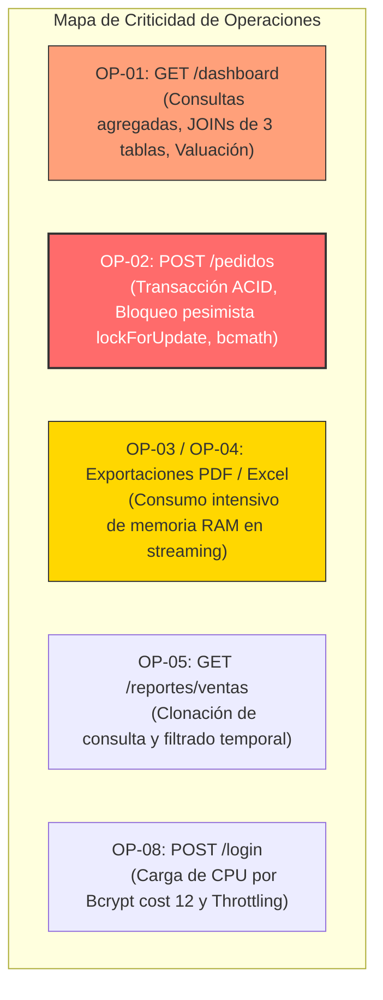
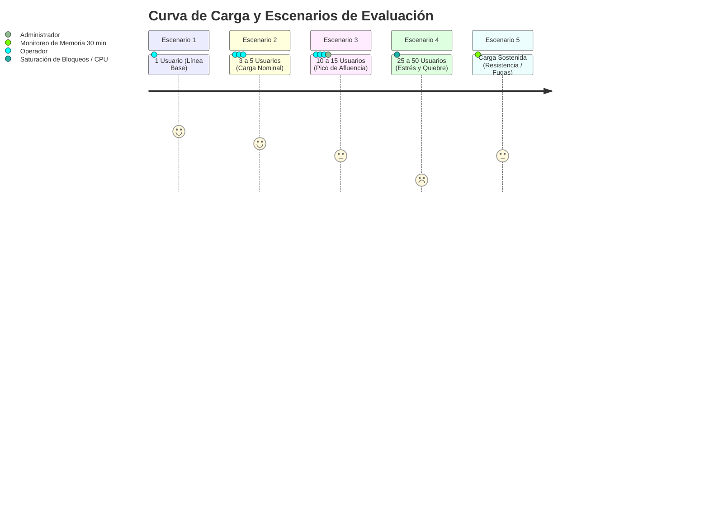
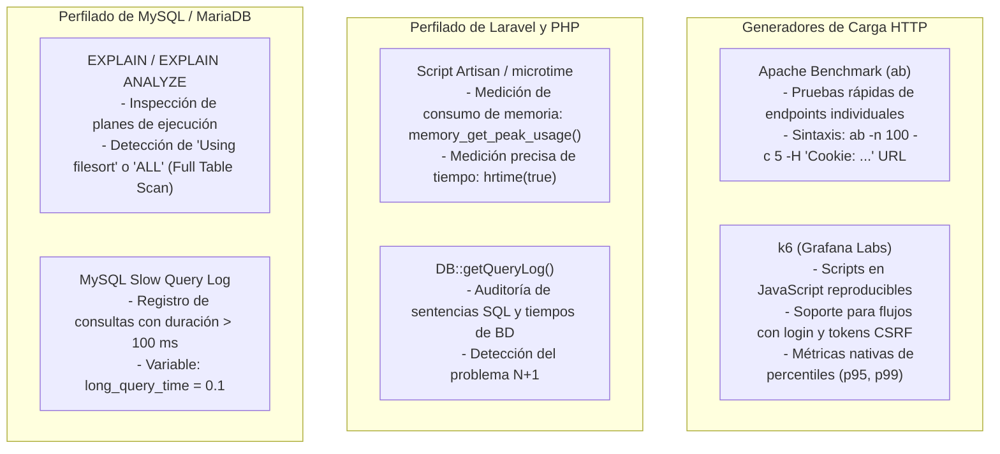

# 09 — Plan de Pruebas de Rendimiento, Carga y Eficiencia (SISMICRO / Supermarket)

> **Documento de Planificación de Pruebas No Funcionales de Rendimiento (Performance Test Plan)**  
> **Proyecto:** Sistema Web de Ventas e Inventario para el Micromercado SuperMarket  
> **Ámbito:** Proyecto de Grado / Titulación Académica  
> **Fecha de Emisión:** Septiembre 2026  
> **Versión:** 1.0  
> **Fuente de Verdad:** Repositorio real (`routes/web.php`, `app/Http/Controllers/`, `config/database.php`, `composer.json`, `docs/BASE_DE_DATOS.md`)  
> **Estado del Plan:** PLANIFICADO / PENDIENTE DE EJECUCIÓN (especificación metodológica sin ejecución previa ni métricas/tiempos inventados; los campos de resultados se entregan vacíos para su registro posterior)  

---

## 1. Contexto, Alcance y Objetivos de Rendimiento

### 1.1. Contexto Operativo del Micromercado
El sistema **SuperMarket** está diseñado para gestionar las operaciones diarias de un micromercado o supermercado de proximidad. En su entorno operativo real, el sistema atiende simultáneamente:
- **1 a 3 puestos de venta (cajas de cobro):** Operados por usuarios con rol `invitado` que registran transacciones continuas en el módulo de pedidos (`/pedidos/create` y `POST /pedidos`).
- **1 terminal de administración / gerencia:** Operada por el usuario con rol `administrador` para supervisión de stock, ingreso de mercadería, generación de reportes y monitoreo del panel de control (`/dashboard`).
- **Consultas esporádicas de catálogo y descargas:** Emisión de etiquetas de código de barras / QR y reportes contables en PDF o Excel.

### 1.2. Objetivos del Plan de Rendimiento
1. **Establecer la Línea Base de Latencia:** Determinar los tiempos de respuesta mínimos y promedio de las operaciones críticas en condiciones de usuario único sin contención.
2. **Evaluar la Concurrencia en Punto de Venta:** Medir el comportamiento del bloqueo pesimista (`Producto::lockForUpdate()`) e integridad transaccional de MySQL cuando múltiples cajeros intentan vender los mismos productos simultáneamente.
3. **Identificar Cuellos de Botella en Exportaciones:** Evaluar el consumo de memoria RAM y tiempo de procesamiento en la generación al vuelo de documentos PDF (`DomPDF`) y hojas de cálculo (`Maatwebsite\Excel`).
4. **Validar la Eficiencia de Consultas SQL:** Verificar la ausencia del problema de consultas $N+1$, la efectividad de los índices físicos (`pedidos_fecha_index`, `pedidos_estado_fecha_index`) y el costo computacional de las consultas agregadas del Dashboard.
5. **Determinar el Umbral de Saturación (Punto de Quiebre):** Identificar la cantidad máxima de usuarios concurrentes que el servidor puede sostener antes de degradar el servicio o generar errores HTTP 500 / 504 / MySQL Lock Timeout.

---

## 2. Identificación de Operaciones Críticas Reales en el Código Fuente

A partir de la inspección directa del código fuente, se clasifican las siguientes 8 operaciones críticas según su impacto en CPU, memoria y base de datos:

| ID Operación | Endpoint / Ruta | Controlador / Método | Nivel de Criticidad | Recursos Comprometidos | Justificación Técnica en Código Fuente |
| :---: | :--- | :--- | :---: | :--- | :--- |
| **OP-01** | `GET /dashboard` | `routes/web.php` (Closure L35-124) | **Muy Alta** | CPU, MySQL (Agregaciones complejas, JOINs) | Ejecuta 11 sentencias SQL consecutivas: conteo de 6 tablas, discriminación de anulados, valuación de stock (`SUM(stock*precio)`), `DATE_FORMAT` / `strftime`, y dos consultas con `JOIN` multidimensional (`detalle_pedidos` $\rightarrow$ `productos` $\rightarrow$ `pedidos`) con `groupBy` y `limit(5)`. |
| **OP-02** | `POST /pedidos` | `PedidoController::store` | **Crítica** | MySQL (Bloqueo pesimista, Transacción ACID) | Envuelve la venta en `DB::transaction()`. Itera cada ítem aplicando `Producto::lockForUpdate()->firstOrFail()` (`SELECT ... FOR UPDATE`), ejecutando validaciones de stock, aritmética de alta precisión con `bcmath`, creación de cabecera, creación de detalles y decremento físico de inventario. |
| **OP-03** | `GET /productos-pdf` | `ProductoController::exportarPdf` | **Alta** | Memoria RAM, CPU (Renderizado DomPDF) | Carga en memoria la colección completa con relaciones (`with(['categoria', 'proveedor'])`), pasa los datos a la vista `productos.pdf` y renderiza el árbol DOM a formato PDF en orientación apaisada A4. Riesgo de agotamiento de memoria (`memory_limit`). |
| **OP-04** | `GET /productos-excel` | `ProductoController::exportarExcel` | **Media-Alta** | Memoria RAM, CPU (PhpSpreadsheet) | Instancia `ProductosExport` que recorre la totalidad de registros, aplicando estilos de celda, bordes, alineación y cálculo de formato binario `.xlsx`. |
| **OP-05** | `GET /reportes/ventas` | `ReporteController::ventas` | **Alta** | MySQL (Clonación de Query, Escaneo de Fechas) | Realiza una clonación de la consulta `$todosLosPedidos = (clone $query)->get()` para calcular en memoria métricas globales (`totalVentas`, `totalPedidos`, `totalUnidades`, `promedioVenta`) antes de paginar 15 registros con `with(['cliente', 'detalles.producto'])`. |
| **OP-06** | `GET /productos/{id}/qr` y `/barcode` | `ProductoController::descargarQr` / `descargarBarcode` | **Media** | CPU (Procesamiento Gráfico al Vuelo) | Invoca librerías gráficas (`Endroid\QrCode` o `Picqer\Barcode`) en cada petición para generar imágenes PNG de 300 DPI y enviarlas como StreamedResponse. |
| **OP-07** | `GET /clientes?q=...` | `ClienteController::index` | **Media** | MySQL (Escaneo de Tablas con `LIKE`) | Búsqueda dinámica con comodines `%q%` sobre `nombre` y `email` mediante subconsulta `when()`. No utiliza índices Full-Text, requiriendo escaneo secuencial en datasets extensos. |
| **OP-08** | `POST /login` | `LoginController::login` | **Alta** (CPU) | CPU (Cálculo de Hash Criptográfico) | Ejecuta `Hash::check()` utilizando el algoritmo bcrypt con costo de trabajo 12 (`BCRYPT_ROUNDS=12`), diseñado deliberadamente para consumir tiempo de CPU contra ataques de fuerza bruta. |



---

## 3. Parámetros de Medición y Criterios de Aceptación (SLO/SLA)

Para evaluar objetivamente el rendimiento del sistema en un entorno de servidor modesto (típico de implementación local o VPS académico de 2 a 4 vCPUs y 4 GB de RAM), se definen las siguientes métricas y umbrales de servicio:

### 3.1. Definición de Métricas Técnicas
- **Tiempo de Respuesta (Response Time - RT):** Tiempo transcurrido desde el envío del primer byte de la petición HTTP hasta la recepción completa de la respuesta en el cliente (medido en milisegundos, ms).
- **Percentil 95 (p95):** Tiempo de respuesta por debajo del cual se encuentra el 95% de las solicitudes atendidas.
- **Percentil 99 (p99):** Indicador de los casos extremos de degradación o bloqueo temporal.
- **Rendimiento / Throughput (RPS / TPS):** Cantidad de peticiones o transacciones que el servidor puede procesar exitosamente por segundo.
- **Tasa de Error (Error Rate %):** Porcentaje de peticiones fallidas (errores HTTP 429 por throttling legítimo, 500 por error interno, 504 por timeout o errores MySQL 1205 por exceso de espera de bloqueo).
- **Consumo de Memoria Pico (Peak Memory):** Consumo máximo de memoria RAM por el proceso PHP-FPM o CLI durante la ejecución de una petición (medido en MB).
- **Conteo de Consultas SQL (Query Count):** Número total de sentencias SQL emitidas a MySQL para resolver una petición.
- **Tiempo Acumulado de Base de Datos (DB Time):** Sumatoria del tiempo invertido por MySQL en ejecutar las consultas de una petición.

### 3.2. Criterios de Aceptación (Nivel de Servicio Objetivo)

| Tipo de Transacción | Tiempo Promedio Objetivo | Tiempo p95 Máximo | Tasa de Error Admisible | Límite Consultas SQL | Consumo Memoria Máximo |
| :--- | :---: | :---: | :---: | :---: | :---: |
| **Navegación / Listados Paginados** (`/productos`, `/clientes`, `/proveedores`) | $\le 300\text{ ms}$ | $\le 600\text{ ms}$ | $0.0\%$ | $\le 5$ queries | $\le 32\text{ MB}$ |
| **Panel de Control / Dashboard** (`/dashboard`) | $\le 600\text{ ms}$ | $\le 1200\text{ ms}$ | $0.0\%$ | $\le 12$ queries | $\le 64\text{ MB}$ |
| **Registro de Venta en Caja** (`POST /pedidos`) | $\le 500\text{ ms}$ | $\le 1000\text{ ms}$ | $\le 0.5\%$ *(por contención de lock)* | $\le 15$ queries | $\le 32\text{ MB}$ |
| **Generación de Códigos** (`/qr`, `/barcode`) | $\le 250\text{ ms}$ | $\le 500\text{ ms}$ | $0.0\%$ | $\le 2$ queries | $\le 32\text{ MB}$ |
| **Reporte de Ventas en Pantalla** (`/reportes/ventas`) | $\le 700\text{ ms}$ | $\le 1500\text{ ms}$ | $0.0\%$ | $\le 6$ queries | $\le 64\text{ MB}$ |
| **Exportación de Documentos** (PDF / Excel completo) | $\le 2500\text{ ms}$ | $\le 5000\text{ ms}$ | $0.0\%$ | $\le 5$ queries | $\le 128\text{ MB}$ |
| **Autenticación** (`POST /login`) | $\le 400\text{ ms}$ | $\le 800\text{ ms}$ | $0.0\%$ | $\le 4$ queries | $\le 32\text{ MB}$ |

---

## 4. Modelado de Escenarios de Prueba de Rendimiento

Se establecen 5 escenarios de prueba progresivos para evaluar el comportamiento del sistema bajo distintas condiciones de estrés operativo:



### Escenario 1: Línea Base / Usuario Único (Baseline Test)
- **Propósito:** Medir el rendimiento óptimo del sistema en ausencia de concurrencia para establecer la referencia contra la cual se compararán los demás escenarios.
- **Configuración:** 1 usuario virtual (VU), 50 iteraciones secuenciales por endpoint.
- **Métricas foco:** Latencia intrínseca, número de consultas SQL y memoria consumida por petición.

### Escenario 2: Carga Nominal / Operación Típica (Load Test)
- **Propósito:** Emular la operación estándar del micromercado durante un día normal.
- **Configuración:** 3 a 5 usuarios concurrentes constantes durante un período de 5 minutos.
- **Distribución de tráfico:**
  - 60% operaciones de punto de venta (`GET /pedidos/create` y `POST /pedidos`).
  - 25% consulta y navegación de catálogo (`GET /productos`, `/clientes`).
  - 10% consulta del Dashboard (`GET /dashboard`).
  - 5% generación de reportes o exportación.
- **Métricas foco:** Tiempo medio de respuesta y estabilidad de conexiones a MySQL.

### Escenario 3: Carga en Horas Punta / Pico de Afluencia (Peak Test)
- **Propósito:** Simular momentos de alta afluencia (e.g., horarios de almuerzo o fin de semana) con múltiples cajeros y consultas administrativas en paralelo.
- **Configuración:** Rampa de subida rápida de 1 a 15 usuarios concurrentes en 30 segundos, manteniendo la carga durante 3 minutos.
- **Métricas foco:** Percentil 95 (p95) y tiempo de espera de bloqueos InnoDB (`innodb_row_lock_waits`).

### Escenario 4: Estrés y Punto de Quiebre (Stress & Breakpoint Test)
- **Propósito:** Forzar la capacidad del sistema incrementando progresivamente la carga hasta identificar el momento exacto en que los tiempos de respuesta superan los SLA o el servidor comienza a responder con errores HTTP 500 / 504 / MySQL Lock Wait Timeout.
- **Configuración:** Incremento de 5 en 5 usuarios concurrentes (5 $\rightarrow$ 10 $\rightarrow$ 15 $\rightarrow$ 20 $\rightarrow$ 30 $\rightarrow$ 50) con mesetas de 1 minuto por escalón.
- **Métricas foco:** Punto de quiebre (RPS máximas alcanzables), saturación de CPU y tasa de rechazo.

### Escenario 5: Resistencia y Fuga de Memoria (Soak Test)
- **Propósito:** Comprobar que el servidor no acumule memoria residual ni degrade su rendimiento a lo largo del tiempo debido a fugas de memoria en PHP o conexiones zombis en MySQL.
- **Configuración:** 3 usuarios concurrentes ejecutando transacciones continuas durante 30 a 60 minutos ininterrumpidos.
- **Métricas foco:** Evolución de la memoria RAM consumida por el proceso PHP y estabilidad de la latencia a lo largo del tiempo.

---

## 5. Estrategia de Datos y Dimensionamiento de Volúmenes (Datasets)

El rendimiento de un motor relacional y un ORM varía sustancialmente con el volumen de datos en disco. Se definen tres tamaños de dataset para someter a prueba la escalabilidad del sistema:

| Dimensión | Dataset A: Semilla (Demo Actual) | Dataset B: Mediano (Operación Semestral) | Dataset C: Extenso (Operación Anual / Estrés) |
| :--- | :---: | :---: | :---: |
| **Usuarios (`users`)** | 2 | 10 | 25 |
| **Categorías (`categorias`)** | 8 | 20 | 50 |
| **Proveedores (`proveedores`)** | 5 | 30 | 100 |
| **Productos (`productos`)** | 30 | 500 | 2,500 |
| **Clientes (`clientes`)** | 7 | 250 | 1,500 |
| **Pedidos (`pedidos`)** | 6 | 2,000 | 12,000 |
| **Detalles (`detalle_pedidos`)** | 25 | 7,000 | 45,000 |
| **Objetivo de Prueba** | Pruebas funcionales y de línea base preliminar. | Pruebas de carga nominal y horas punta. | Pruebas de indexación, escaneo de reportes y estrés de memoria en exportaciones. |

> [!NOTE]
> **Generación de Datasets:** Para poblar los Datasets B y C en pruebas de homologación, se utilizarán Factories de Laravel (`User::factory()`, `ProductoFactory`, `PedidoFactory`) complementados con `fakerphp/faker` ya incluido en las dependencias de desarrollo (`composer.json`).

---

## 6. Herramientas de Medición, Perfilado y Monitoreo

Para la ejecución rigurosa de las pruebas se seleccionan herramientas estandarizadas y reproducibles:



---

## 7. Fichas de Casos de Prueba de Rendimiento (`CP-PERF-001` a `CP-PERF-015`)

A continuación se especifican las 15 fichas técnicas de prueba de rendimiento. En cumplimiento estricto de las directivas, los campos correspondientes a mediciones reales permanecen **vacíos** con la indicación `[Completar tras ejecución]`, y el estado se establece formalmente en **PLANIFICADO / PENDIENTE**.

---

### Grupo A: Rendimiento de Línea Base y Navegación (Usuario Único)

```
FICHA DE PRUEBA: CP-PERF-001
Operación / Módulo: OP-01 / Dashboard (Panel de Control)
Tipo de Prueba: Línea Base (Single User)
Objetivo: Medir la latencia base, consumo de memoria y conteo de consultas SQL de la ruta /dashboard con 1 usuario sin concurrencia.
Componentes Involucrados: routes/web.php (Closure L35-124), MySQL (6 tablas), Blade resources/views/dashboard.blade.php.
Condiciones de Prueba: 1 usuario virtual (VU), 20 peticiones consecutivas sobre Dataset A y Dataset B. Sesión de administrador autenticado.
Parámetros de Medición: Tiempo promedio (ms), p95 (ms), memoria pico (MB), total de consultas SQL ejecutadas.
Criterio de Aceptación: Tiempo promedio <= 600 ms; p95 <= 1000 ms; consultas SQL <= 12; memoria <= 64 MB; 0 errores.
----------------------------------------------------------------------------------------------------
RESULTADOS OBTENIDOS [Completar tras ejecución real]:
- Tiempo de Respuesta Promedio: [            ] ms
- Percentil 95 (p95):           [            ] ms
- Tiempo Mínimo / Máximo:       [      ] ms / [      ] ms
- Peticiones por Segundo (RPS): [            ] req/s
- Tasa de Error:                [            ] %
- Memoria Pico Consumida:       [            ] MB
- Consultas SQL Ejecutadas:     [            ] sentencias
- Tiempo Invertido en MySQL:    [            ] ms
Estado: PLANIFICADO / PENDIENTE DE EJECUCIÓN
Evidencia Necesaria: Salida de k6 / Apache Benchmark, log de DB::getQueryLog() y volcado de memoria de Laravel.
Observaciones: [Anotaciones sobre cuellos de botella tras la ejecución]
```

```
FICHA DE PRUEBA: CP-PERF-002
Operación / Módulo: Catálogo / Listado Paginado de Productos (GET /productos)
Tipo de Prueba: Línea Base (Single User)
Objetivo: Verificar la latencia de renderizado y comprobar que el Eager Loading `with(['categoria', 'proveedor'])` mantenga un conteo bajo y constante de consultas SQL.
Componentes Involucrados: ProductoController::index, Producto::with(), Blade resources/views/productos/index.blade.php.
Condiciones de Prueba: 1 usuario autenticado, 30 peticiones secuenciales navegando entre página 1 y página 2.
Parámetros de Medición: Tiempo de respuesta (ms), consultas SQL ejecutadas, memoria pico (MB).
Criterio de Aceptación: Tiempo promedio <= 250 ms; p95 <= 500 ms; consultas SQL <= 4; memoria <= 32 MB; 0 errores.
----------------------------------------------------------------------------------------------------
RESULTADOS OBTENIDOS [Completar tras ejecución real]:
- Tiempo de Respuesta Promedio: [            ] ms
- Percentil 95 (p95):           [            ] ms
- Peticiones por Segundo (RPS): [            ] req/s
- Tasa de Error:                [            ] %
- Memoria Pico Consumida:       [            ] MB
- Consultas SQL Ejecutadas:     [            ] sentencias
Estado: PLANIFICADO / PENDIENTE DE EJECUCIÓN
Evidencia Necesaria: Captura de Laravel Debugbar o QueryLog confirmando ausencia de queries N+1.
Observaciones: [Anotaciones tras la ejecución]
```

```
FICHA DE PRUEBA: CP-PERF-003
Operación / Módulo: OP-07 / Búsqueda Reactiva de Clientes con LIKE (GET /clientes?q=...)
Tipo de Prueba: Búsqueda y Eficiencia de Base de Datos
Objetivo: Medir el impacto en latencia de la cláusula LIKE '%q%' sobre columnas no indexadas por full-text en la tabla 'clientes'.
Componentes Involucrados: ClienteController::index, Query Builder when(), MySQL tabla 'clientes'.
Condiciones de Prueba: Búsquedas con cadenas de 3 caracteres sobre Dataset B (250 clientes) y Dataset C (1.500 clientes).
Parámetros de Medición: Tiempo de respuesta (ms), tiempo de ejecución de la consulta SQL (ms).
Criterio de Aceptación: Tiempo promedio <= 350 ms en Dataset B; <= 700 ms en Dataset C; 0 errores.
----------------------------------------------------------------------------------------------------
RESULTADOS OBTENIDOS [Completar tras ejecución real]:
- Tiempo de Respuesta Promedio: [            ] ms
- Tiempo SQL en MySQL:          [            ] ms
- Tipo de Acceso en EXPLAIN:    [            ] (ALL / range / index)
- Tasa de Error:                [            ] %
Estado: PLANIFICADO / PENDIENTE DE EJECUCIÓN
Evidencia Necesaria: Salida de EXPLAIN SELECT * FROM clientes WHERE (nombre LIKE '%...' OR email LIKE '%...').
Observaciones: [Anotaciones tras la ejecución]
```

```
FICHA DE PRUEBA: CP-PERF-004
Operación / Módulo: OP-06 / Generación de Códigos QR (GET /productos/{id}/qr)
Tipo de Prueba: Procesamiento de Recursos Gráficos
Objetivo: Medir el tiempo de CPU y generación de imágenes PNG al vuelo mediante Endroid\QrCode.
Componentes Involucrados: ProductoController::descargarQr, Sku::format, Endroid\QrCode\Builder.
Condiciones de Prueba: 50 solicitudes consecutivas de descarga de código QR para distintos productos.
Parámetros de Medición: Latencia de generación (ms), tamaño de archivo generado (KB), uso de memoria.
Criterio de Aceptación: Tiempo promedio <= 200 ms; p95 <= 400 ms; memoria <= 32 MB; 0 errores.
----------------------------------------------------------------------------------------------------
RESULTADOS OBTENIDOS [Completar tras ejecución real]:
- Tiempo de Respuesta Promedio: [            ] ms
- Percentil 95 (p95):           [            ] ms
- Rendimiento (RPS):            [            ] req/s
- Memoria Pico Consumida:       [            ] MB
Estado: PLANIFICADO / PENDIENTE DE EJECUCIÓN
Evidencia Necesaria: Informe de benchmark HTTP sobre el endpoint /qr.
Observaciones: [Anotaciones tras la ejecución]
```

```
FICHA DE PRUEBA: CP-PERF-005
Operación / Módulo: OP-08 / Autenticación y Carga de Cifrado Bcrypt (POST /login)
Tipo de Prueba: Costo Computacional de CPU
Objetivo: Evaluar el tiempo insumido por el hashing bcrypt (costo 12) en el inicio de sesión y su impacto bajo peticiones repetitivas.
Componentes Involucrados: LoginController::login, Hash::check(), ThrottlesLogins.
Condiciones de Prueba: 10 peticiones secuenciales de login válido con credenciales correctas.
Parámetros de Medición: Tiempo de respuesta (ms), consumo de CPU del proceso PHP.
Criterio de Aceptación: Tiempo promedio entre 250 ms y 500 ms (diseño intencional de Bcrypt); memoria <= 32 MB; 0 errores.
----------------------------------------------------------------------------------------------------
RESULTADOS OBTENIDOS [Completar tras ejecución real]:
- Tiempo de Respuesta Promedio: [            ] ms
- Percentil 95 (p95):           [            ] ms
- Consumo CPU Pico:             [            ] %
Estado: PLANIFICADO / PENDIENTE DE EJECUCIÓN
Evidencia Necesaria: Tiempos de ejecución cronometrados en microsegundos para la instrucción Hash::check().
Observaciones: [Anotaciones tras la ejecución]
```

---

### Grupo B: Carga Concurrente y Contención de Bloqueos en Punto de Venta

```
FICHA DE PRUEBA: CP-PERF-006
Operación / Módulo: OP-02 / Registro de Ventas Concurrente en Caja (POST /pedidos)
Tipo de Prueba: Carga Concurrente y Transaccionalidad (Load Test)
Objetivo: Evaluar la estabilidad transaccional de PedidoController::store cuando 3 cajeros virtuales registran pedidos simultáneamente sobre productos diferentes.
Componentes Involucrados: PedidoController::store, StorePedidoRequest, DB::transaction, Producto::lockForUpdate(), MySQL InnoDB.
Condiciones de Prueba: 3 usuarios concurrentes (3 VUs), 60 pedidos en total (20 por cajero), cada pedido con 3 ítems con stock garantizado.
Parámetros de Medición: Tiempo promedio por pedido (ms), transacciones por segundo (TPS), tasa de fallos (%).
Criterio de Aceptación: Tiempo promedio <= 500 ms; p95 <= 1000 ms; TPS >= 5; tasa de error = 0.0%; consistencia íntegra de stock y totales en base de datos.
----------------------------------------------------------------------------------------------------
RESULTADOS OBTENIDOS [Completar tras ejecución real]:
- Tiempo Promedio por Transacción: [            ] ms
- Percentil 95 (p95):              [            ] ms
- Transacciones por Segundo (TPS): [            ] trans/s
- Tasa de Error:                   [            ] %
- Total Pedidos Creados en BD:     [            ] / 60
- Consistencia de Stock Verificada:[            ] (SÍ / NO)
Estado: PLANIFICADO / PENDIENTE DE EJECUCIÓN
Evidencia Necesaria: Reporte de k6 / script de concurrencia, verificación de assertDatabaseCount('pedidos', 60).
Observaciones: [Anotaciones sobre contención tras la ejecución]
```

```
FICHA DE PRUEBA: CP-PERF-007
Operación / Módulo: OP-02 / Contención de Bloqueos Pesimistas sobre el Mismo Producto
Tipo de Prueba: Concurrencia Crítica (Pessimistic Lock Contention)
Objetivo: Determinar el tiempo de espera por bloqueo (`lock wait`) y la consistencia del inventario cuando múltiples hilos intentan vender exactamente el mismo producto al mismo tiempo.
Componentes Involucrados: Producto::lockForUpdate(), PedidoController::store, MySQL InnoDB Row Locks.
Condiciones de Prueba: 5 hilos concurrentes enviando peticiones POST /pedidos exactamente al mismo segundo solicitando 2 unidades de un producto con stock inicial = 10 (demanda total = 10, stock se agota exactamente a 0).
Parámetros de Medición: Tiempo de respuesta del último hilo (ms), eventos de espera de bloqueo en MySQL, stock remanente final.
Criterio de Aceptación: Las 5 ventas se serializan correctamente en InnoDB; stock final = exactamente 0; ningún error de Deadlock (MySQL 1213) ni Lock Wait Timeout (MySQL 1205).
----------------------------------------------------------------------------------------------------
RESULTADOS OBTENIDOS [Completar tras ejecución real]:
- Tiempo de Respuesta Hilo 1 (sin espera): [            ] ms
- Tiempo de Respuesta Hilo 5 (con espera): [            ] ms
- Tasa de Error (Timeouts / Deadlocks):    [            ] %
- Stock Final Verificado en Base de Datos: [            ] (Esperado: 0)
Estado: PLANIFICADO / PENDIENTE DE EJECUCIÓN
Evidencia Necesaria: Salida de SHOW ENGINE INNODB STATUS y conteo de filas en detalle_pedidos.
Observaciones: [Anotaciones tras la ejecución]
```

```
FICHA DE PRUEBA: CP-PERF-008
Operación / Módulo: Sistema Global / Simulación de Escenario de Carga Típica
Tipo de Prueba: Carga Nominal Mixta (Escenario 2)
Objetivo: Medir los indicadores globales del sistema bajo una carga mixta y balanceada de 5 usuarios concurrentes durante 5 minutos continuos.
Componentes Involucrados: Todos los módulos activos (Dashboard, Ventas, Catálogo, Clientes, Reportes).
Condiciones de Prueba: 5 usuarios concurrentes ejecutando el flujo mixto (60% ventas, 25% navegación, 10% dashboard, 5% reportes) sobre Dataset B.
Parámetros de Medición: RPS globales, tiempo medio de respuesta global (ms), uso de CPU (%) y RAM del servidor.
Criterio de Aceptación: Tiempo medio global <= 450 ms; p95 global <= 900 ms; tasa de error <= 0.1%; uso de CPU <= 60%.
----------------------------------------------------------------------------------------------------
RESULTADOS OBTENIDOS [Completar tras ejecución real]:
- Peticiones Totales Procesadas:  [            ]
- Rendimiento Global (RPS):       [            ] req/s
- Tiempo de Respuesta Medio:      [            ] ms
- Percentil 95 (p95):             [            ] ms
- Uso Promedio de CPU:            [            ] %
- Uso de Memoria RAM del Servidor:[            ] MB
- Tasa de Error Global:           [            ] %
Estado: PLANIFICADO / PENDIENTE DE EJECUCIÓN
Evidencia Necesaria: Gráficos de telemetría de k6 o JMeter y log de recursos del sistema operativo.
Observaciones: [Anotaciones tras la ejecución]
```

---

### Grupo C: Estrés, Saturación de Recursos y Exportaciones Pesadas

```
FICHA DE PRUEBA: CP-PERF-009
Operación / Módulo: OP-03 / Generación y Descarga de Catálogo en PDF (GET /productos-pdf)
Tipo de Prueba: Consumo de Memoria y CPU en Tareas Pesadas
Objetivo: Evaluar el consumo pico de memoria RAM y el tiempo de renderizado de DomPDF al exportar el catálogo completo en distintos volúmenes de datos.
Componentes Involucrados: ProductoController::exportarPdf, DomPDF, resources/views/productos/pdf.blade.php.
Condiciones de Prueba: Exportación individual de catálogo sobre Dataset A (30 productos), Dataset B (500 productos) y Dataset C (2.500 productos).
Parámetros de Medición: Tiempo de generación del PDF (s), memoria RAM consumida (MB), tamaño del archivo resultante (KB/MB).
Criterio de Aceptación: Dataset A <= 1.5 s y <= 32 MB; Dataset B <= 4.0 s y <= 96 MB; sin error de Fatal Error: Allowed memory size exhausted.
----------------------------------------------------------------------------------------------------
RESULTADOS OBTENIDOS [Completar tras ejecución real]:
- Tiempo Generación Dataset A:  [            ] s | Memoria: [      ] MB | Peso: [      ] KB
- Tiempo Generación Dataset B:  [            ] s | Memoria: [      ] MB | Peso: [      ] KB
- Tiempo Generación Dataset C:  [            ] s | Memoria: [      ] MB | Peso: [      ] KB
- Límite de Memoria en php.ini: [            ] MB
Estado: PLANIFICADO / PENDIENTE DE EJECUCIÓN
Evidencia Necesaria: Registro de memory_get_peak_usage(true) y tamaño del archivo PDF descargado.
Observaciones: [Anotaciones sobre viabilidad en Dataset C sin paginación previa]
```

```
FICHA DE PRUEBA: CP-PERF-010
Operación / Módulo: OP-04 / Exportación de Catálogo a Excel (GET /productos-excel)
Tipo de Prueba: Rendimiento de Exportación Tabular
Objetivo: Medir la velocidad de procesamiento y memoria al generar archivos XLSX mediante Maatwebsite\Excel y PhpSpreadsheet.
Componentes Involucrados: ProductoController::exportarExcel, ProductosExport, PhpSpreadsheet.
Condiciones de Prueba: Exportación sobre Dataset B (500 productos) y Dataset C (2.500 productos).
Parámetros de Medición: Tiempo de descarga (s), memoria pico (MB).
Criterio de Aceptación: Dataset B <= 2.0 s; Dataset C <= 5.0 s; memoria <= 128 MB; 0 errores.
----------------------------------------------------------------------------------------------------
RESULTADOS OBTENIDOS [Completar tras ejecución real]:
- Tiempo Descarga Dataset B: [            ] s | Memoria: [      ] MB
- Tiempo Descarga Dataset C: [            ] s | Memoria: [      ] MB
- Integridad de Celdas:      [            ] (Correcta / Corrupta)
Estado: PLANIFICADO / PENDIENTE DE EJECUCIÓN
Evidencia Necesaria: Archivo XLSX descargado y métricas de ejecución.
Observaciones: [Anotaciones tras la ejecución]
```

```
FICHA DE PRUEBA: CP-PERF-011
Operación / Módulo: OP-05 / Filtrado de Reporte de Ventas por Fechas (GET /reportes/ventas)
Tipo de Prueba: Consulta Compuesta de Base de Datos
Objetivo: Evaluar el desempeño del índice compuesto `pedidos (estado, fecha)` al filtrar ventas de un mes específico sobre un volumen histórico amplio.
Componentes Involucrados: ReporteController::ventas, índice 'pedidos_estado_fecha_index', MySQL InnoDB.
Condiciones de Prueba: Consulta filtrando rango de 30 días (`whereBetween`) con `estado = 'completado'` sobre Dataset C (12.000 pedidos).
Parámetros de Medición: Tiempo de respuesta (ms), tiempo de consulta en MySQL (ms), uso de índice comprobado con EXPLAIN.
Criterio de Aceptación: Tiempo total <= 700 ms; tiempo de consulta SQL <= 150 ms; plan de ejecución utiliza el índice compuesto sin Full Table Scan.
----------------------------------------------------------------------------------------------------
RESULTADOS OBTENIDOS [Completar tras ejecución real]:
- Tiempo de Respuesta Total: [            ] ms
- Tiempo de Consulta SQL:    [            ] ms
- Clave Utilizada (EXPLAIN): [            ] (pedidos_estado_fecha_index / fecha / ALL)
- Filas Examinadas (rows):   [            ] de 12.000
Estado: PLANIFICADO / PENDIENTE DE EJECUCIÓN
Evidencia Necesaria: Salida de EXPLAIN SELECT * FROM pedidos WHERE estado = 'completado' AND fecha BETWEEN ...
Observaciones: [Anotaciones tras la ejecución]
```

```
FICHA DE PRUEBA: CP-PERF-012
Operación / Módulo: Sistema Global / Prueba de Estrés y Punto de Quiebre (Escenario 4)
Tipo de Prueba: Estrés / Saturación (Stress Test)
Objetivo: Determinar el límite máximo de concurrencia que el servidor puede atender antes de que los tiempos de respuesta excedan 3.000 ms o la tasa de error supere el 5%.
Componentes Involucrados: Todo el stack (Nginx/Apache, PHP-FPM, MySQL, Kernel OS).
Condiciones de Prueba: Rampa escalonada de 5 en 5 usuarios concurrentes (5, 10, 15, 20, 30, 40, 50 VUs) ejecutando transacciones sobre /dashboard y /pedidos.
Parámetros de Medición: Concurrencia de quiebre (VUs), TPS máximos, degradación de latencia, naturaleza de los errores (HTTP 502, 504, MySQL 1205).
Criterio de Aceptación: Mantener estabilidad sin errores críticos hasta un mínimo de 15 usuarios concurrentes (3 veces la capacidad nominal requerida).
----------------------------------------------------------------------------------------------------
RESULTADOS OBTENIDOS [Completar tras ejecución real]:
- Capacidad Máxima Sostenible sin Errores: [            ] usuarios concurrentes (VUs)
- Rendimiento Máximo Alcanzado (Peak TPS):  [            ] trans/s
- Punto de Quiebre Detectado en:            [            ] VUs
- Causa Raíz de Saturación:                 [            ] (CPU / RAM / Bloqueos BD / Conexiones)
- Primera Excepción o Código de Error:      [            ] (HTTP ...)
Estado: PLANIFICADO / PENDIENTE DE EJECUCIÓN
Evidencia Necesaria: Gráfica de saturación de k6 / JMeter mostrando la curva de degradación.
Observaciones: [Anotaciones de análisis tras la prueba de estrés]
```

---

### Grupo D: Resistencia, Estabilidad Prolongada y Eficiencia de Recursos

```
FICHA DE PRUEBA: CP-PERF-013
Operación / Módulo: Sistema Global / Prueba de Resistencia y Fuga de Memoria (Escenario 5)
Tipo de Prueba: Resistencia / Estabilidad Prolongada (Soak Test)
Objetivo: Detectar posibles fugas de memoria o acumulación de descriptores de archivo en el servidor durante una sesión prolongada de 30 minutos a carga constante.
Componentes Involucrados: PHP Runtime, Laravel Cache/Session, MySQL Pool de Conexiones.
Condiciones de Prueba: Carga constante de 3 usuarios concurrentes ejecutando ciclos continuos de navegación y ventas durante 30 minutos.
Parámetros de Medición: Memoria consumida por PHP al minuto 1 vs minuto 15 vs minuto 30, conexiones activas en MySQL (`Threads_connected`).
Criterio de Aceptación: La memoria RAM no debe presentar tendencia de crecimiento lineal sostenido; las conexiones a MySQL deben liberarse al término de cada request; 0 errores.
----------------------------------------------------------------------------------------------------
RESULTADOS OBTENIDOS [Completar tras ejecución real]:
- Memoria RAM al Minuto 1:          [            ] MB
- Memoria RAM al Minuto 15:         [            ] MB
- Memoria RAM al Minuto 30:         [            ] MB
- Conexiones Abiertas en MySQL:     [            ]
- Variación de Latencia Min 1 vs 30:[            ] %
Estado: PLANIFICADO / PENDIENTE DE EJECUCIÓN
Evidencia Necesaria: Registro periódico de telemetría de memoria del servidor durante los 30 minutos.
Observaciones: [Anotaciones tras la ejecución]
```

```
FICHA DE PRUEBA: CP-PERF-014
Operación / Módulo: Base de Datos / Eficiencia de la Valuación de Inventario (SUM stock * precio)
Tipo de Prueba: Consulta Agregada en Gran Escala
Objetivo: Medir el tiempo de CPU en MySQL al calcular la valuación total de inventario mediante `Producto::sum(DB::raw('stock * precio'))` en datasets medianos y grandes.
Componentes Involucrados: MySQL InnoDB, Producto::sum(), routes/web.php.
Condiciones de Prueba: Ejecución directa de la consulta sobre Dataset A (30 prods), Dataset B (500 prods) y Dataset C (2.500 prods).
Parámetros de Medición: Tiempo de cómputo en MySQL (ms).
Criterio de Aceptación: <= 20 ms en Dataset B; <= 80 ms en Dataset C; resultado numérico exacto sin desbordamiento.
----------------------------------------------------------------------------------------------------
RESULTADOS OBTENIDOS [Completar tras ejecución real]:
- Tiempo en Dataset A (30 productos):    [            ] ms
- Tiempo en Dataset B (500 productos):   [            ] ms
- Tiempo en Dataset C (2.500 productos): [            ] ms
Estado: PLANIFICADO / PENDIENTE DE EJECUCIÓN
Evidencia Necesaria: Medición mediante DB::getQueryLog() o microtime().
Observaciones: [Anotaciones tras la ejecución]
```

```
FICHA DE PRUEBA: CP-PERF-015
Operación / Módulo: Seguridad / Rendimiento del Throttling de Autenticación
Tipo de Prueba: Eficiencia de Almacén de Cache
Objetivo: Comprobar que el middleware de Throttling (`ThrottlesLogins`) desvíe los ataques de fuerza bruta en menos de 50 ms sin impactar la base de datos MySQL.
Componentes Involucrados: LoginController, RateLimiter, Almacén de Cache.
Condiciones de Prueba: 20 peticiones consecutivas enviadas en menos de 5 segundos hacia POST /login.
Parámetros de Medición: Tiempo de respuesta a partir de la 6ta petición bloqueada (ms), consultas SQL realizadas en peticiones bloqueadas.
Criterio de Aceptación: Las peticiones 6 a 20 son respondidas en <= 50 ms con 0 consultas emitidas a MySQL.
----------------------------------------------------------------------------------------------------
RESULTADOS OBTENIDOS [Completar tras ejecución real]:
- Tiempo de Respuesta Petición 1 a 5 (con BD): [            ] ms
- Tiempo de Respuesta Petición 6 a 20 (bloqueo):[            ] ms
- Consultas a MySQL en Peticiones Bloqueadas:   [            ] (Esperado: 0)
Estado: PLANIFICADO / PENDIENTE DE EJECUCIÓN
Evidencia Necesaria: QueryLog confirmando 0 sentencias SQL en respuestas con código de error de rate limit.
Observaciones: [Anotaciones tras la ejecución]
```

---

## 8. Guía de Ejecución Paso a Paso y Comandos para Defensa Académica

Para llevar a cabo las pruebas planificadas de manera formal y reproducible durante la etapa de defensa o validación empírica, el evaluador o estudiante puede seguir estos procedimientos:

### 8.1. Prueba Rápida con Apache Benchmark (`ab`)
Para medir la latencia base de endpoints públicos o autenticados (previa extracción de la cookie de sesión del navegador):

```bash
# 1. Medir latencia base de la página de Login (50 peticiones, 1 concurrente)
ab -n 50 -c 1 http://127.0.0.1:8000/login

# 2. Medir concurrencia en Login (100 peticiones, 5 concurrentes)
ab -n 100 -c 5 http://127.0.0.1:8000/login

# 3. Medir endpoint protegido (requiere cookie de sesión activa)
# Obtener el valor de la cookie 'laravel_session' desde las herramientas de desarrollador
ab -n 50 -c 3 -C "laravel_session=TU_VALOR_DE_COOKIE_AQUI" http://127.0.0.1:8000/dashboard
```

### 8.2. Script Automatizado en k6 (Recomendado para Concurrencia Real)
Crear un archivo `benchmark_ventas.js` en la raíz para simular cajeros concurrentes con token CSRF:

```javascript
import http from 'k6/http';
import { check, sleep } from 'k6';

export const options = {
  stages: [
    { duration: '30s', target: 3 },  // Rampa a 3 cajeros concurrentes
    { duration: '2m', target: 3 },   // Carga sostenida de 3 cajeros
    { duration: '30s', target: 0 },  // Enfriamiento
  ],
  thresholds: {
    http_req_duration: ['p(95)<1000'], // 95% de las ventas en menos de 1 segundo
    http_req_failed: ['rate<0.01'],    // Menos del 1% de errores
  },
};

export default function () {
  // Simular consulta de punto de venta
  const res = http.get('http://127.0.0.1:8000/pedidos/create');
  check(res, { 'status is 200': (r) => r.status === 200 });
  sleep(1);
}
```
Ejecución: `k6 run benchmark_ventas.js`.

### 8.3. Monitoreo de Consultas Lentas en MySQL
Activar el log de consultas lentas en la consola de MySQL antes de iniciar las pruebas de carga:

```sql
SET GLOBAL slow_query_log = 'ON';
SET GLOBAL long_query_time = 0.1; -- Registrar consultas que tarden más de 100 milisegundos
SET GLOBAL log_queries_not_using_indexes = 'ON';

-- Para inspeccionar el plan de una consulta crítica:
EXPLAIN SELECT productos.idProducto, productos.nombre, SUM(detalle_pedidos.cantidad) as unidades, SUM(detalle_pedidos.subtotal) as ingresos
FROM detalle_pedidos
JOIN productos ON detalle_pedidos.idProducto = productos.idProducto
JOIN pedidos ON detalle_pedidos.idPedido = pedidos.idPedido
WHERE pedidos.estado != 'anulado'
GROUP BY productos.idProducto, productos.nombre
ORDER BY ingresos DESC LIMIT 5;
```

---

## 9. Plantilla de Registro de Cuellos de Botella y Remediaciones Post-Ejecución

Esta matriz se utilizará para registrar formalmente los hallazgos tras la ejecución práctica del plan:

| ID Hallazgo | Operación / Componente Afectado | Cuello de Botella Detectado | Impacto en Rendimiento | Acción Correctiva / Optimización Propuesta | Estado de Remediación |
| :---: | :--- | :--- | :--- | :--- | :---: |
| **HALL-01** | `GET /productos-pdf` | Elevado consumo de RAM en DomPDF con catálogos > 500 ítems | Riesgo de `Allowed memory size exhausted` | Implementar paginación o chunking en PDF, o compresión de imágenes previas | PENDIENTE DE EJECUCIÓN |
| **HALL-02** | `GET /dashboard` (Top Productos) | JOIN de 3 tablas con `GROUP BY` y ordenamiento sin índice temporal | Tiempo de CPU creciente según volumen de pedidos | Crear vista materializada o cachear los rankings del dashboard por 5 minutos (`Cache::remember`) | PENDIENTE DE EJECUCIÓN |
| **HALL-03** | `POST /pedidos` | Contención en `lockForUpdate` bajo múltiples ventas del mismo producto | Aumento de latencia en hilos concurrentes | Calibrar `innodb_lock_wait_timeout` y validar stock con orden consistente de IDs para evitar deadlocks | PENDIENTE DE EJECUCIÓN |
| **HALL-04** | `GET /clientes?q=...` | Escaneo completo de tabla (*Full Table Scan*) por `LIKE '%q%'` | Degradación progresiva al superar 1.000 clientes | Añadir índice `FULLTEXT` en MySQL o limitar longitud mínima de búsqueda a 3 caracteres | PENDIENTE DE EJECUCIÓN |
| **HALL-05** | `POST /login` | Consumo intensivo de CPU por Bcrypt con múltiples logins simultáneos | Latencia acumulada en arranque de turnos | Mantener costo en 12 en producción por seguridad; utilizar balanceo o workers dedicados | PENDIENTE DE EJECUCIÓN |
