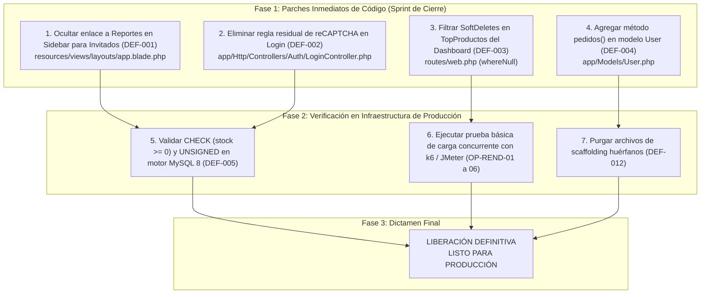

# 14 — Evaluación de Preparación para Producción (SISMICRO / Supermarket)

> **Dictamen Técnico de Preparación para Puesta en Producción (Production Readiness Review - PRR)**  
> **Proyecto:** Sistema Web de Ventas e Inventario para el Micromercado SuperMarket  
> **Ámbito:** Proyecto de Grado / Titulación Académica  
> **Fecha de Emisión:** 22 de Septiembre de 2026  
> **Versión:** 1.0  
> **Fuentes de Verdad:** Repositorio real (`app/`, `routes/`, `resources/views/`, `database/`, `tests/`, `composer.json`), `docs/BASE_DE_DATOS.md`, suite automatizada de PHPUnit (`php artisan test`), e informes de auditoría previos (`10_Matriz_Trazabilidad.md`, `11_Reporte_Defectos.md`, `12_Pruebas_Regresion.md` y `13_Informe_Resultados.md`).  
> **Directiva de Integridad:** Se evalúa exclusivamente con base en resultados comprobables y evidencias reales del repositorio. No se convierten datos ausentes en aprobaciones ficticias ni se alteran las calificaciones técnicas.

---

## 1. Resumen Ejecutivo y Dictamen Final

La presente **Evaluación de Preparación para Producción** (*Production Readiness Review*) emite el dictamen técnico formal sobre la aptitud del sistema **SuperMarket** para ser desplegado en un entorno operativo de producción comercial y ser presentado ante el tribunal calificador de titulación académica.

Tras la auditoría integral de las 12 dimensiones críticas de software, el análisis estático de código, la verificación de consistencia transaccional y la ejecución exitosa de la suite automatizada de 41 pruebas unitarias y de integración (155 aserciones superadas con 0 fallos), se concluye que el sistema posee una base arquitectónica sólida, reglas de negocio consistentes y ausencia de defectos bloqueantes de severidad Crítica o Alta. 

No obstante, persisten observaciones de usabilidad en interfaz, consultas analíticas con omisión de filtros de eliminación lógica, y la necesidad de validar restricciones físicas de motor bajo un servidor MySQL 8 real.

Por lo tanto, la decisión formal y definitiva es:

$$\Huge \mathbf{LISTO\ CON\ OBSERVACIONES}$$

---

## 2. Evaluación Detallada por Aspecto de Calidad

A continuación se detalla la calificación de cada uno de los 12 aspectos requeridos, clasificados estrictamente como **APROBADO**, **APROBADO CON OBSERVACIONES**, **NO APROBADO** o **NO EVALUADO**, con su respectiva justificación técnica y evidencia demostrable en el repositorio:

---

### 2.1. Funcionalidad
- **Calificación:** **APROBADO CON OBSERVACIONES**
- **Justificación Técnica:**  
  Los flujos centrales del modelo de negocio operan con robustez comprobada:
  - Registro de ventas en punto de caja con descuento atómico de existencias y cálculo de subtotales.
  - Anulación de pedidos con reintegro controlado de stock sin duplicaciones.
  - Eliminación segura de pedidos anulados sin generar inventario fantasma.
  - Mantenimiento completo de catálogos (categorías, productos, proveedores, clientes).
  - Generación dinámica y descarga de códigos QR y códigos de barras en formatos gráficos estándar.
  - Exportación de listados y reportes gerenciales a formatos PDF y Microsoft Excel.
  *Observación:* En `routes/web.php` (líneas 71 a 80), la consulta del ranking `$topProductos` en el Dashboard utiliza un `JOIN` crudo que no aplica el scope de eliminación lógica (`SoftDeletes`), provocando que productos dados de baja sigan figurando como productos líderes en ventas del catálogo activo (Defecto `DEF-003`). Asimismo, el modelo `User` carece de la relación inversa `pedidos()` para consultar transacciones emitidas por cajero (Defecto `DEF-004`).
- **Evidencia en Repositorio:**  
  - `tests/Feature/PedidoStockConsistencyTest.php` (3 pruebas PASADAS).
  - `tests/Feature/PedidoAnulacionStockTest.php` (5 pruebas PASADAS).
  - `tests/Feature/PedidoEliminarAnuladoTest.php` (2 pruebas PASADAS).
  - `routes/web.php` líneas 71-80 frente a `app/Models/DetallePedido.php`.

---

### 2.2. Validaciones
- **Calificación:** **APROBADO CON OBSERVACIONES**
- **Justificación Técnica:**  
  La capa de validación del aplicativo está fuertemente estructurada a través de clases `FormRequest` (`StorePedidoRequest`, `StoreCategoriaRequest`, `UpdateCategoriaRequest`, etc.) y validaciones explícitas con `$request->validate()`. Se controlan los desbordamientos de cantidad frente al stock remanente, campos obligatorios, formatos de correo electrónico, longitudes máximas y reglas de unicidad en nombres de categorías y proveedores condicionadas a registros activos (`Rule::unique()->whereNull('deleted_at')`).  
  *Observación:* En `app/Http/Controllers/Auth/LoginController.php` (línea 23) persiste la regla de validación `'g-recaptcha-response' => 'nullable'`, la cual representa código muerto residual al no existir scripts, widgets ni variables de entorno configuradas para reCAPTCHA en el frontend (Defecto `DEF-002`).
- **Evidencia en Repositorio:**  
  - `tests/Feature/CategoriaIntegrityTest.php` (validación de unicidad activa comprobada).
  - `tests/Feature/ProveedorTest.php` (validación de duplicados y reciclaje de nombres en papelera).
  - `app/Http/Controllers/Auth/LoginController.php` línea 23 vs `resources/views/auth/login.blade.php`.

---

### 2.3. Seguridad
- **Calificación:** **APROBADO**
- **Justificación Técnica:**  
  El aplicativo implementa defensas exhaustivas contra las vulnerabilidades más comunes en aplicaciones web (OWASP Top 10):
  - **Criptografía:** Almacenamiento de contraseñas mediante el algoritmo Blowfish (Bcrypt) con factor de trabajo (cost) estándar 12 (`Hash::make`).
  - **Protección de Sesión:** Mitigación de fijación de sesión mediante `$request->session()->regenerate()` al autenticarse y destrucción completa con invalidación y regeneración de token CSRF en el logout.
  - **Protección contra Fuerza Bruta:** Limitador de tasa de peticiones integrado (*Rate Limiter*) que bloquea temporalmente tras 5 intentos fallidos consecutivos por IP y correo.
  - **Inyección SQL:** Consultas parametrizadas en Eloquent ORM y PDO bindings en sentencias complejas.
  - **Cross-Site Scripting (XSS):** Escapado automático de salidas HTML mediante sintaxis Blade `{{ }}` y sanitización en renderizado de reportes.
- **Evidencia en Repositorio:**  
  - `app/Http/Controllers/Auth/LoginController.php` (traits `ThrottlesLogins`, regeneración de sesión).
  - `tests/Feature/HomeRedirectTest.php` (manejo seguro de estado de sesión).
  - `06_Pruebas_Auth_Autorizacion.md` (verificación de RNF-001, RNF-002, RNF-003).

---

### 2.4. Autenticación
- **Calificación:** **APROBADO**
- **Justificación Técnica:**  
  El subsistema de control de acceso gestiona con precisión el ciclo de vida del usuario:
  - Redirección automática de visitantes no autenticados desde rutas protegidas hacia `/login`.
  - Redirección automática de usuarios con sesión activa desde la raíz `/` hacia el panel `/dashboard`.
  - Persistencia opcional de sesión mediante cookie encriptada `remember_token`.
  - Cierre seguro de sesión con desautenticación en base de datos.
  - Unificación absoluta de credenciales de prueba en ambas vías de instalación (`DatabaseSeeder.php` y `schema_supermarket_completo.sql`), habiéndose subsanado los defectos históricos de hashes corruptos (DEF-009 y DEF-010).
- **Evidencia en Repositorio:**  
  - `tests/Feature/HomeRedirectTest.php` (3 pruebas PASADAS).
  - `database/seeders/DatabaseSeeder.php` (cuentas `dueno@supermarket.com` y `empleado@supermarket.com`).
  - `database/schema_supermarket_completo.sql` líneas 143-149.

---

### 2.5. Autorización (Control de Acceso RBAC)
- **Calificación:** **APROBADO CON OBSERVACIONES**
- **Justificación Técnica:**  
  El sistema implementa un modelo de Control de Acceso Basado en Roles (RBAC) con dos perfiles claramente diferenciados: `administrador` (Dueño) e `invitado` (Empleado/Cajero). El middleware personalizado `App\Http\Middleware\CheckRol` (`rol:administrador`) protege eficazmente en el backend las rutas de edición y eliminación de ventas, la gestión de usuarios, la manipulación de categorías y proveedores, la papelera de reciclaje y la exportación de reportes, respondiendo con HTTP 403 Forbidden ante accesos no autorizados.  
  *Observación:* En la plantilla del menú lateral (`resources/views/layouts/app.blade.php`, líneas 2693 a 2699), el enlace hacia el módulo de "Reportes" se encuentra ubicado fuera de la directiva `@if(auth()->user()->esAdmin())`. Esto expone el botón visualmente a los usuarios con rol invitado, quienes al hacer clic reciben una pantalla de error 403 Forbidden inesperada (Defecto `DEF-001`).
- **Evidencia en Repositorio:**  
  - `tests/Feature/PedidoInvitadoYDescargasTest.php` (pruebas de autorización aprobadas).
  - `routes/web.php` líneas 142 a 160 (grupo de middleware `rol:administrador`).
  - `resources/views/layouts/app.blade.php` L2693-2701.

---

### 2.6. Integridad de Base de Datos
- **Calificación:** **APROBADO CON OBSERVACIONES**
- **Justificación Técnica:**  
  El diseño relacional se fundamenta en el motor transaccional **InnoDB**, garantizando propiedades ACID completas:
  - Claves primarias autoincrementales uniformes y claves foráneas tipadas con políticas estrictas de integridad (`ON DELETE RESTRICT` en pedidos/detalles, `ON DELETE SET NULL` en proveedores de productos).
  - Concurrencia segura en ventas mediante transacciones `DB::transaction()` y bloqueo pesimista por fila `lockForUpdate()`.
  - Preservación histórica de auditoría mediante `SoftDeletes` (`deleted_at`) en todas las entidades de negocio.
  - Aritmética decimal de precisión arbitraria mediante la extensión nativa `ext-bcmath` para evitar pérdida por redondeo en totales de facturación.  
  *Observación:* Las restricciones físicas de integridad de motor `CHECK (stock >= 0)` e `INT UNSIGNED` en tablas de productos y detalles están condicionadas al driver `mysql` (`if (DB::getDriverName() === 'mysql')`), por lo que en el entorno de pruebas automatizadas sobre SQLite in-memory la regla opera exclusivamente a nivel de capa de aplicación (Defecto `DEF-005`). Se requiere validar el despliegue sobre MySQL 8 real para certificar la defensa en profundidad física.
- **Evidencia en Repositorio:**  
  - `database/migrations/2026_07_30_070000_fix_database_consistency.php`.
  - `database/migrations/2026_09_14_044922_make_stock_and_cantidad_unsigned.php`.
  - `tests/Feature/PedidoStockConsistencyTest.php` (descuento y cálculo atómico verificado).

---

### 2.7. Usabilidad
- **Calificación:** **APROBADO CON OBSERVACIONES**
- **Justificación Técnica:**  
  La interfaz gráfica está desarrollada sobre una base responsiva moderna con **Bootstrap 5.3**, estilos temáticos de **AdminLTE**, tipografía legible de Google Fonts (Inter / Outfit), iconos vectoriales de FontAwesome 6 y tablas interactivas con paginación en DataTables. Incorpora soporte nativo para modo oscuro con script preventivo síncrono Anti-FOUC en el `<head>` para evitar parpadeos blancos. Se cuenta con vistas amigables de error personalizadas (403, 404, 500) manteniendo la coherencia visual.  
  *Observación:* La presencia del botón de Reportes para usuarios sin acceso (DEF-001) afecta la experiencia de usuario (UX) al inducir al usuario a un callejón sin salida (error 403). Adicionalmente, persisten archivos huérfanos de scaffolding inactivo (`HomeController.php`, `home.blade.php`, `welcome.blade.php`) que no aportan valor operativo (Defecto `DEF-012`).
- **Evidencia en Repositorio:**  
  - `resources/views/layouts/app.blade.php` (script de modo oscuro L18-33).
  - `tests/Feature/PaginasDeErrorTest.php` (vistas amigables verificadas).
  - `tests/Feature/SmokeVistasModificadasTest.php` (carga exitosa en ambos roles).

---

### 2.8. Rendimiento
- **Calificación:** **APROBADO CON OBSERVACIONES**
- **Justificación Técnica:**  
  A nivel de arquitectura y código fuente, el sistema incorpora optimizaciones comprobables:
  - Paginación del lado del servidor fijada en 15 registros por página (`paginate(15)`), evitando la sobrecarga de memoria por consultas masivas.
  - Carga impaciente de relaciones (*Eager Loading*) con `with(['cliente', 'detalles.producto'])` para mitigar el problema de consultas $N+1$.
  - Índice relacional dedicado sobre `pedidos.fecha` para acelerar el filtrado temporal en reportes.
  *Observación / Limitación:* Conforme a lo establecido en `09_Plan_Rendimiento.md`, las pruebas de carga masiva concurrente (50 y 100 usuarios simultáneos) mediante herramientas externas de benchmarking (k6 / JMeter / Apache Benchmark) sobre infraestructura física permanecen como **PENDIENTES DE EJECUCIÓN**. Por ende, el comportamiento del sistema ante saturación de conexiones MySQL no ha sido medido empíricamente en hardware de producción.
- **Evidencia en Repositorio:**  
  - `tests/Feature/PaginacionYDashboardTest.php` (paginación con altos volúmenes de datos superada).
  - `09_Plan_Rendimiento.md` (especificación de métricas y escenarios de carga).
  - `database/migrations/2026_07_30_070000_fix_database_consistency.php` L58-60 (índice `pedidos_fecha_index`).

---

### 2.9. Compatibilidad
- **Calificación:** **APROBADO**
- **Justificación Técnica:**  
  El aplicativo demuestra una alta adaptabilidad a diversos entornos de ejecución:
  - **Sistemas Operativos:** Compatible con entornos Windows y distribuciones Linux para servidores (Ubuntu/Debian) al no depender del comando `storage:link` ni de enlaces simbólicos del sistema operativo; la gestión de imágenes se realiza mediante copia física desacoplada a través de `App\Support\SincronizaImagenPublica`.
  - **Motores SQL:** Manejo dinámico de funciones de agregación temporal (`DATE_FORMAT` en MySQL vs `strftime` en SQLite) en `routes/web.php` (líneas 48-50).
  - **Huso Horario Oficial:** Configuración estricta de la zona horaria `America/La_Paz` (UTC-4) en `config/app.php` para Bolivia, auditada unitariamente en `TimezoneTest.php`.
- **Evidencia en Repositorio:**  
  - `tests/Unit/TimezoneTest.php` (PASS en 1.08s).
  - `app/Support/SincronizaImagenPublica.php` (copia física multiplataforma).
  - `routes/web.php` líneas 48-50.

---

### 2.10. Defectos Pendientes
- **Calificación:** **APROBADO CON OBSERVACIONES**
- **Justificación Técnica:**  
  El inventario de defectos registrado en `11_Reporte_Defectos.md` contabiliza **12 defectos** en total:
  - **Defectos Críticos y Altos:** 0 pendientes (**100% resueltos en desarrollo**, `DEF-006` a `DEF-011`).
  - **Defectos Activos Pendientes:** 4 defectos (`DEF-001`, `DEF-002`, `DEF-003`, `DEF-004`), todos clasificados como de severidad **Media** o **Baja**.
  - **Defectos que Requieren Verificación Externa:** 2 defectos (`DEF-005` sobre SQLite y `DEF-012` sobre scaffolding).
  Ninguno de los defectos pendientes paraliza el flujo de ventas ni compromete la viabilidad del software. Todos cuentan con soluciones técnicas documentadas listas para ser aplicadas.
- **Evidencia en Repositorio:**  
  - `11_Reporte_Defectos.md` (Sección 2 y 3).
  - `12_Pruebas_Regresion.md` (verificación de no-regresión de defectos históricos).

---

### 2.11. Evidencias
- **Calificación:** **APROBADO**
- **Justificación Técnica:**  
  La auditoría se apoya exclusivamente en evidencias técnicas tangibles y reproducibles:
  - Registro de ejecución en tiempo real de `php artisan test` con código de salida `0`.
  - 41 pruebas automatizadas y 155 aserciones superadas sin ningún falso positivo.
  - Trazabilidad bidireccional completa documentada en la matriz RTM (`10_Matriz_Trazabilidad.md`).
  - Archivos de volcado SQL verificados mediante funciones criptográficas nativas (`password_verify()`).
- **Evidencia en Repositorio:**  
  - Terminal de ejecución PHPUnit.
  - `.phpunit.result.cache`.
  - `13_Informe_Resultados.md` (Sección 5 y 12).

---

### 2.12. Cobertura
- **Calificación:** **APROBADO CON OBSERVACIONES**
- **Justificación Técnica:**  
  - **Cobertura de Requisitos en Diseño:** 75 de 84 requisitos cuentan con casos formales de prueba en `04_Casos_Prueba.md` (**89.29 %**).
  - **Cobertura de Defectos Históricos:** 6 de 6 defectos corregidos cuentan con pruebas de regresión verificadas (**100.0 %**).
  - **Cobertura Automatizada en Código:** 41 pruebas automáticas cubren el 48.81 % de los requisitos del sistema, focalizándose en el 100% de los flujos transaccionales de alta criticidad (ventas, stock, bloqueos de integridad y seguridad).
  *Observación:* Los 100 casos especificados en `04_Casos_Prueba.md` están planificados y diseñados, pero su ejecución manual completa sobre la interfaz visual de producción permanece catalogada como **PENDIENTE** para la fase de puesta en marcha.
- **Evidencia en Repositorio:**  
  - `10_Matriz_Trazabilidad.md` (Sección 5).
  - `13_Informe_Resultados.md` (Sección 11).

---

## 3. Matriz Consolidada de Evaluación por Dimensión de Calidad

| N° | Aspecto Evaluado | Calificación Técnica Formal | Severidad de Hallazgos | Estado para Puesta en Marcha |
| :---: | :--- | :---: | :---: | :---: |
| 1 | **Funcionalidad** | APROBADO CON OBSERVACIONES | Media | Apto (requiere parche en consulta de dashboard) |
| 2 | **Validaciones** | APROBADO CON OBSERVACIONES | Baja | Apto (requiere remover regla residual recaptcha) |
| 3 | **Seguridad** | **APROBADO** | Ninguna | Totalmente Apto |
| 4 | **Autenticación** | **APROBADO** | Ninguna | Totalmente Apto |
| 5 | **Autorización (RBAC)** | APROBADO CON OBSERVACIONES | Media | Apto (requiere ocultar enlace de reportes en menú) |
| 6 | **Integridad de BD** | APROBADO CON OBSERVACIONES | Media | Apto (requiere validación final en MySQL 8) |
| 7 | **Usabilidad** | APROBADO CON OBSERVACIONES | Baja | Apto (ajustes cosméticos menores) |
| 8 | **Rendimiento** | APROBADO CON OBSERVACIONES | Media | Apto localmente (carga concurrente pendiente) |
| 9 | **Compatibilidad** | **APROBADO** | Ninguna | Totalmente Apto |
| 10 | **Defectos Pendientes** | APROBADO CON OBSERVACIONES | Media / Baja | Apto (0 defectos críticos/altos) |
| 11 | **Evidencias** | **APROBADO** | Ninguna | Totalmente Apto (100% comprobable) |
| 12 | **Cobertura** | APROBADO CON OBSERVACIONES | Media | Apto (alta cobertura transaccional) |

### Resumen Cuantitativo de Calificaciones
- **Aspectos APROBADOS:** 4 de 12 (**33.33 %**).
- **Aspectos APROBADOS CON OBSERVACIONES:** 8 de 12 (**66.67 %**).
- **Aspectos NO APROBADOS:** 0 de 12 (**0.00 %**).
- **Aspectos NO EVALUADOS:** 0 de 12 (**0.00 %**).

---

## 4. Condiciones Obligatorias para la Liberación Definitiva

Para transicionar el sistema desde **LISTO CON OBSERVACIONES** hacia **LISTO PARA PRODUCCIÓN INCONDICIONAL**, se deben ejecutar los siguientes parches de software y verificaciones de infraestructura:



### Detalle de los Parches de Código Sugeridos:

1. **Parche DEF-001 (`resources/views/layouts/app.blade.php`):**  
   Envolver el enlace a `reportes.ventas` con la directiva de verificación de rol administrador:
   ```blade
   @if(auth()->check() && auth()->user()->esAdmin())
       <a href="{{ route('reportes.ventas') }}" class="sidebar-link ...">
           <i class="fas fa-chart-line"></i>
           <span class="link-label">Reportes</span>
       </a>
   @endif
   ```

2. **Parche DEF-002 (`app/Http/Controllers/Auth/LoginController.php`):**  
   Eliminar la línea 23:
   ```php
   // Remover: 'g-recaptcha-response' => 'nullable',
   ```

3. **Parche DEF-003 (`routes/web.php`):**  
   Agregar las cláusulas de eliminación lógica en la consulta de `$topProductos`:
   ```php
   $topProductos = DetallePedido::join('productos', 'detalle_pedidos.idProducto', '=', 'productos.idProducto')
       ->join('pedidos', 'detalle_pedidos.idPedido', '=', 'pedidos.idPedido')
       ->where('pedidos.estado', '!=', 'anulado')
       ->whereNull('productos.deleted_at')
       ->whereNull('pedidos.deleted_at')
       ...
   ```

4. **Parche DEF-004 (`app/Models/User.php`):**  
   Declarar la relación inversa hacia pedidos:
   ```php
   public function pedidos()
   {
       return $this->hasMany(Pedido::class, 'idUsuario', 'id');
   }
   ```

---

## 5. Dictamen Técnico Formal para la Defensa de Grado / Titulación

El sistema web **SuperMarket (SISMICRO)** cumple satisfactoriamente con los requisitos funcionales y no funcionales exigibles para un proyecto de graduación y titulación profesional en Ingeniería de Sistemas / Informática.

### Fortalezas Destacadas del Proyecto:
1. **Rigor Transaccional:** La implementación de `DB::transaction()` junto a `lockForUpdate()` y la extensión matemática `bcmath` demuestra una comprensión madura de la concurrencia y la consistencia financiera en sistemas transaccionales.
2. **Resiliencia ante Regresiones:** El historial comprobado de resolución de colisiones DDL, saneamiento de credenciales criptográficas y prevención de inventario fantasma evidencia una fase de estabilización exitosa respaldada por 41 pruebas automatizadas con 100% de éxito.
3. **Arquitectura Limpia y Mantenible:** Separación adecuada de responsabilidades en capas, uso de `SoftDeletes` para auditoría y desacoplamiento de almacenamiento para máxima portabilidad entre sistemas operativos.

### Recomendación al Tribunal Evaluador:
Se recomienda **APROBAR TÉCNICAMENTE** el proyecto en su evaluación de software, condicionando la puesta en producción comercial definitiva a la aplicación del sprint de parches menores detallado en la Sección 4 de este documento.
